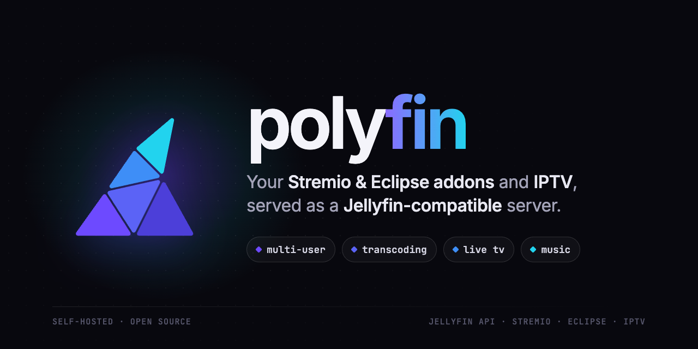
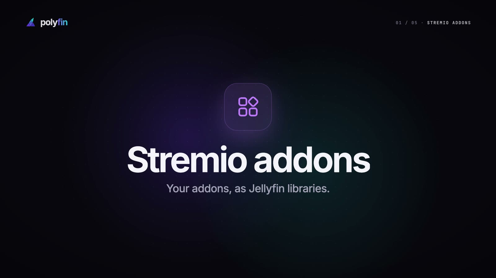

<p align="center"><a href="https://moodiness.github.io/polyfin/videos/polyfin-ad.mp4"></a></p>

Polyfin is a self-hosted server that speaks the Jellyfin API. It turns Stremio addons, music addons, IPTV sources and your own folders into libraries that any Jellyfin app plays, with real user accounts and transcoding, and without Jellyfin installed.

[](https://github.com/moodiness/polyfin/releases/latest) [](https://github.com/moodiness/polyfin/pkgs/container/polyfin) [](LICENSE) [](https://moodiness.github.io/polyfin/docs/)

## What you get

- **Your addons as libraries:** Stremio catalogs become libraries and collections, and their streams become versions of a title, torrents too once you turn them on. [Addons](docs/addons.md), [Libraries](docs/addons-and-libraries.md), [Torrents](docs/torrents.md)
- **Your own files:** folders on the server, SMB and WebDAV shares, S3 buckets, SFTP servers and rclone remotes. [Local folders](docs/local-folders.md), [Naming and matching files](docs/naming-and-matching.md)
- **Live TV and IPTV:** M3U playlists, Xtream Codes accounts and HDHomeRun tuners, with a programme guide, recordings and Replay. [Live TV](docs/live-tv.md), [IPTV sources](docs/iptv.md), [HDHomeRun tuners](docs/hdhomerun.md)
- **Music, audiobooks and podcasts:** Eclipse music addons become music and book libraries. [Music, audiobooks and podcasts](docs/music.md)
- **Real accounts:** each user has their own watch state, limits and parental control, and can bring their history from Jellyfin, Emby or Plex. [Users and permissions](docs/users.md), [Moving to Polyfin](docs/moving-to-polyfin.md)
- **Transcoding on your GPU:** direct play when the app can, else repackaging or conversion on an NVIDIA, AMD or Intel GPU or VideoToolbox, HDR tone mapping included. [Transcoding](docs/transcoding.md), [GPUs and HDR](docs/gpus-and-hdr.md)
- **Built in:** the web player, the admin app, skip buttons, tracking, DLNA, notifications, statistics and backups. [Documentation](docs/README.md)
- **Six languages:** the admin app, Polyfin's own names and messages, its additions to the web player and Polyfin Desktop speak English, French, German, Spanish, Italian and Brazilian Portuguese.

<p align="center"><a href="https://moodiness.github.io/polyfin/videos/polyfin-showcase.mp4"></a></p>

## Works with your apps

Infuse, Swiftfin, Findroid, Streamyfin, Nuvio, Strand, Odin, VidHub, the official Jellyfin apps, Kodi and other apps that connect to a Jellyfin server, as Polyfin targets the Jellyfin 12.4 API, plus Silo's apps through their own API. See [Jellyfin apps](docs/jellyfin-compatibility.md) and [Silo's apps](docs/silo-apps.md).

## Install

### Docker Compose

You need Docker with Compose v2. The image, `ghcr.io/moodiness/polyfin`, is published for linux/amd64 and linux/arm64.

```sh
git clone https://github.com/moodiness/polyfin.git
cd polyfin
cp .env.example .env    # then set POSTGRES_PASSWORD, e.g. openssl rand -hex 24
docker compose up -d
```

Open `http://<server>:8096/admin/`, and enter the one-time setup code from the log (`docker compose logs polyfin`) to create the administrator. [Installation](docs/installation.md) covers the rest.

### Desktop app

[Polyfin Desktop](docs/desktop.md) runs Polyfin from the tray on Windows, macOS and Linux, on x64 or arm64, with its own database. Its installers are on the [releases page](https://github.com/moodiness/polyfin/releases).

Next: [Getting started](docs/getting-started.md).

## Documentation

Read it on the [website](https://moodiness.github.io/polyfin/docs/), or in [`docs/`](docs/README.md).

## Status

> [!NOTE]
> Polyfin is in early development. Expect changes between releases, and report problems in the [issues](https://github.com/moodiness/polyfin/issues).

## Community and support

Ask questions in [Q&A](https://github.com/moodiness/polyfin/discussions/categories/q-a), post and vote for ideas in [Ideas](https://github.com/moodiness/polyfin/discussions/categories/ideas), follow the [roadmap](https://github.com/users/moodiness/projects/1), and report bugs with the [bug report form](https://github.com/moodiness/polyfin/issues/new?template=bug_report.yml). See [Contributing](CONTRIBUTING.md), [Getting help](SUPPORT.md) and the [code of conduct](CODE_OF_CONDUCT.md).

## Legal disclaimer

Polyfin does not host, store, or distribute any content. It only relays what the addons and services configured by its operator provide. You are solely responsible for the addons and services you configure and for complying with the laws that apply to you.

Polyfin is an independent project, not affiliated with or endorsed by Jellyfin or Stremio.

## License

Polyfin is released under the [MIT License](LICENSE). To report a vulnerability, see the [security policy](SECURITY.md).
