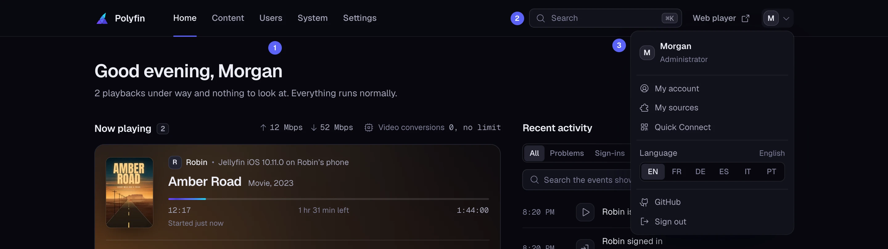
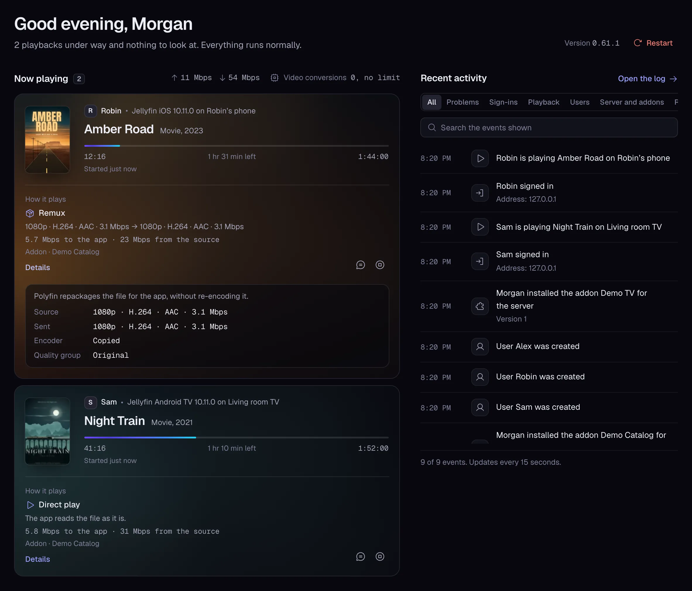

# The admin app

This page is for administrators, and for members who manage their own account. It tours Polyfin's admin app: its **Home**, its **System** pages and **Settings**.

Other administration pages:

- [HTTPS and networking](https-and-networking.md): HTTPS, Let's Encrypt and local network discovery;
- [Updates and restarts](updates-and-restarts.md): new versions, **Restart** and **Update now**;
- [Metrics and API keys](metrics-and-api-keys.md): Prometheus, API keys and what Jellyfin apps can administer.

## The admin app

Open the admin app at `/admin/`. From the [web player](web-client.md), it opens in these ways:

- **Administrators:** the dashboard link opens it. jellyfin-web's dashboard pages open their counterpart: users, libraries, logs, scheduled tasks, API keys and playback settings.
- **Members:** the **Polyfin** entry, which the web player shows them instead of **Dashboard**, opens it.

A user signed in to the web player arrives signed in, as that user. The admin app stays signed in only as long as the web player does. Signing out of the web player, or signing in there as someone else, signs the admin app out too (see [Signing in to the admin app](web-client.md#signing-in-to-the-admin-app)).

### The top bar

A bar at the top holds the sections, for administrators:

- **Home** (`/admin/`): what plays now and what needs a look;
- **Content**: **Sources** (`/admin/sources`), **Libraries** (`/admin/libraries`), **Live TV** (`/admin/live-tv`) and **Versions** (`/admin/versions`);
- **Users** (`/admin/users`);
- **System**: **Health**, **Statistics**, **Schedule**, **Logs** and **API keys** (`/admin/system/…`);
- **Settings**, one page per section (`/admin/settings/general`, `/admin/settings/content`…).

The account menu, on the right, holds **My account**, **My sources** and **Quick Connect** (`/admin/me/…`), the language, a link to Polyfin's source code on GitHub, and **Sign out**.

1: the sections. 2: **Search**, with the web player link beside it. 3: the account menu.

- **Members** see a shorter bar: **Home**, **My sources**, **My account** and **Quick Connect**. The other pages tell them they may not open them.
- On a phone, the bar keeps the logo, the search and a menu button. The menu opens all of these, the web player first.

### The web player link

When the server serves a web player, the bar has a link to it (see [Back to the web player](web-client.md#back-to-the-web-player)):

| Admin app opened | The link reads | It opens the web player |
|---|---|---|
| From the web player, or inside the Jellyfin apps for Android and iOS | **Back to the web player**, a back arrow before the logo on a phone | In place |
| Any other way | **Web player** | In a new tab |

In the Jellyfin apps, Android's **Back** button and the iOS app's **Home** tab lead back to the web player too.

### Language

The admin app is in English, French, German, Spanish, Italian and Brazilian Portuguese.

- It starts in the first of these the browser prefers. Any Portuguese means Brazilian Portuguese; no match means English.
- To change it for this browser, use the language list at the top of the sign-in and setup pages, or **Language** in the account menu.

### My account

**My account** has these sections:

| Section | What it holds |
|---|---|
| **Statistics** | The hours you watched, your most played titles, apps and devices, and your recent playbacks, with **Export CSV** (see [Statistics](statistics.md#my-account)) |
| **Tracking** | Your tracking services (see [Tracking services](tracking.md)) |
| **Continue Watching**, **Next Up** and **Hidden titles** | What your apps resume and suggest next, and the titles you hid (see [Continue Watching and Next Up](watch-state.md#continue-watching-and-next-up)) |
| **Home rows** | Your rows of the web player's home (see [Home rows](home-rows.md#rows-each-user-turns-off)) |
| **Track choices** | Your remembered audio and subtitle choices, with **Forget my track choices** (see [Track choices](watch-state.md#track-choices)) |
| **Taste profile** | What your recommendations follow (see [Taste profile](home-rows.md#the-taste-profile)) |
| **Metadata language** | The language of titles' names and overviews in your apps (see [Metadata language](watch-state.md#metadata-language)) |
| **Web player theme** | The web player's look on every browser you sign in with (see [Web player theme](themes-and-custom-code.md#theme-per-user)) |
| **Audio region** | The region of the audio you prefer (see [Audio region](watch-state.md#audio-region)) |
| **Sound** | Ways to make your videos louder (see [Louder sound](loudness.md#louder-sound)) |
| **Shared links** | The share links you made (see [Share links](invite-and-share-links.md#share-links)) |
| **Reminders** | The programmes and series you asked to be reminded of from the web player, with **Delete**, shown with the **Live TV** permission (see [Programme reminders](live-tv.md#programme-reminders)) |
| **Import from another server** | Your watch history from a Jellyfin, Emby or Plex server, or Letterboxd (see [Importing your own watch history](moving-to-polyfin.md#importing-your-own-watch-history)) |
| **Import from an app** | Your watch history from an app such as Stremio or Nuvio (see [Importing from an app](moving-to-polyfin.md#importing-from-an-app)) |
| **Notifications** | Your notification targets, with **Remind me before** and **Also show reminders on my apps** under them (see [Notifications](notifications.md)) |
| **Devices** | The apps signed in with the account. Signing out a device asks first. |
| **Password** | **Change password** |
| **Two-step sign-in** | A code from an authenticator app after the password (see [Two-step sign-in](sign-in-and-security.md#two-step-sign-in)) |

### Signing in and search

Sign in to the admin app with the account's name and password. An account with two-step sign-in then gives the code of its authenticator app, or a recovery code.

- Administrators can require two-step sign-in of administrators in **Settings › Security**.
- They can turn it off for a user who lost their phone (see [For administrators](sign-in-and-security.md#for-administrators)).

**Search** finds pages, settings, users and sources by name, with or without accents.

- Open it with ⌘K on a Mac, Ctrl K elsewhere, or `/`.
- Use the arrows and Enter to open a result, and Escape to close the search.

Addresses from before this layout, such as `/admin/health` or `/admin/settings#settings-tracking`, still open the right page.

**Compared with Jellyfin**

- None of the admin app's pages exist in Jellyfin's API. They use Polyfin's admin API only.

## Home

**Home** greets you by name. On the right of the greeting, it shows:

- the version Polyfin runs;
- **Restart**, in red;
- **Update now**, while an update tool is set (see [Restart and updates](updates-and-restarts.md#restart-and-updates)).

Below, it shows these sections:

- A notice of a new version, when one is out, with **Release notes**, and **Update now** while an update tool is set (see [New versions](updates-and-restarts.md#new-versions)).
- **Get started**, until each step of a good setup is done or you dismiss it (see [The Get started card](getting-started.md#the-get-started-card)).
- **Now playing**, updated every 3 seconds (see [Now playing](#now-playing)).
- **To look at**: the problems [Health](health.md) found, with a link to it.
- **Server state**: version, database, cache and GPU.
- **Recent activity**: the [activity log](#activity-log), which you can filter by kind and search. Its list scrolls in its own box, and loads older events as you reach its end.

The layout follows the window's width:

| Window | Layout |
|---|---|
| 1280 pixels wide or more | Two columns. On the left: the new version notice, **Get started**, **Now playing**, **To look at** and **Server state**. On the right: **Recent activity** from the top, as tall as the window lets it be and at least 420 pixels, so it shows whole as the page opens. |
| Narrower | One column, in the same order, **Recent activity** last |

The greeting, the version, **Restart** and **Update now** stay across the top.

**Compared with Jellyfin**

- Jellyfin's dashboard also puts its activity log in a column beside the server's information, its running tasks and its devices, from 900 pixels wide, with alerts and paths in a third column from 1536 pixels ([index.tsx, lines 109 to 132](https://github.com/jellyfin/jellyfin-web/blob/v12.4/src/apps/dashboard/routes/index.tsx#L109-L132)). Polyfin's playbacks need more width than Jellyfin's devices, hence its wider breakpoint.

### Now playing

**Now playing** shows each playback under way. A playback leaves it when its app reports nothing for five minutes, as when a tab closes while it plays (see [Playbacks](statistics.md#playbacks)). For each playback you see:

- the user, the device and the app, the title and the position;
- **How it plays**: **Direct play**, **Remux** (repackaged without conversion) or **Conversion**;
- **Details**: Jellyfin's reasons, the user's quality group, the resolution and bitrate sent, and whether the GPU or the CPU encodes.

The source it describes is the version played:

- When the app names only the title, it is the version the app's last PlaybackInfo chose. jellyfin-web does this when it plays a title's first version as it is.
- When the play went on from another version because its source failed, it is that version, named under **Switched version** (see [Carrying a play on](reading-the-sources.md#carrying-a-play-on)).

When the video sent is smaller than the source, **Smaller than the source** tells what limited it (see [Size of converted video](conversion-quality.md#size-of-converted-video)):

- the GPU's 4K, the processor's 1080p, or HDR converted by the processor;
- the user's quality group, or **Maximum quality of converted video**;
- the bitrate allowed by the app or by the user's **Maximum quality**.

A [converted download](transcoding.md#converted-downloads) shows there too, labeled "Downloading". Its bar tells how far the copy is made.

### Bandwidth

Each row of **Now playing** tells, under **How it plays**, what the play moves now. It is averaged over the last 10 seconds and shown as a bitrate, in two directions:

- what Polyfin sends the app;
- what the version's source sends Polyfin.

Below, it tells where the version is read from:

- an addon, by its name as installed;
- a torrent, with its addon and the peers connected;
- a local folder, or a network share: a folder whose location is an address such as `smb://` or `s3://`;
- IPTV, for channels, programmes, Replay and the IPTV sources' videos.

A recording made by Polyfin has no source to tell.

**The rate to the app** counts what the media routes answer: a direct play's file, HLS segments, live channels, downloads, share links and DLNA. Answers with an error count for nothing. A direct play's requests count for its device, whatever address the app fetches:

- the device whose token they carry, as the `Authorization` header, `ApiKey` or `api_key`;
- else the device that asked for the address. The `Path` of each media source, which some apps fetch as it is, carries no token. It carries a grant naming the device that asked PlaybackInfo or the item's details for it. So does the play session, for an address of the file as it is (`static=true`) that carries the play session alone.

Other plays count this way:

- a guest's, and a converted download's without a token, count for their play session;
- a DLNA device's count for that device;
- a play whose app Polyfin sent to read the source itself shows "The app reads the source itself" in place of its rate. None of its bytes pass through Polyfin, whatever address the app asked.

**The rate from the source** counts what the source cache and the relays read from the source. Several plays of the same version share it.

Beside the title of **Now playing**, Home shows the server's totals, refreshed every 3 seconds:

- what every play sends to apps;
- what Polyfin receives from sources, a version played on several devices counted once.

The bytes sent for each playback are kept in its history (see [Statistics](statistics.md#the-history)).

**Compared with Jellyfin**

- Jellyfin's sessions tell the bitrate of a conversion ([TranscodingInfo.cs, lines 37 to 40](https://github.com/jellyfin/jellyfin/blob/v12.4/MediaBrowser.Model/Session/TranscodingInfo.cs#L37-L40)), not what a play moves, nor where its file comes from. Polyfin measures both, and the server's totals.

API details: [Playback bandwidth](jellyfin-api.md#playback-bandwidth-in-the-admin-api).

### Stopping a playback or sending a message

An administrator can act on a playback whose app accepts remote control, as Jellyfin's remote control does:

- **Stop** stops the playback, and asks first;
- **Send a message** shows a message on its app.

An administrator whose **Can control other users' apps** permission was taken away is refused. See [Users](users.md) for permissions.

### Activity log

**Recent activity** on Home shows the last entries of the activity log, and Jellyfin apps can read it. It keeps 30 days, and records:

- sign-ins and failed sign-ins, wrong codes of two-step sign-in included, and sign-ins with a recovery code;
- two-step sign-in turned on or off, and by which administrator for another user;
- playback start and stop;
- users created, changed or deleted, and accounts that reach their end date (see [Ending an account](users.md#ending-an-account));
- user groups created, changed or deleted. A change names the sections changed, as "Group Kids was changed: Access, Allowed hours" (see [User groups](users.md#user-groups));
- members added to a group, removed, or no longer following it, as "sam no longer follows the group Kids: changed from Jellyfin Web";
- the settings of a user or a group reset to their defaults, naming the administrator, as "alex reset the settings of sam to their defaults" (see [Resetting settings to their defaults](users.md#resetting-settings-to-their-defaults));
- settings saved, and the order of the libraries applied to every user (see [The order of libraries](addons-and-libraries.md#the-order-of-libraries));
- addons installed or removed;
- share links made, revoked or expired, and each guest playback through one, as "A guest played Example Movie (2008) through the link shared by alex" (see [Share links](invite-and-share-links.md#share-links));
- restarts and updates asked for, with who asked (see [Restart and updates](updates-and-restarts.md#restart-and-updates));
- saved keys shown, and metrics tokens made, with who did it, never the key (see [Showing a saved key](#showing-a-saved-key)).

## Statistics

**System › Statistics** shows how the server is used, with **Export CSV**:

- hours watched and data sent;
- the most played titles;
- how videos play;
- the busiest hours.

See [The Statistics page](statistics.md#the-statistics-page).

## Schedule

**System › Schedule** lists:

- the **Tasks**, with their last run, result and next run. **Run now** and **Stop** run or stop each one by hand;
- **Database backups**, with **Back up now**, each destination's last upload, and **Restore** (see [Backups](backups.md));
- the **Upcoming recordings** (see [Live TV](live-tv.md));
- the **Live TV refreshes**: when the IPTV lists and guides are fetched again (see [IPTV](iptv.md)).

Schedule covers the server's addons, IPTV sources and guides first. Those users keep under **My sources** follow, each marked with its owner.

### Scheduled tasks

| Task | When it runs on its own |
|---|---|
| Sign out unused devices | Every hour, for the apps left unused for the days the settings choose |
| Clean the activity log | Every day: deletes the entries older than 30 days |
| Refresh Live TV guides | Polyfin looks every 5 minutes for the IPTV lists and guides due under **Settings › Live TV**. Started by hand, it fetches every list and guide. |
| Read the libraries' first pages | For the libraries older than **Refresh catalogs after (minutes)** |
| Read every collection | Every day at the hour set in **Settings › Catalogs**; never by default |
| Refresh ratings | Only when started: it asks the addons again |
| Record ended accounts | Every hour |
| Record expired share links | Every 10 minutes, also deleting the links that ended more than 30 days ago |
| Scan local folders | Each folder at startup, then every number of hours set in **Settings › Catalogs** |
| Delete old recordings | For the recordings older than the days the settings keep them |
| Schedule series recordings | For the new programmes of each series recording |
| Find commercials in recordings | While **Find commercials in recordings** is on, in **Settings › Recordings** |
| Back up the database | Every day at the hour set in **Settings › Backups**, while backups are on |
| Build taste profiles | Every hour |
| Clean the playback history | For the playbacks older than the days to keep set in **Settings › Playback** |
| Send the weekly summary | At the day and hour set in **Settings › Notifications** |
| Send the month in review | On the 1st, at the hour of the weekly summary |
| Send the year in review | On January 1st, at the hour of the weekly summary |
| Look for versions of watchlist titles | For each title again after the hours set in **Settings › Catalogs** |

Jellyfin apps see every task of **System › Schedule**, and can start and stop them. They cannot change these schedules. Some follow the hours and days set in Polyfin's settings, as above.

API details: [Scheduled tasks](jellyfin-api.md#scheduled-tasks-in-the-jellyfin-api).

## Health

**System › Health** shows what needs a look on the server: addons, IPTV sources, network shares, the transcoder, disks, backups, torrents and stored keys. Open it from **System** in the top bar.

- **Home** lists its problems under **To look at**, with a link to it.
- Its problems, and those solved, can be sent to notification targets (see [Notifications](notifications.md)).

See [Health](health.md) for each check, warning and error.

## Logs

**System › Logs** follows the in-memory log, redacted as it is for Jellyfin apps (see [Server logs](#server-logs)). It has a **Level** filter, a search box, **Follow** and **Pause**, and **Download**.

A listing of a library or a collection that takes more than 5 seconds logs "A listing was slow" (Info). The line holds the folder, whether the app asked for every title, how many it got, and where the time went:

- `checked`: the user and the request;
- `read`: the addons and the database;
- `described`: the titles for the app.

### Server logs

The server log is kept in memory.

- Apps can download its last 5 MB as one file, `polyfin.log`.
- URLs are reduced to their host, and tokens, keys and passwords are replaced.
- Logs that apps upload go to the server log, redacted the same way, up to 1 MB each.

API details: [Server logs](jellyfin-api.md#server-logs-in-the-jellyfin-api).

## Settings

**Settings** has one page per section, listed on its left, with a search box over all of them (**Search a setting**).

- Each section page saves only its own changes.
- Leaving a page with unsaved changes asks first.
- **Settings › Diagnostics** ends with the `POLYFIN_*` variables in effect, read only. Secrets are hidden, and the database URL shows its host and database only.

See [Configuration](configuration.md) for the variables, and [Web player](web-client.md) for **Settings › Web player**. The identity provider, in **Settings › Security**, is on [Sign-in and security](sign-in-and-security.md#signing-in-with-an-identity-provider).

## Showing a saved key

Fields that hold a key or a secret hide it. While you type one, an eye button (**Show key**, **Hide key**) shows what you typed. Once saved, the key shows as dots, with its own eye.

| Where | Who | Keys that can be shown |
|---|---|---|
| **Settings** | Administrators | The server's **PublicMetaDB key**, **TheIntroDB key**, **Trakt client secret**, **Last.fm shared secret** and **Metrics token** |
| **My account › Tracking** | Each user, their own | MDBList and PublicMetaDB API keys, and the **ListenBrainz user token** |

Trakt, Simkl and Last.fm hold tokens or session keys rather than keys, which are never shown.

- The key is fetched from the server when the eye is clicked.
- It is hidden again on a second click, after a minute, or when you leave the page.
- Each time, the activity log records who showed which key, never the key itself.
- The answer is never cached.
- A key that cannot be decrypted with `POLYFIN_SECRET_KEY` counts as not saved, and cannot be shown.

*Artwork and people* moved to [Health](health.md#artwork-and-people).

*Clearing the image cache* moved to [Health](health.md#clearing-the-image-cache).

*HTTPS* moved to [HTTPS and networking](https-and-networking.md#https).

*Local network discovery* moved to [HTTPS and networking](https-and-networking.md#local-network-discovery).

*Metrics* moved to [Metrics and API keys](metrics-and-api-keys.md#metrics).

*Identity provider* moved to [Sign-in and security](sign-in-and-security.md#identity-provider-settings).

*New versions* moved to [Updates and restarts](updates-and-restarts.md#new-versions).

*Restart and updates* moved to [Updates and restarts](updates-and-restarts.md#restart-and-updates).

*Update now* moved to [Updates and restarts](updates-and-restarts.md#update-now).

