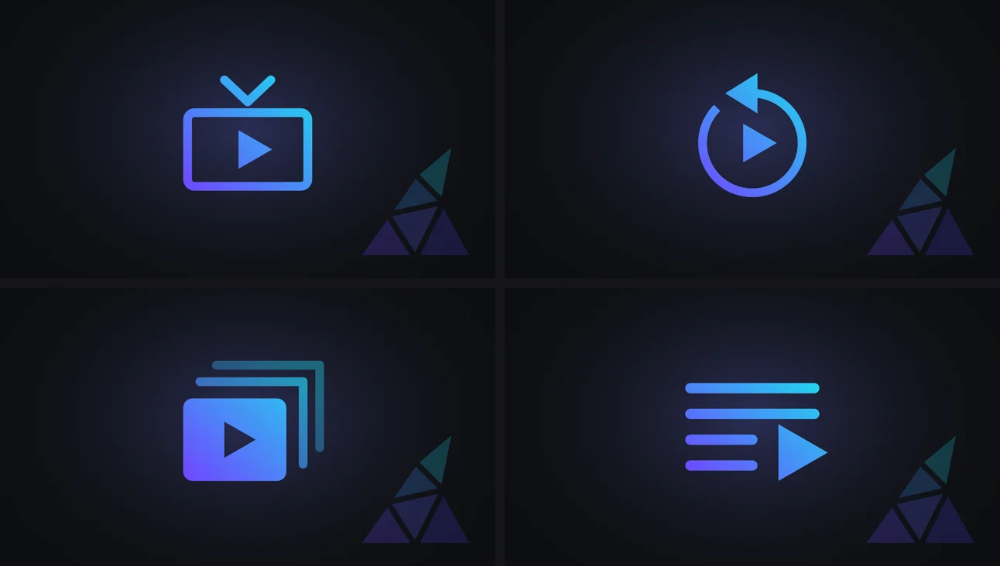

# Artwork and editing

This page is for administrators. It covers library images, how Polyfin relays and caches artwork, poster shapes, badges and replacement posters, the images Polyfin draws, and editing items from jellyfin-web.

## Library images

Each library shows a small image at the start of its row, under **Content › Libraries**. Select it to choose, under **Image in apps**, the image Jellyfin apps show on the library's tile:

| Choice | The image |
|---|---|
| **None** | No image. |
| **Automatic** | Taken from the catalog's first page: the first backdrop, as library tiles are wide, else the first wide poster, else the first poster. A music library takes the first artwork of its row. A catalog without any shows no image. |
| **Generated** | A wide 16:9 image Polyfin draws from the posters of the catalog's first titles, up to six, under a gradient, with the library's name across them (see [Generated images](#generated-images)). |
| **Custom** | An image you upload with **Upload an image**, or download once from **Or an image address**. |

**Defaults:** **Generated** for new movie and series libraries, as Jellyfin draws an image for each of its libraries. Other libraries start with **None**.

**Automatic and Generated:**

- Users under parental control or blocking genres are not shown them, since they may come from a title hidden from them.
- A generated image comes once Polyfin has read the catalog's first page, as apps do when they open the library.
- A collection library's generated image takes the posters of its first collections. For a collection without one, it takes the first poster of that collection's own generated image.
- A music library has no posters to draw from, so it does not offer **Generated**.

**Custom:**

- The picture follows the rules of [Edit images](#edit-images): a JPEG, PNG or WebP picture of up to 10 MB, kept in the database.
- Only administrators can use local network addresses.
- **Remove the image** deletes it, and the library shows none.

Apps are told the shape of the image: 16:9 for a generated image, and for an automatic backdrop or wide poster. So apps that size tiles by it show it whole.

**Saving:**

- Image changes are saved at once, apart from the list's **Save**.
- A catalog just added to the list gets its image once the list is saved.
- Live TV catalogs make no library tile, so they have no image.
- Users choose the images of their own libraries the same way, under **My sources**.

**With jellyfin-web:** a library image uploaded with jellyfin-web's **Edit images** is its custom image too. It wins over the automatic or generated one, and deleting it brings that one back. Choosing **None**, **Automatic** or **Generated** in the admin app deletes it.

**Keeping it:** a library taken out of the list keeps its custom image, for when it is added back. Removing the addon deletes the custom images of all its libraries.

API details: [Library images](jellyfin-api.md#library-images-for-apps).

### Images of Polyfin's views

Polyfin's own views get an image of their own, with nothing to choose:

| View | Its image |
|---|---|
| A smart list shown as a library | Each user's own: a generated wide image of the first titles the list keeps for them, up to six, with the list's name across them |
| A playlist, the [Watchlist playlist](tracking-imports.md#the-watchlist-playlist) included | Each viewer's own, the same way, from its first entries they can see, a series' poster standing for its episodes. An image uploaded with **Edit images** wins over it. |
| Live TV, Replay, Collections and Playlists | An emblem, the same for every user and in every language: the view's sign in the colors of Polyfin's logo, without words |

**Each user's own image:**

- It is drawn as other [generated images](#generated-images) are, from the titles the list or the playlist shows that user, and its tag is theirs.
- Image requests carry no user, and a list or a playlist has the same identifier for everyone. So Polyfin finds the image by its tag, and keeps what each one shows in the database: an app asking for it after a restart still gets it.
- Once the image changes, the one before it is still served until the next change, as jellyfin-web keeps the list of views it was given for a minute.
- Polyfin compares the titles shown with the first titles at most once a minute for each user, when the list or the playlist is listed.
- A smart list's image changes as a collection's does, once half its titles have left the list's first 20.
- A playlist's shows only entries still on it: one removed gives way to the next at once.
- As a library's generated image, it is drawn whatever **Generate images for collections without one** says. Users under parental control or blocking genres get none, nor do users who hid one of the titles it shows.
- It goes with its user, and with its smart list or its playlist.

**Emblems:** Polyfin draws each once, then keeps it with the relayed artwork. An image uploaded with **Edit images** wins over it.

## Artwork

Polyfin relays images from the addons' artwork servers, IPTV channel logos included. So Jellyfin apps only ever talk to Polyfin.

### Downloads

- **Once:** Polyfin downloads an image once, however many apps ask for it at once.
- **Per server:** it asks one artwork server for at most 16 images at a time.
- **Spared servers:** it asks for at most 4 at a time from the servers of IPTV sources and of their logos, often the provider's panel. The same holds for 10 minutes for a server that reset a connection, or answered 429, 502, 503 or 504.
- **Servers that ask to wait:** an artwork server that answers `429`, or `503`, with a `Retry-After` is asked nothing for that long, 15 minutes at most. Its images fail at once meanwhile.

### Cache

| Where | Size | Kept after a restart |
|---|---|---|
| Memory | 128 MB | No |
| The `images` folder of Polyfin's cache folder | 1 GB | Yes, so images are not downloaded again |

- The least recently used images go first.
- **Clear the image cache**, in **System › Health**, empties both and forgets the failed downloads (see [Clearing the image cache](health.md#clearing-the-image-cache)).
- An app asking for an image much smaller than the original gets it resized, as a JPEG, or a PNG when it was one. Sizes are rounded up to a few steps, which are kept too.
- Polyfin resizes as many images at once as half its processors, 2 at least.

### Failed downloads

An image that could not be downloaded is not asked for again for a while. Meanwhile, its requests answer the same.

| The image | Not asked again for |
|---|---|
| Could not be downloaded | 2 minutes, then 4, 8, 16 and so on each time it fails again, an hour at most |
| Its artwork server does not have it | An hour |
| Its server asked to wait | As long as it asked |

- **Dead images:** an image its server does not have (`404` or `410`), or that failed 3 times running, is dead for a day. Titles and people stop giving its tag, so that apps draw their placeholder, as Jellyfin drops such an image from its item. jellyfin-web otherwise shows an empty card for an image whose tag it was given and that does not load.
- **Replacements:** a person's dead photo gives way to TMDB's (see [Photos and biographies from TMDB](collections-people-and-ratings.md#photos-and-biographies-from-tmdb)). So does a movie's or series' dead poster or backdrop, at once (see [Posters from TMDB](#posters-from-tmdb)).
- **Refresh metadata** on a title forgets the failures of its artwork, its episodes' and its people's photos, the dead ones included, and the waits of their servers. Each is downloaded at its next request.

**The log and Health:**

- With **Detailed log (to diagnose a problem)** on, in **Settings › Diagnostics**, each failed request logs `Artwork could not be downloaded`. It gives the first download's cause: `the last download failed: ` followed by its error, such as `addon unreachable: HTTP 500`.
- Every hour with failures logs one INFO line, `Artwork downloads failed in the last hour`. It gives the failures by kind, the 5 servers that failed most, and those waited for.
- **System › Health** shows the same (see [Health](administration.md#health)).

### Season posters

Seasons show their own poster when the metadata addon lists the seasons' posters, as Jellyfin shows a season's own image. A season without one shows its series' poster.

That list does not name the seasons. So Polyfin reads it only when it has one poster per season of the series' episodes, with specials included or left out. Otherwise it shows the series' poster on every season, rather than risk showing one season's poster on another. Polyfin asks the addon for nothing more: the posters come with the series' description.

API details: [Artwork requests](jellyfin-api.md#artwork-requests-for-apps).

### Poster shapes

An addon may declare the shape of a title's or collection's poster, in its catalogs and descriptions, as Stremio's `posterShape`:

| Shape | Proportions | Shown as |
|---|---|---|
| `poster`, also when it declares none | 2 by 3 | 2:3 |
| `landscape` | Wide, about 16 by 9 | 16:9 |
| `square` | Square | 1:1 |

- **Which shape:** a library, collection, smart list, search result or home row gives the shape the catalog declares. A title's page gives the one of the description it shows. A poster in the user's [metadata language](watch-state.md#metadata-language) comes with the shape its description declares.
- **Replaced posters:** an image in place of the addon's poster has no shape of the addon's, and shows as 2:3. That is one uploaded or downloaded with [Edit images](#edit-images), a local folder's poster, or the poster Polyfin draws for a collection without one.
- **Seasons and episodes:** they keep their own shapes, 2:3 and 16:9.

jellyfin-web shows a title's or collection's page with a poster of its shape ([cardImage.ts, lines 15 to 31](https://github.com/jellyfin/jellyfin-web/blob/v12.4/src/components/cardbuilder/cardImage.ts#L15-L31)). A row or grid takes one shape for all its cards, from the median ratio of its items ([imageLoader.js, lines 178 to 234](https://github.com/jellyfin/jellyfin-web/blob/v12.4/src/components/images/imageLoader.js#L178-L234), [cardBuilder.js, lines 81 to 105](https://github.com/jellyfin/jellyfin-web/blob/v12.4/src/components/cardbuilder/cardBuilder.js#L81-L105)). So a catalog of wide posters shows wide cards. One that mixes shapes shows all its cards in the shape nearest that median.

**Compared with Jellyfin**

- Polyfin takes the shape the addon declares, else that of the type, since it lists the addons' artwork without downloading it. Jellyfin measures a Primary image kept on its disk. It gives a remote one the shape of the item's type ([DtoService.cs, lines 1849 to 1879](https://github.com/jellyfin/jellyfin/blob/v12.4/Emby.Server.Implementations/Dto/DtoService.cs#L1849-L1879)): 2:3 for movies, series and collections ([Movie.cs, lines 48 to 57](https://github.com/jellyfin/jellyfin/blob/v12.4/MediaBrowser.Controller/Entities/Movies/Movie.cs#L48-L57), [Series.cs, lines 71 to 77](https://github.com/jellyfin/jellyfin/blob/v12.4/MediaBrowser.Controller/Entities/TV/Series.cs#L71-L77), [BoxSet.cs, lines 78 to 79](https://github.com/jellyfin/jellyfin/blob/v12.4/MediaBrowser.Controller/Entities/Movies/BoxSet.cs#L78-L79)).
- An uploaded poster shows as 2:3 whatever its size. Jellyfin would measure it.

### Posters warmed ahead

The first time a poster shows, it waits for the artwork server, then for its resize. So every hour, once it has read the libraries' first pages, Polyfin downloads their posters ahead. It resizes them to the sizes jellyfin-web asks for its cards: 240, 400 and 480 pixels wide for a poster of 2 by 3. A home row or library then shows them from Polyfin's cache the first time too, and its next posters on scrolling.

**Which posters:**

- The first 100 titles of each library that some user sees, as each user sees it.
- A server library hidden from every user is left out.
- So is a title that every user who sees its library hides, or that parental control or blocked genres hide from them.
- A title whose rating or genres Polyfin does not know yet waits for the next hour.
- A user's own libraries are warmed only once the user opened them in an app, and for a week after. A home row does not open its library. Polyfin forgets the libraries opened when it restarts.
- Left out: music libraries and smart lists, the images Polyfin draws or an administrator uploaded, and the posters a user's metadata language shows instead of the server's.
- A local folder's posters are warmed as the addons' are.

**Its share:**

- Warming downloads at most a quarter of the images Polyfin asks one artwork server for at a time: 4. From a server of an IPTV source, or one Polyfin spares, it downloads 1.
- It resizes at most half as many images at once as apps' requests do. The rest stays for apps.
- It keeps images in the `images` folder only, never in memory. It fills the folder up to 90% of its bound, deletes no image for room, and stops once the folder is that full.
- The images it warmed go first when apps' images fill the folder, until an app asks for them.
- Without a cache folder, nothing is warmed.
- A poster warmed is not downloaded again while the folder keeps it.

Jellyfin downloads a title's images when it scans its library, and resizes them the first time an app asks. Polyfin has no scan of the addons' catalogs: it warms what apps show first, and resizes it ahead too.

### Badges on posters

While **Badges on posters** is on, in **Settings › Content › Posters**, Polyfin draws badges over the Primary image of every movie and series. Every app shows them, Jellyfin's and Silo's alike, as they are part of the image. They are off by default.

**What they show:**

- **Top left, one under the other:** the star rating the title's page shows, with "IMDb" in place of the star when it is the IMDb rating MDBList gave. Then, while the server has an **MDBList API key for ratings** (see [Ratings](collections-people-and-ratings.md#ratings)), the critics' score with a speech bubble, and the audience score with a group of people, in percent. A rating the title lacks is left out.
- **Top right, for a series:** a play mark when an episode came out in the last 30 days. A stack when a season other than the first started in them. Specials, season 0, count for neither, as they are often extras.
- **Where series data comes from:** the series' descriptions Polyfin keeps, whichever addon gave them, never asking an addon. A series nobody opened yet shows none. What it read is kept for 10 minutes.
- **Text:** icons and numbers only, written in Go Bold, built into Polyfin. They read the same in every language.

**Settings beside it:**

- **Badge size** sets how large they are for the poster's width: **Small**, **Medium** (the default) or **Large**. On a small card they keep a least size. Only as many as fit in the poster's upper half are drawn.
- **Preview** shows titles of your libraries as apps show them: as they are, with badges, and on a small card, at the size chosen, before it is saved, whether the badges are on or not. **Another title** goes to the next one, those with something to show first.

**How they behave:**

- A title with nothing to show, an image an administrator uploaded, and the images Polyfin draws keep their image as it is.
- The image keeps its address. Its tag, which apps send to ask for it, changes when what the badges show changes. Apps load the image again once they list the title again.
- jellyfin-web keeps the listings it read in the browser, and shows them first. So a change shows there once it reads them again.
- A tag Polyfin did not sign draws nothing.
- The image as the addon gives it stays in the image cache. Each one with badges is kept beside it, at each width asked for, under the same bound.
- Turned off, every title gets its image and tag back. An app that asks with a badged tag still gets the image without badges, and keeps that image for a week at most.
- The badges follow the listings. A title a user may not see, through parental control, blocked genres, a hidden library or a hidden title, is not listed to them, badges or not.
- While badges are on, the web player shows no ratings on hover (see [Ratings on posters](web-client.md#ratings-on-posters)).

**Compared with Jellyfin**

- Polyfin can draw badges over posters; Jellyfin draws nothing over images. Its apps show the ratings their own way, or not at all.

### Poster address template

**Poster address template**, in **Settings › Content › Posters**, is an address movies' and series' posters are downloaded from, in place of the addons' ones. An example is `https://posters.example/{type}/{imdb_id}.jpg`.

| Placeholder | Filled in with |
|---|---|
| `{imdb_id}` | The IMDb identifier |
| `{tmdb_id}` | The TMDB identifier |
| `{type}` | `movie` or `series` |
| `{tmdb_type}` | TMDB's `movie` or `tv` |

The address must name `{imdb_id}` or `{tmdb_id}`.

- **Missing identifiers:** a title lacking an identifier the address names keeps its addon's poster. When its listing lacks it, Polyfin looks in its description kept. So a title's page may show the template's poster while a listing shows the addon's.
- **Failures:** a poster the address cannot give, for any reason, is replaced by the addon's. Apps keep that one for a week at most, so that the template's comes once it can.
- **What wins:** a local folder's poster and an uploaded one still come first. Seasons and episodes keep their own images.
- **Local addresses:** the address is the administrator's, so it may point to a server of the local network.
- **Empty**, the default: the addons' posters show, with their tags.

**Compared with Jellyfin**

- Polyfin takes posters from the addons, from this one address when it is set, and from TMDB for titles whose addon gives none (see [Posters from TMDB](#posters-from-tmdb)). Jellyfin takes posters from its metadata providers and plugins.

### Posters from TMDB

Some addons give a movie or series no poster, or one its artwork server no longer has. While the server has a [TMDB API key](collections-people-and-ratings.md#tmdb-key), such a title shows TMDB's poster in its place, when it has a TMDB or IMDb identifier.

- **What:** TMDB's poster of the title. Also its backdrop, when the addon gives none or a dead one, which comes in the same answer at no further cost. Polyfin relays them as all artwork, resized for the apps. The poster shows as 2:3, whatever shape the addon declares.
- **Which titles:** a movie or series whose addon gives no poster, in its listing or its description kept, or a dead one (see [Failed downloads](#failed-downloads)).
- **What wins:** the poster address template, a local folder's poster and an uploaded one still come first. A working poster of the addon's is never replaced. Seasons and episodes keep their own images.
- **No poster:** a title of neither a TMDB nor an IMDb identifier, and one TMDB does not know or has no poster of, shows none.
- **No key:** nothing changes, and TMDB is never asked.

**Language:**

- They follow the server's [metadata language](watch-state.md#metadata-language), as Edit images and Jellyfin do.
- In English, they are the main poster and backdrop of the title's details. Box sets read the same answer, so a movie box sets looked up costs no request.
- In another language, TMDB is asked for the title's details with its images in that language, in English and without text, in one request. The poster is the best rated in that language, else in English, else without text, else the main one. The backdrop is the best rated without text first, as Jellyfin downloads backdrops.
- Changing the metadata language looks titles up again, as their images are asked for.

**When Polyfin asks:**

- Only when an app asks for the image. Listings, search results and title pages ask TMDB nothing.
- The image's request waits up to 5 seconds for TMDB. It goes ahead of the passes of cast and crew and of box sets, in the same queue, at most four titles a second.
- One request a title, or two for one known by its IMDb identifier only, that box sets or cast and crew did not look up yet.
- A screen of 20 search results without posters fills in about 5 seconds the first time, then at once.

**Tags, which tell apps an image exists:**

- A title not looked up yet gives a poster tag of its own, so that apps ask for the image. Polyfin cannot know whether TMDB has a poster before asking. Asking about every title of a listing would ask TMDB about titles no one sees, such as those of an app reading a whole library.
- A title TMDB has no poster of fails that once, which jellyfin-web shows as an empty card. It then gives no tag, so that apps draw their placeholder.
- A title looked up gives the tags of TMDB's images. No backdrop tag is given before the lookup.
- **Dead posters:** the request that finds the addon's poster or backdrop dead answers with TMDB's at once. Apps keep it for a week at most, and the title then gives the tag of TMDB's.

**Kept:**

- In the database, for every user and language, 30 days, whether TMDB has an image or not. TMDB is then asked again at the image's next request.
- A lookup that does not end within the 5 seconds goes on. The image fails that time, and the next listing gives the tag of TMDB's poster.
- A lookup that failed is not kept, and is tried again at the image's next request.
- **Refresh metadata** on a title asks TMDB again at the image's next request, and forgets the failures of TMDB's images.

**Compared with Jellyfin**

- Jellyfin downloads a Primary or Backdrop image an item lacks from its image providers, TMDB's among them, when it scans or refreshes the item ([ItemImageProvider.cs, lines 292 to 333](https://github.com/jellyfin/jellyfin/blob/v12.4/MediaBrowser.Providers/Manager/ItemImageProvider.cs#L292-L333)). It picks from the posters and backdrops TMDB lists for it ([TmdbMovieImageProvider.cs, lines 57 to 114](https://github.com/jellyfin/jellyfin/blob/v12.4/MediaBrowser.Providers/Plugins/Tmdb/Movies/TmdbMovieImageProvider.cs#L57-L114)): those in the metadata language first, then English, then without text ([EnumerableExtensions.cs, lines 19 to 54](https://github.com/jellyfin/jellyfin/blob/v12.4/MediaBrowser.Model/Extensions/EnumerableExtensions.cs#L19-L54)).
- Polyfin chooses them the same way, but in English takes the main poster and backdrop of the title's details, which box sets read too.
- Polyfin asks TMDB only about the titles whose image an app asks for, as it has no scan of the addons' catalogs. It gives a poster tag before it knows whether TMDB has one.

### Generated images

Polyfin draws these images (see [Library images](#library-images) and [Collections from addons](collections-people-and-ratings.md#collections-from-addons)):

- those of the addons' collections without a poster;
- those of the smart lists shown as collections;
- those of the libraries whose image is set to **Generated**;
- each user's own image of the smart lists shown as libraries and of the playlists they see, the Watchlist playlist included (see [Images of Polyfin's views](#images-of-polyfin-s-views)).

**What it draws:**

| Image | Posters | Size | Lines of name |
|---|---|---|---|
| Poster | 4 | 1,000 × 1,500 pixels | 3 |
| Wide image | 6 | 1,920 × 1,080 pixels | 2 |

- A mosaic of the posters of the first titles the item lists, in its own order.
- A gradient darkens it toward the bottom, and the item's name is written across the middle. A name too long for its lines is cut with an ellipsis.

**Fonts:**

- The name is written with the fonts of `POLYFIN_FONTS_DIR`, as the fallback fonts of subtitles are (see [Configuration](configuration.md)). The Docker image has DejaVu, for Latin, Greek and Cyrillic.
- Each character takes the first font that has it, bold sans-serif fonts first.
- Mount fonts for other scripts in that folder, for example CJK fonts.
- A character none of them has is written with Go Bold, built into Polyfin, else left out.
- Letters are drawn one by one. Scripts whose letters join, or that are written right to left, do not show as they should.

**How it is made:**

- Polyfin chooses the titles from the catalog pages and descriptions it keeps, and asks no addon for them. An item gets its image's tag once they are known.
- It draws the image the first time an app asks for it, from the posters it relays.
- It keeps the image with the relayed artwork, in the cache folder's `images` folder. Apps asking for a smaller size get it resized, as other artwork is.
- A poster its artwork server does not have is left out. One that cannot be downloaded for now is left out of the image served, which is drawn again at the next request.

**When it changes:**

- The titles shown stay while the item keeps its name, and fewer than half of them have left its first 20 titles. That holds for the poster and for the wide image each.
- Past that, or when the item is renamed (with **Edit metadata** too), or when it shows fewer titles than it could, Polyfin chooses them again. The image's tag changes, and apps that keep images by tag fetch the new one.
- Polyfin compares them at most once a minute for each item.

**Who sees it:**

- Users under parental control or blocking genres get no generated image, since it may show a title hidden from them. Neither does a listing an app narrows by rating, such as with `maxOfficialRating`.
- Neither do users who hid one of the titles it shows.
- An image uploaded with **Edit images** replaces the generated one of its type. Deleting it brings the generated one back.

## Editing items

Administrators can use jellyfin-web's **Edit metadata**, **Edit images** and **Identify** on the items apps show. Those are titles, seasons, episodes, people, channels, music, libraries, views, collections and playlists.

### Edit metadata

Polyfin keeps your changes apart from what the addons say. Your changes win for every user, wherever the item shows:

- in details and listings;
- in search: a renamed title is also found by its new name;
- in parental control, which judges a title by the custom rating set, else the official rating, and by the genres set, as Jellyfin does, also on the [channels of your titles](live-tv.md#channels-of-your-titles) that air it.

The official rating the editor starts from is the one for the server's **Rating country**, such as `VM14` for Italy. A rating you type is judged in that country's system first, so type one of its ratings, a plain age such as `14`, or a rating with its country, such as `US-R` (see [How the rating of a title is found](user-limits.md#how-the-rating-of-a-title-is-found)).

A series' name and ratings show on its seasons and episodes.

Polyfin keeps these fields:

- name, original title, sort name, overview and tagline;
- genres, tags and studios;
- official and custom ratings, community and critic ratings;
- premiere and end dates, production year;
- a series' display order (see [Episode orders](#episode-orders));
- a movie's or series' TMDB identifier, and a series' TVDB identifier, from the External IDs fields.

- **Back to the addon:** a field left empty, or set back to the addon's value, follows the addon again. The addon's later changes then show.
- **Not kept:** people and the editor's other fields (locks, content type, date added). They stay the addons'.
- **Local folders:** an IMDb identifier typed for a movie or show of a local folder links its files to that title instead (see [Identify in the web player](unmatched-files.md#identify-in-the-web-player)). Typed for a title only addons list, it changes nothing.

**TMDB and TVDB identifiers:**

- They are kept for a title of any source, local folders included. An emptied field, or the source's own identifier, follows the source again, so resetting a field brings the source's back.
- A value that is not a positive whole number, or a TVDB identifier typed for a movie, is ignored: an identifier already set stays, and the other fields still save.
- A title known by its TMDB identifier (`tmdb:…`) keeps that one, and a title known by its TVDB identifier (`tvdb:…`) keeps that one: those fields are read-only.
- Seasons and episodes have no identifiers to edit.
- Everything follows the identifiers set, for every user: the links and identifiers apps show, the [poster address template](#poster-address-template), ratings, TMDB people and artwork, skip segment lookups, the tracking services and imports.

### Episode orders

A series shows its seasons and episodes as its addon numbers them, as aired. An administrator can show a series in another order, for every user. The order is one of the series' TMDB episode groups, such as DVD, absolute or story arc, read with the server's [TMDB API key](collections-people-and-ratings.md#tmdb-key).

Two places set it:

| Where | What it offers |
|---|---|
| "Display order" in jellyfin-web's **Edit metadata** | A type: Original air date, Absolute, DVD, Digital, Story arc, Production or TV. The series shows in the first of its TMDB groups of that type. Aired, the default, and the TVDB orders the editor also offers (Alternate, Regional, Alternate DVD) show it as aired. |
| **Content › Libraries › Episode orders**, in the admin app | Any of the series' TMDB groups, and where the specials show |

In **Content › Libraries › Episode orders**:

- It lists the series shown in an order of their own, and finds others by name.
- Each series shows its poster and year, as **Content › Versions** shows the titles it finds. So series sharing a name, such as a remake and its original, can be told apart. A series without a poster shows the TV icon instead.
- It lists the series' TMDB groups by type and name, with their seasons and episodes. So one group can be chosen among several of a type.
- It sets where the specials show: **First**, as Jellyfin lists season 0, **Last**, or **Hidden**.
- The editor's "Display order" then shows the group's type. Saving the editor with the same type keeps the group and the specials' place. Another type takes the first group of that type.

In an order:

- **Seasons:** the group's parts are the series' seasons, under their names. Its part at place N is season N, as Jellyfin reads a group. They have identifiers of their own, and show the series' artwork.
- **Episodes:** each shows the season and number the group gives it, the first of a part being episode 1. Episodes are matched with the group by TMDB's season and number. Those are the ones the episode's identifier names when it is TMDB's (`tmdb:1399:1:2`), else the addon's.
- **What the group leaves out stays:** the addon's specials it leaves out go to season 0, after its own specials. Its other episodes go to a last season, "Other episodes".
- **Where it applies:** the series' seasons and episodes in Jellyfin apps, an episode's details, Next Up, Continue Watching and Upcoming. Next Up follows the order and leaves out season 0. A season of the order counts the episodes the user played in it.
- **Presentation only:** an episode keeps its identifier, watch state, tracking, history and the streams it plays, those of the addon's season and number. Changing the order back shows every played mark as it was. DLNA devices and Silo list the series as aired.
- **Specials hidden:** season 0 and its episodes leave the series' listings, so Next Up and playing on never reach them. An episode of it still opens and plays from Continue Watching or a link.
- **While TMDB cannot tell:** the series shows as aired without a TMDB key, for a series TMDB does not know by its TMDB or IMDb identifier, and for one without a group of the type. A listing waits for TMDB 5 seconds at most, then shows the series as aired until TMDB answered. TMDB's answers are kept 24 hours.

**Compared with Jellyfin**

- Jellyfin keeps a series' `DisplayOrder` as the metadata editor sends it ([ItemUpdateController.cs, lines 412 to 415](https://github.com/jellyfin/jellyfin/blob/v12.4/Jellyfin.Api/Controllers/ItemUpdateController.cs#L412-L415)), and its TMDB provider reads the first group of that type ([TmdbClientManager.cs, lines 182 to 226](https://github.com/jellyfin/jellyfin/blob/v12.4/MediaBrowser.Providers/Plugins/Tmdb/TmdbClientManager.cs#L182-L226)).
- Polyfin moves episodes to the group's places, with the same numbering, and keeps their identity, as an addon numbers its episodes as aired. Jellyfin's seasons and episodes come from the files, already numbered in that order. It only reads each episode's metadata at its place in the group, part N being season N and place N episode N+1 ([lines 286 to 297](https://github.com/jellyfin/jellyfin/blob/v12.4/MediaBrowser.Providers/Plugins/Tmdb/TmdbClientManager.cs#L286-L297)).
- Choosing a group among several of a type, and the place of the specials, are Polyfin's own.

### Edit images

**Edit images** uploads a Primary, Backdrop, Logo, Thumb or Banner image in place of the addon's. Or it searches two image providers for one:

| Provider | Offers |
|---|---|
| **TMDB**, while the server has a [TMDB API key](collections-people-and-ratings.md#tmdb-key) | A movie's or series' posters, backdrops and logos, an episode's stills, a season's posters and a person's photos, with their language, size and votes |
| **Addons** | The poster, background, logo and wide poster each of the server's metadata addons gives in its description of a movie or series, under the addon's name. An addon that lists the title for a user is asked too. |

**Finding the item on TMDB:**

- A title is found by the TMDB identifier its addons give, else through TMDB's lookup of its IMDb identifier.
- A person is found by name: the most popular of that very name.

**What each type lists:**

| Image type | Lists |
|---|---|
| Primary | Posters |
| Backdrop | Backdrops |
| Thumb | Backdrops, with the addons' wide posters first |
| Logo | Logos |
| Banner | Nothing |

**TMDB's languages:**

- They follow the language of the user who searches: their [metadata language](watch-state.md#metadata-language), else the server's.
- Unless jellyfin-web's All languages box is ticked, they are those in that language and those without text.
- With it ticked, every language, that language first, then by votes.
- TMDB's logos given as SVG files are left out, since they cannot be kept.

**Relaying and downloading:**

- Images are relayed by Polyfin, as all artwork is. Apps never reach TMDB or an addon's artwork server.
- Polyfin relays only the images it listed for the item, and an addon's under the same limits as the addon. A user's own addon reaches public addresses only.
- TMDB's answers are kept for 24 hours. At most 4 requests go to TMDB at a time, its images included.
- Downloading an image is for administrators only. It keeps the image as an upload is kept, below.
- An address Polyfin did not list for the item and image type is refused, so the server is never sent to an arbitrary address.

An uploaded or downloaded image:

- must be a JPEG, PNG or WebP picture of up to 10 MB;
- is scaled down to 3,840 pixels, and kept in the database, as profile pictures are;
- wins over the image Polyfin draws (see [Generated images](#generated-images)).

- Other image types, and anything that is not such a picture, are refused.
- Deleting one shows the addon's image again, or, for a collection without a poster, the image Polyfin draws.
- The addon's own artwork cannot be deleted.

What the TMDB key brings, and what is missing without it, is in [TMDB key](collections-people-and-ratings.md#tmdb-key).

### Identify

**Identify** looks movies and series up by the IMDb, TMDB or TVDB identifier typed, then by name, in the server's addons that describe titles.

- With the server's [TMDB API key](collections-people-and-ratings.md#tmdb-key), TMDB turns TMDB and TVDB identifiers into IMDb ones.
- It finds nothing for other types.
- Applying a result to a title only addons list fails, because an item is its addon's title and cannot be bound to another.
- On a title of a local folder, it links the file to the title chosen (see [Identify in the web player](unmatched-files.md#identify-in-the-web-player)).

**Compared with Jellyfin**

- Polyfin refuses an uploaded file of another type. Jellyfin keeps any uploaded image file as sent.
- Applying an **Identify** result to a title only addons list fails, as a failed identification does in Jellyfin. Applied to a title of a local folder, it succeeds as in Jellyfin.
- Polyfin picks suggestions among the first page of each library. Jellyfin picks them among everything.

API details: [Root folder, counts and suggestions](jellyfin-api.md#root-folder-counts-and-suggestions-for-apps).
