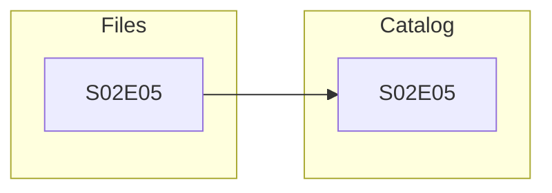
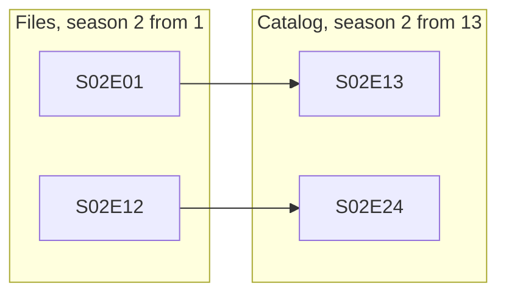
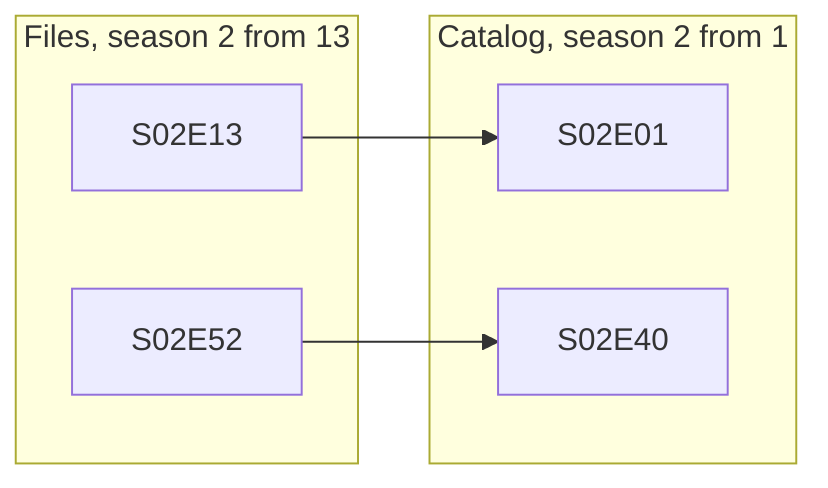
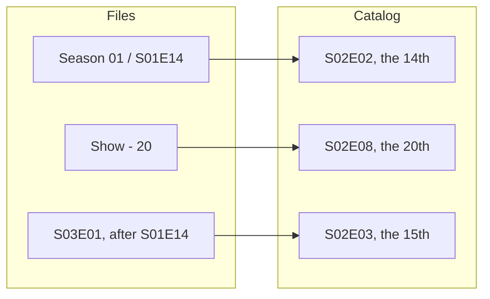
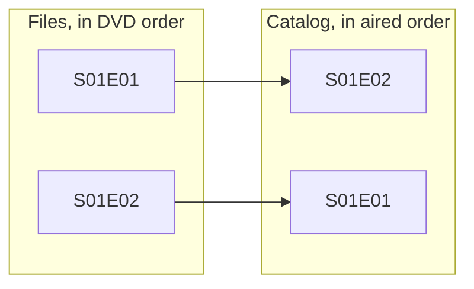

# Episode numbering

This page is for administrators whose show files are in [local folders](local-folders.md). It covers how a file's season and episode numbers map to the catalog's episodes, absolute numbers, choosing how a show's files are numbered, and episodes only the files hold.

How to name show files is on [Naming and matching files](naming-and-matching.md#naming-files).

## Episode numbers

A show's seasons and episodes are those its metadata addon describes: the catalog's. A file becomes a version of a catalog episode only when:

- its name gives a season and episode number the catalog lists exactly;
- or its name gives an absolute number alone, and the catalog reaches that number (see [Absolute episode numbers](#absolute-episode-numbers)).

Polyfin maps no other numbering onto the catalog's, unless an administrator says how the show's files are numbered (see [How show files are numbered](#how-show-files-are-numbered)). A file numbered otherwise is an episode of its own, named after the file, beside the catalog's (see [Episodes the metadata addon does not list](#episodes-the-metadata-addon-does-not-list)). The folder's page lists it under **Episodes only in the files**, next to the catalog's numbers for its season.

The files' numbering and the catalog's differ most often in these cases:

| Case | Example | Result |
|---|---|---|
| Files continuing from season 1 | Season 2 starts at `S02E41` because season 1 had 40. The catalog starts each season at 1. | The files' episodes come after the catalog's last episode of the season. |
| Seasons split otherwise | The files keep in a season 3 what the catalog lists in its season 2, or the reverse. | Numbers the catalog has in another season are extra episodes. A season it does not have is an extra season. |
| A catalog numbering on from season 1 | The catalog's season 2 starts at 25, say. The files start each season at 1. | The files' `S02E01` comes before the catalog's list of season 2. |
| Absolute names | `Show - 41.mkv`, `Show 41.mkv` or `[Group] Show - 041 [1080p].mkv` give the episode's place among all the show's episodes, but no season, as anime is often named. | A version of the catalog's episode of that place, specials left out (see [Absolute episode numbers](#absolute-episode-numbers)). A number the catalog does not reach is an episode of its own, shown under **Episodes only in the files** as named by an absolute number. |

Names giving an air date, such as `Show 2024-03-15.mkv`, are not read.

To have the files play as the catalog's episodes, choose how the show's files are numbered on the folder's page. That renames nothing, and moves what users did with them (see [How show files are numbered](#how-show-files-are-numbered)). Or rename the files with the catalog's numbers:

1. Find the catalog's season and number of each episode. Open the show in the web player, whose seasons and episodes are the catalog's. Or read them beside the files' under **Episodes only in the files**.
2. Rename each file with them, such as `Show S02E01.mkv`, or `Episode 1.mkv` inside the `Season 02` folder. A file at the top of the show's folder needs the season in its name.
3. Scan the folder. The files are then versions of the catalog's episodes, and the episodes only they held are gone.

Played marks and resume points stay with the season and number they were given at. Those of an episode only a file held do not follow the file to the catalog's episode.

## Absolute episode numbers

A show's file may be named by its episode's absolute number alone, its place among all the show's episodes, as anime often is:

```
/media/shows/Harbor Tales/Season 02/Harbor Tales - 41.mkv
/media/shows/Harbor Tales/Harbor Tales 41.mkv
/media/shows/Harbor Tales/[Group] Harbor Tales - 041 [1080p].mkv
```

Such a file, in a season folder or at the top of its show's folder, is the 41st episode the show's metadata addon lists.

- Specials are left out of the count.
- Episodes are counted by season, then number, as [tracking](tracking.md) counts an absolute numbering.
- With 40 episodes in season 1, it is a version of season 2's first episode.
- It plays as that episode, at that season and number, whatever season folder it is in.

**Names read:** as Jellyfin reads an absolute number ([`NamingOptions.cs`](https://github.com/jellyfin/jellyfin/blob/v12.4/Emby.Naming/Common/NamingOptions.cs#L361-L390)):

| Pattern | Notes |
|---|---|
| `Show - 41` | A dash between spaces or underscores. It may be followed by tags between brackets or parentheses, an episode's title, or `v2`. |
| `[Group] Show-41 [1080p]` | A dash without spaces, when the name has a tag between brackets |
| `Show 41` | The show's name in letters and digits, then the number, up to 4 digits |

**Names not read as absolute numbers:**

- A name that also gives a season and episode, `S02E01`, `2x01`, or `Episode 1` in a season folder, keeps them. Its other numbers are never read as an absolute one.
- A year, `Show 2019` or `Show - 2019`, is no episode. Nor is a resolution, `Show 1080p` or `Show 720`.
- Nor is a number given as a season's or a part's (`Show S2 - 05`, `Show Part 2`), nor a range (`Show 41-42`). Such a file stays unmatched, its name unreadable.
- `Show - 1080`, with its dash, is episode 1080 of a long show.
- In a `Specials` folder, `Show - 03` is the third special, as Jellyfin reads it.

**Numbers the catalog does not reach:** a show whose addon lists 52 episodes, with a file named `Show - 60`, gets an episode of its own.

- It is at its season folder's season, else season 1, at its number, named after its file (see [Episodes the metadata addon does not list](#episodes-the-metadata-addon-does-not-list)).
- Once the catalog lists that many episodes, as for a show still airing, the file becomes a version of the 60th the next time the show is described.
- What users did with its own episode then follows it there, as in [How show files are numbered](#how-show-files-are-numbered).

**Which catalog:**

- It is the one the server's metadata addons give. A user's own metadata addon numbering the show otherwise moves no file.
- A catalog missing an episode moves every file numbered after it onto the next one.

The folder's page under **Content › Sources** counts the files matched this way: "3 files are matched by their absolute number".

**Compared with Jellyfin**

- Polyfin makes a file named `Show - 41` a version of the catalog's 41st episode, specials left out. It lists the file as Jellyfin does only when the catalog does not reach it. Jellyfin makes the file episode 41 of its season folder's season, else of none, which its TMDB provider reads as season 1 ([`TmdbEpisodeProvider.cs`](https://github.com/jellyfin/jellyfin/blob/v12.4/MediaBrowser.Providers/Plugins/Tmdb/TV/TmdbEpisodeProvider.cs#L99-L100)). Both read `Show - 41`, `[Group] Show - 041 [1080p]` and `Show 41` ([`NamingOptions.cs`](https://github.com/jellyfin/jellyfin/blob/v12.4/Emby.Naming/Common/NamingOptions.cs#L361-L390)).
- Polyfin reads no year nor resolution as an absolute number. Jellyfin reads `Show 2019` as episode 2019 and `Show 1080p` as 1080.
- Polyfin reads the number after the dash, and the last number of a name without one. Jellyfin reads the first number of `Show 2 - 05` or `Station 100 05`.
- Polyfin reads no range of absolute numbers. Jellyfin's `Show 41-42` holds two episodes.

<a id="how-a-show-s-files-are-numbered"></a><a id="how-a-shows-files-are-numbered"></a>

## How show files are numbered

A show's files are numbered as its catalog until an administrator says otherwise: Polyfin never guesses another numbering. When a show's files are numbered another way, choose how on the folder's page under **Content › Sources**:

- in **How shows' files are numbered**, which lists the folder's shows;
- or beside the show under **Episodes only in the files**.

The files then become versions of the catalog's episodes, without being renamed, and the show lists no separate entries for them. The choice is the folder's, for each show: another folder holding the same show keeps its own.

| Choice | The files | Example |
|---|---|---|
| **As the catalog** (default) | Carry the catalog's own seasons and numbers. A name giving an absolute number alone is the catalog's episode of that place (see [Absolute episode numbers](#absolute-episode-numbers)). | `S02E05` is the catalog's S02E05. |
| **Per season** | Start each season at 1. A file's number counts among the episodes the catalog lists in its season, in order, as when the catalog numbers on from season 1. | The catalog's season 2 is E13 to E24. `S02E01` is its S02E13, `S02E12` its S02E24. |
| **Continuing from season 1** | Number on across seasons. Each season starts after the episodes the catalog lists in the seasons before it. | The catalog lists 12 episodes in season 1 and 40 in season 2, each from 1. `S02E13` is its S02E01, `S02E52` its S02E40. |
| **Absolute** | Carry each episode's place among all the show's episodes, specials left out, whatever their season. A name giving an absolute number alone uses that number, the others their episode number. A season whose numbers start again at or below the previous season's last counts on from it, so files split into seasons otherwise than the catalog are read in order. | The catalog lists 12 episodes in each of its 2 seasons. `Season 01/Show S01E14.mkv` is its S02E02, and `Show - 20.mkv` its S02E08. After files up to `S01E14`, `S03E01` is the 15th, its S02E03. |
| **An episode order** | Follow one of the series' TMDB episode groups, chosen by name, such as its DVD order. The group at order N is season N, and its episode at order N is episode N+1, as Jellyfin reads a group. It needs a TMDB key under **Settings › Content**. | A DVD order whose first volume holds the aired S01E02, then S01E01. `S01E01` is the catalog's S01E02, `S01E02` its S01E01. |

The diagrams below show each choice with the examples of the table: the files' numbers on the left, the catalog's episodes on the right.

**As the catalog:**



**Per season:** for a catalog whose season 2 is E13 to E24:



**Continuing from season 1:** for a catalog of 12 episodes in season 1 and 40 in season 2:



**Absolute:** for a catalog of 12 episodes in each of 2 seasons:



**An episode order:** for a DVD order whose first volume holds the aired S01E02, then S01E01:



**How the choice applies:**

- **Specials** (season 0) keep their numbers, and so do the episodes given by hand to the titles of a show's disc (see [Shows on discs](discs.md#shows-on-discs)). The exception is an episode order, whose season 0 holds the specials.
- **Several episodes in a file:** a file such as `S02E03-E04` holds the episodes its numbers map to, while they follow one another in one season of the catalog.
- **Which catalog:** the one the server's metadata addons give, as for [absolute numbers](#absolute-episode-numbers). A user's own metadata addon numbering the show otherwise moves no file. When the catalog changes, as for a show still airing, the files are mapped again the next time the show is described.
- **Episode orders** are read from TMDB when the show is described. While TMDB does not answer, the files keep the places they had.
- **Playback:** a file mapped this way plays as its episode, whatever episode its name gives. The check that leaves out an addon's stream naming another episode does not apply to a folder's files (see [Versions of another title](versions.md#versions-of-another-title)).
- **Scans** place the files they find as their show's choice says. A show linked to another title is numbered as that title's catalog until a choice is made for it.
- **The show's own list:** the choice maps the files only. The show still lists its seasons as its catalog does, or in the order chosen for it under **Content › Libraries** (see [Episode orders](artwork-and-editing.md#episode-orders)). Choosing the same TMDB group for both shows the files' episodes at the numbers they were named with.

### Files the numbering cannot place

A file the choice cannot map stays an episode of its own, named after its file.

- It is at its own season and number.
- When the catalog lists that number, it comes after the catalog's and the other files' last episode of its season.
- It is never a version of an episode it is not.

The show's row on the folder's page lists it with why, and with the episode it is listed as:

| Reason | Meaning |
|---|---|
| `outside_season` | Per season or continuing: the catalog's season has no episode at that place, as `S02E15` against a season of 12 episodes, or the catalog has no such season |
| `beyond_catalog` | Absolute: the catalog lists fewer regular episodes than the file's number |
| `not_in_order` | An episode order: the group has no episode at the file's season and number |
| `not_listed` | An episode order: the group's episode at that place is not one the catalog lists |
| `no_order` | An episode order: TMDB could not give the group when the file was scanned. It is placed once the show is described with TMDB answering |
| `no_catalog` | No metadata addon of the server describes the show |

### Changing the choice

The files are placed again at once. What users did with the episodes they were listed as follows them to their new episodes, by an import's rules, as when a folder's kind changes (see [Changing what a folder holds](local-folders.md#changing-what-a-folder-holds)):

- played marks and favorites are given to the new episode, the former keeping its own;
- a resume point moves.

**Episodes only in the files** is updated at the same time. Choosing **As the catalog** again puts the files back where their names number them, and their played marks and resume points follow them back.

**Compared with Jellyfin**

- Polyfin's episodes are the catalog's. A file numbered otherwise is an episode of its own, listed on the folder's page (see [Episode numbers](#episode-numbers)), until an administrator says how the show's files are numbered: per season, continuing from season 1, absolute, or in a TMDB episode group read as Jellyfin reads it. The files are then mapped to the catalog's episodes, and the series keeps its own display order. Jellyfin needs no such choice, and Polyfin never guesses it.
- Jellyfin's episodes are the files, numbered as their names say. Its provider reads each one's metadata at that season and number in the series' display order, which may be a TMDB episode group such as absolute or DVD order. A file is never listed next to a catalog copy of itself ([`TmdbClientManager.cs`](https://github.com/jellyfin/jellyfin/blob/v12.4/MediaBrowser.Providers/Plugins/Tmdb/TmdbClientManager.cs#L276-L297)).
- Polyfin reads no air dates in names, and says why on the folder's page. Jellyfin reads them ([`NamingOptions.cs`](https://github.com/jellyfin/jellyfin/blob/v12.4/Emby.Naming/Common/NamingOptions.cs#L332-L351)).

API details: [Local folder routes](jellyfin-api.md#local-folder-routes).

## Episodes the metadata addon does not list

A show's seasons and episodes are those its metadata addon describes, and those its files hold besides. These are listed all the same, as Jellyfin makes an episode of every file whatever its provider knows ([`EpisodeResolver.cs`](https://github.com/jellyfin/jellyfin/blob/v12.4/Emby.Server.Implementations/Library/Resolvers/TV/EpisodeResolver.cs#L50-L88)):

- an episode a file holds that the addon does not list, as when it numbers the seasons or the specials otherwise than the files;
- the episodes of a show the addon describes without any episode.

Such an episode is named after its file, without its extension, as `The Lone Ranger S02E07`. It has no description, and plays its files as the other episodes do. A file holding two episodes is both.

- Only enabled shows folders give them, matched to that show by a scan or a link.
- The folder's page says how many there are, as the shows were last described. A show no one opened since its files were added is counted once it is described: when someone opens it, or its library's descriptions are read again.
- An episode the addon lists that no file holds is listed as before, playing the addons' streams only.
- A show matched to a title no metadata addon describes lists the episodes its files hold, named after their files, as `Harbor Show S01E02`. The title of a show's disc is named as `Episode 5`.

**Episodes only in the files**, on the folder's page, lists their shows by name. Each shows its IMDb identifier and folder. Season by season, it gives the numbers the files hold that the addon does not list, next to those the addon lists in that season:

```
Season 2
In the files: E41-E42
In the catalog: E1-E40
```

- For a season the addon does not have, it gives the addon's first and last episodes, specials left out, such as `The catalog has no season 3: it lists S01E01 to S02E40`.
- A show last described before an update shows the addon's numbers once an app opens it again.
- Renaming the files with the catalog's numbers makes them versions of its episodes (see [Episode numbers](#episode-numbers)).

An episode whose file has no intro or credits in its chapters, of a series or season the segment databases do not know, gets the intro and credits its season's episodes share in their audio. That happens once one of them was played (see [Intros and credits found in local episodes' audio](skip-segments.md#intros-and-credits-found-in-the-audio-of-local-episodes)).

**Compared with Jellyfin**

- Both list every episode a show's files hold, those the metadata provider does not know named after their files.

API details: [Local files in the Jellyfin API](jellyfin-api.md#local-files-in-the-jellyfin-api).
