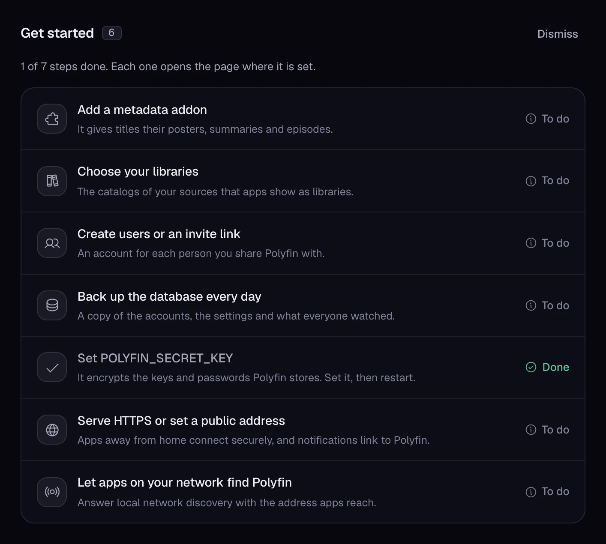
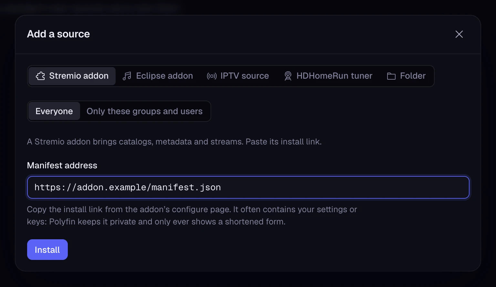

# Getting started

This page walks a new self-hoster through the first hour with Polyfin. You install it, create the administrator, add two addons, choose libraries, and play a title in a Jellyfin app. Then you create accounts for the other people you share Polyfin with.

## Install Polyfin

Pick one way to run Polyfin:

- **Docker:** run Polyfin and its database with Docker Compose, as [Installation](installation.md#steps) shows.
- **Polyfin Desktop:** install the app on Windows, macOS or Linux, as [Polyfin Desktop](desktop.md#install) shows.

Both serve Polyfin on port 8096.

## First run

### Open the admin app

Open `http://<server>:8096/admin/` in a browser, with your server's address in place of `<server>`. Polyfin Desktop opens it by itself at its first start.

The admin app shows **Welcome to Polyfin** while no administrator exists. It asks for a **Setup code**, which proves you run the server.

Until an administrator exists, Polyfin prints this one-time setup code in its log. Find it there:

- **Docker:** `docker compose logs polyfin` shows the log (see [Steps](installation.md#steps)). On Unraid, open the container log.
- **Polyfin Desktop:** choose **Setup code** in its menu to copy the code (see [First start](desktop.md#first-start)).

The code has the form `XXXX-XXXX`. Case and the dash do not matter.

### Create the administrator

Fill in the setup page, then choose **Create administrator**:

1. **Setup code:** the code from the log.
2. **Administrator name** and **Password:** the account you manage Polyfin with, and sign in to Jellyfin apps with.
3. **Confirm password:** the same password again.

The language the setup page shows becomes the language of the names Polyfin generates (see [Language of generated names](#language-of-generated-names)).

**Restore a backup instead** brings back a Polyfin from a backup of its database, in place of a new administrator. See [Backups](backups.md).

### The Get started card

Once the administrator exists, the admin app's **Home** shows **Get started**: the steps of a good setup, each marked **Done** or **To do**. Each step opens the page where it is set. The card reads the server's state each time Home loads, and again every 10 seconds for what **System › Health** tells.

| Step | Done when | Opens |
|---|---|---|
| **Add a metadata addon** | An enabled Stremio addon of the server gives metadata (its manifest lists the `meta` resource), the addons that the **System › Health** warning about metadata languages counts. | **Content › Sources** |
| **Choose your libraries** | At least one of the server's libraries is enabled. | **Content › Libraries** |
| **Create users or an invite link** | Another account than the first exists, or an invite link is active. | **Users** |
| **Back up the database every day** | **Back up the database every day** is on, as the **Backups** part of **System › Health** tells. | **Settings › Backups** |
| **Set POLYFIN_SECRET_KEY** | `POLYFIN_SECRET_KEY` is set, as the **Stored keys** part of **System › Health** tells (see [Configuration](configuration.md#stored-keys-and-tokens)). | **System › Health**, at **Stored keys** |
| **Serve HTTPS or set a public address** | **Public address** is set, in **Settings › Notifications**, or **Serve HTTPS** is on and **System › Health** finds no problem with its port, its certificate files or Let's Encrypt. | **Settings › Security**, or the page of the HTTPS problem in **System › Health** |
| **Let apps on your network find Polyfin** | **Answer local network discovery** is on, **Address on the local network** is set, and **System › Health** finds no problem with discovery's port or the address it announces. | **Settings › General**, or the page of the discovery problem in **System › Health** |

The next sections follow the first two steps. Do the others when you are ready:

- Discovery asks for **Address on the local network** because, without it, a container on a bridge network announces an address apps cannot reach. See [Local network discovery](https-and-networking.md#local-network-discovery).
- The card goes away once every step is done.
- It comes back if a step is undone later, such as backups turned off.
- **Dismiss** hides it for good in this browser. The steps still show their state on their pages.

## Add a metadata addon and a stream addon

Polyfin's movies and series come from Stremio addons. An addon's manifest lists the resources it offers:

| Resource in the manifest | What the addon gives |
|---|---|
| `catalog` | Lists of titles, which can become libraries. |
| `meta` | Metadata: posters, summaries, and the episodes of series. |
| `stream` | Streams, the videos a title plays. |

You need at least one addon whose manifest lists `meta`, and one whose manifest lists `stream`. One addon may offer both.

To add each addon:

1. Open the addon's configure page, set it up, and copy its install link.
2. In the admin app, open **Content › Sources** and choose **Add a source**.
3. Under **Kind of source**, keep **Stremio addon**, the first choice. Leave **Used by** on **Everyone**.
4. Paste the install link in **Manifest address**, then choose **Install**.

The install link often holds your settings or keys. Polyfin keeps it private and only shows a shortened form.

A **TMDB API key**, in **Settings › Content**, adds to what metadata addons give. It is optional: Polyfin bundles no key. With one, Polyfin adds:

- people's photos and biographies, and each title's cast and crew;
- posters for movies and series whose addon gives none;
- matches for a local folder's files whose search every metadata addon fails.

The key does not replace a metadata addon. See [Addons and libraries](addons-and-libraries.md) for more.

## Choose your libraries

Each catalog of an addon can become a library in Jellyfin apps. Installing an addon makes some of its catalogs libraries:

- its collection catalogs, each showing collections such as genres or decades;
- for an addon without collections, its movie, series and TV catalogs.

Polyfin makes these libraries only until the server has 20. The message after **Install** says when none of its catalogs became a library, and why.

To choose the rest, open **Content › Libraries**:

1. Under **Available catalogs**, choose **Add** beside each catalog you want. It joins the end of **Shown in Jellyfin apps**.
2. Drag the libraries into the order apps should list them, and rename them in **Name in apps** if you like.
3. Choose **Save**.

Each library adds a row to the home screen of Jellyfin apps. More than 20 libraries can make that screen heavy. A TV catalog's channels appear in Live TV instead.

## Connect a Jellyfin app

Polyfin works with Jellyfin's apps on phones, TVs and computers. See [Jellyfin apps](jellyfin-compatibility.md) for the list.

1. Install a Jellyfin app and open it.
2. Add a server at `http://<server>:8096`. On your local network, the app may find Polyfin by itself (see [Local network discovery](https-and-networking.md#local-network-discovery)).
3. Sign in with the administrator's name and password.

The app shows your libraries on its home screen.

## Play something

Open a library in the app, choose a title, and play it.

The stream addons' streams are the title's versions, which the app's version menu lists. See [Playback](playback.md) for how Polyfin orders and plays them.

## Users and sign-in

### Create users

Create the other accounts with **Create a user**, in **Users**. See [Users](users.md) for more.

Moving from a Jellyfin, Emby or Plex server? **Import from another server**, in **Users** too, creates its accounts in Polyfin. It also brings over what each user watched: played movies and episodes, resume points and favorites. See [Moving from Jellyfin](moving-to-polyfin.md#moving-from-jellyfin) and [Moving from Emby and Plex](moving-to-polyfin.md#moving-from-emby-and-plex).

Moving from an app built on addons, such as Stremio or Nuvio? **Import from an app** brings over what a user watched there. See [Importing from an app](moving-to-polyfin.md#importing-from-an-app).

### Sign in from Jellyfin apps

Jellyfin apps sign in with these accounts, in one of two ways:

- **Password:** the account's user name and password.
- **Quick Connect:** the app shows a 6-digit code, and a signed-in user approves it on the admin app's **Quick Connect** page. Silo's TV apps show an 8-digit code, approved the same way (see [Signing a TV in with a code](silo-apps.md#signing-a-tv-in-with-a-code)).

An account with [two-step sign-in](sign-in-and-security.md#two-step-sign-in) signs in to apps with Quick Connect only.

To approve a device with Quick Connect:

1. On the device, choose Quick Connect in a Jellyfin app, or open Silo's app on a TV.
2. In the admin app, open **Quick Connect** and type the code the device shows in **Quick Connect code**. An administrator finds the page in the account menu, and other users in the top bar.
3. Check the device, then choose **Approve and sign in this device**.

Codes expire after 10 minutes. Quick Connect works while **Allow Quick Connect**, in **Settings › General**, is on, as it is by default.

### Change a password

Users can change their password from Jellyfin apps, or in the admin app's **My account › Password** (**Change password**). Doing so signs their other devices out.

When the web player signed the admin app in, the web player in that browser stays signed in too. The admin app's session lasts as long as its sign-in (see [Signing in to the admin app](web-client.md#signing-in-to-the-admin-app)).

## Language of generated names

Polyfin generates some names that Jellyfin apps show:

- seasons;
- untitled episodes;
- the type that tells apart libraries with the same name, such as "Popular (Movies)";
- a music addon's "My music", and the Replay and Watchlist views;
- the ending of version names that says how the app plays each, such as "(direct play)" (see [Version names](versions.md#version-names)).

These names are in English, French, German, Spanish, Italian or Brazilian Portuguese. Set the language with **Language of generated names**, in **Settings › General**. It defaults to the language the setup page was in.

A user whose **Metadata language** is one of these languages sees some names in that language instead:

- the names of seasons and untitled episodes;
- library types, "My music", and the Replay and Watchlist views.

Any Portuguese counts as Brazilian Portuguese. Other metadata languages keep the server's language, and version names always do. See [Metadata language](watch-state.md#metadata-language).

## Next steps

- [Addons and libraries](addons-and-libraries.md): add sources and build libraries.
- [Music addons](music.md#music-addons): music, audiobooks and podcasts.
- [Local folders](local-folders.md): add your own files and network shares.
- [Torrents](torrents.md): play the torrents addons list.
- [Live TV](live-tv.md): watch and record channels.
- [IPTV](iptv.md): add IPTV sources.
- [Users](users.md): manage accounts and access.
- [Web player](web-client.md): use Polyfin in a browser.
- [Backups](backups.md): keep a copy of the database.
- [HTTPS](https-and-networking.md#https): reach Polyfin securely from away.
- [Configuration](configuration.md): the environment variables.
