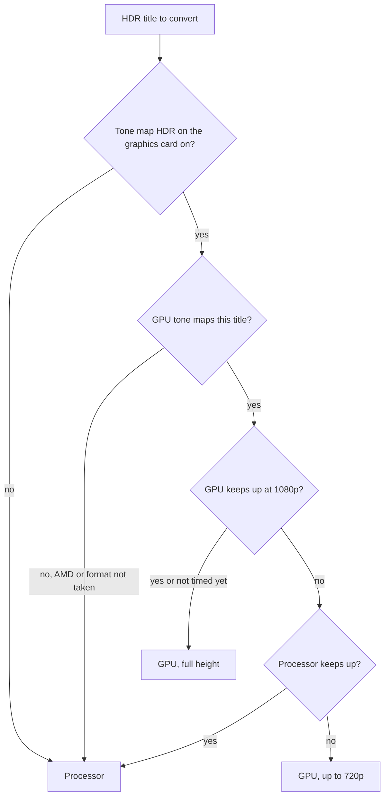

# GPUs and HDR

This page covers converting video on a GPU and tone mapping HDR to SDR. It is for administrators who give Polyfin a graphics card, in Docker or on a computer, and want HDR titles to look right.

For when Polyfin converts at all, see [Transcoding](transcoding.md).

## GPUs

Video converts on a GPU when one is available, with the methods of the system Polyfin runs on. Otherwise it converts on the processor.

- **A GPU:** keeps the source's size, up to 4K.
- **The processor:** converts to 1080p at most.

### GPU methods per system

Each system offers only its own GPU methods. They show under **Graphics card used to convert** and in `POLYFIN_HWACCEL`, in the order **Automatic** tries them:

| System | Methods | Decoding | Encoders |
| --- | --- | --- | --- |
| Linux | NVIDIA (`nvenc`), then AMD or Intel (`vaapi`) | CUDA; VAAPI | `h264_nvenc`, `hevc_nvenc`; `h264_vaapi`, `hevc_vaapi` |
| macOS | VideoToolbox (`videotoolbox`) | VideoToolbox | `h264_videotoolbox`, `hevc_videotoolbox` |
| Windows | NVIDIA (`nvenc`), then Intel (`qsv`), then AMD (`amf`) | CUDA; Direct3D 11 (D3D11VA) for Intel and AMD | `h264_nvenc`, `hevc_nvenc`; `h264_qsv`, `hevc_qsv`; `h264_amf`, `hevc_amf` |

- **Two GPUs on Windows:** Intel and AMD GPUs are opened through the Direct3D 11 adapter of their vendor. A computer with two GPUs thus uses the right one for each method.
- **No GPU:** a system without a GPU that encodes, such as a Windows computer without one, converts on the processor, as on Linux.
- **A backup restored elsewhere:** it keeps its choice of method. When the new system does not offer it, it reads as **Automatic**.

### Detection

At startup, Polyfin encodes a few frames with each encoder of the system's methods, in the order above. It logs the one it converts video on.

- **Skipped:** when **Settings › Conversion (transcoding)** chooses a GPU.
- **VAAPI:** it tries each render node of `/dev/dri` in turn, unless **Graphics card for VAAPI** names one.
- **A method that fails:** when all its encoders fail, the log says `A GPU method does not encode`, with the method, the encoder and the end of what FFmpeg wrote. The line has the level of the line that tells what video is converted on: information under **Automatic**, a warning when the settings choose that method.
- **Then:** it measures, in the background, which way converts faster on that GPU, in a few seconds (see [Frames on the GPU](#frames-on-the-gpu)).

**On arm64:** VAAPI is tried only where libva is installed. The arm64 image has no libva, nor the AMD and Intel drivers VAAPI uses. There, VAAPI is not tried, and the log says `VAAPI is not offered here: libva is not installed`. On amd64, and on an arm64 system with libva, a failure gives FFmpeg's own reason.

### Which FFmpeg runs

- **Polyfin Desktop:** it always runs the FFmpeg it downloads, or the one for older NVIDIA drivers (see [NVIDIA driver](#nvidia-driver)). It cannot be given another: `POLYFIN_FFMPEG` and `POLYFIN_FFPROBE` in the environment it starts from are left out (see [Configuration](configuration.md)).
- **`polyfin serve` and Docker:** they run the FFmpeg and ffprobe that `POLYFIN_FFMPEG` and `POLYFIN_FFPROBE` name, FFmpeg 9.0 or later. Polyfin does not check the version at startup. An older FFmpeg, such as Jellyfin's 8.1, starts, and may fail later on what it lacks.
- **When it does not matter:** copied video runs no video encoder, as for audio converted alone (see [Dolby audio in browsers](transcoding.md#dolby-audio-in-browsers)). A conversion on a GPU uses the GPU's own encoder, such as NVENC, whichever FFmpeg drives it.

### NVIDIA driver

The FFmpeg 9.0 of the Docker image and of Polyfin Desktop is built for NVENC's API 13.1. That API needs NVIDIA driver 610.00 or newer, on Linux and on Windows. In Docker, this is the host's driver.

NVIDIA's R580 drivers are the last for Maxwell, Pascal and Volta cards, which never reach 610. These include the GeForce GTX 900 and 10 series, the Quadro M and P series and the Titan V.

For drivers 570 to 609, R570 and R580 among them, Polyfin uses a second FFmpeg. It is the same FFmpeg 9.0, built for NVENC's API 13.0, which takes drivers from 570. API 13.1 adds nothing Polyfin uses.

| Case | What happens |
|---|---|
| When | NVENC's test encode at startup fails with `Driver does not support the required nvenc API version. Required: 13.1 Found: 13.0`, as it does with such a driver. |
| Download | Polyfin downloads that FFmpeg into the data folder, in `tools/nvenc13`: 64 MB on Linux amd64, 50 MB on arm64, 86 MB on Windows. It checks it against the checksum pinned in Polyfin, and keeps it. Video converts on the processor meanwhile, a few seconds to a minute. |
| Use | NVENC is tested again with it. When it encodes, Polyfin runs that FFmpeg for every conversion while the NVIDIA card is the one chosen, and its own FFmpeg otherwise. |
| What tells it | **Detected on this server**, in **Settings › Conversion (transcoding) › Graphics card**, and **System › Health › Transcoder** name the FFmpeg used: **The one Polyfin ships** or **For NVIDIA drivers older than 610**. |
| Download failed | **System › Health** warns, with why. Polyfin tries again at its next start, or when the conversion settings are saved. A server without internet converts on the processor until it has downloaded it once. |
| NVENC fails with it too | **System › Health** warns, with FFmpeg's reason. |
| Drivers older than 570 | Nothing is downloaded. **System › Health** warns that the driver is older than version 570.0. Update the driver to use the card. |
| Other systems | This FFmpeg exists for Linux on amd64 and arm64, and for Windows on x64, where NVIDIA's drivers run NVENC. |

Turing cards (GeForce GTX 16 and RTX 20 series) and newer ones get drivers from 610 on. They convert with the FFmpeg Polyfin ships once their driver is updated.

**License and source code:** this FFmpeg is free software under the GNU General Public License, version 3, a separate program from Polyfin. Its license is `LICENSE.txt` in its folder. It is built by `scripts/ffmpeg-nvenc13.sh` with the workflow `ffmpeg-nvenc13`. It is published with its complete source code as the release `ffmpeg-nvenc13.0-autobuild-2026-09-30-13-08` of Polyfin's repository (see [`third_party/ffmpeg-nvenc13`](../third_party/ffmpeg-nvenc13)).

**Compared with Jellyfin**

- Jellyfin ships one FFmpeg, whose NVENC needs the driver its NVIDIA headers ask for. Polyfin adds the second FFmpeg, so the last drivers of older cards still convert on the card.

### Frames on the GPU

A GPU's decoded frames can stay in its memory until it encodes them. They can also come back to memory for the filters, then go to the GPU again. Either may be faster, depending on the card and its driver. Polyfin measures both ways at startup, and uses the faster one for each kind of conversion:

- **SDR video kept on the GPU:** it is scaled there, with `scale_cuda` on NVIDIA, `scale_vaapi` on AMD or Intel through VAAPI, `scale_vt` with VideoToolbox, `scale_qsv` on Intel through QSV, or `vpp_amf` on AMD through AMF.
  - It is deinterlaced there with the matching filter: `yadif_cuda` or `bwdif_cuda`, `deinterlace_vaapi`, `yadif_videotoolbox`, or `vpp_qsv`'s deinterlacer. AMF has none.
  - A deinterlacer is used only once it deinterlaced a short sample on the GPU at startup. One that fails there, or makes FFmpeg crash, leaves interlaced video to the processor.
  - On Windows, Intel and AMD GPUs decode into Direct3D 11 frames, which QSV maps to its own.
- **HDR video on NVIDIA, kept on the GPU:** it is decoded into Vulkan frames, which libplacebo tone maps where they are. FFmpeg cannot hand Vulkan frames back to NVENC. The converted picture, at its final size, thus goes to the encoder through memory.
- **HDR video on Intel and VideoToolbox:** always kept on the GPU. The GPU deinterlaces, scales and tone maps it there, then encodes it: `scale_vaapi` and `tonemap_vaapi` through VAAPI, `vpp_qsv` through QSV, `scale_vt` with VideoToolbox. Burned-in subtitles are laid on in memory after the tone mapping. There is no other way on the GPU to choose from, but its speed is measured (see [A GPU too slow for HDR](#a-gpu-too-slow-for-hdr)).

Each measurement converts 2 seconds of generated 4K video to 1080p both ways.

- **The log:** it shows, for each kind, the way chosen and the speed of each (`Timed the GPU's conversion chains`).
- **Before it ends:** conversions that start go through memory.
- **Next:** the GPU's HDR tone mapping, on every GPU that tone maps, and the processor's tone mapping are measured (see [HDR and tone mapping](#hdr-and-tone-mapping)).

Frames always go through memory in these cases:

- burned-in subtitles, except on Intel and VideoToolbox when they tone map;
- formats unchecked under **Read these formats on the graphics card**;
- tone mapping on the processor;
- a GPU where the way through its memory failed.

### Giving the container an NVIDIA GPU

- Docker: `--runtime=nvidia`. Compose: `runtime: nvidia`.
- This needs the NVIDIA Container Toolkit, or Unraid's Nvidia Driver plugin.
- The host's NVIDIA driver must be 610.00 or newer for the image's FFmpeg. From 570 to 609, Polyfin downloads an FFmpeg built for it (see [NVIDIA driver](#nvidia-driver)).
- HDR is also tone mapped on the NVIDIA GPU, through Vulkan. This needs `graphics` among `NVIDIA_DRIVER_CAPABILITIES`; the image sets it.

### Giving the container an AMD or Intel GPU

- Docker: `--device /dev/dri`. Compose: `devices`.
- This works with the amd64 image only: the arm64 image has no VAAPI.

### Permissions

The container runs as user 65532. When the render nodes in `/dev/dri` are not open to every user, add the group that owns them with `--group-add`.

## Graphics card settings

| Setting | Where | Default | What it does |
|---|---|---|---|
| **Graphics card used to convert** | **Settings › Conversion (transcoding) › Graphics card** | `POLYFIN_HWACCEL` at the first start, else **Automatic** | **Automatic** takes the first that works, in the order of [GPU methods per system](#gpu-methods-per-system). Or one of the system's methods, or **None**. Applied once saved. |
| **Graphics card for VAAPI** | **Settings › Conversion (transcoding) › Graphics card** | **Each in turn** | On Linux, with **Automatic** or **AMD or Intel (VAAPI)**: the render node VAAPI converts on when several GPUs could. **Each in turn** takes the first that works; or pick one found in `/dev/dri`. Applied once saved. |
| **Detected on this server** | **Settings › Conversion (transcoding) › Graphics card** | Read only | The GPU chosen with its device, its encoders, whether it tone maps HDR and, for VAAPI, whether it takes a quality number. Also the processor's encoders and tone mapping, with the height it tone maps up to. |
| **Read these formats on the graphics card** | **Settings › Conversion (transcoding) › Graphics card** | All checked | H.264, HEVC, HEVC 10-bit (needs HEVC), VP9, AV1, MPEG-2 and VC-1. An unchecked format is decoded by the processor, for conversions and thumbnails. |

The methods each system offers under **Graphics card used to convert**:

| System | Choices |
|---|---|
| Linux | **NVIDIA (NVENC)**, **AMD or Intel (VAAPI)** |
| macOS | **VideoToolbox** |
| Windows | **NVIDIA (NVENC)**, **Intel (QSV)**, **AMD (AMF)** |

- The chosen GPU is detected when you save, once per choice. Playbacks already converting go on as they started.
- Options the hardware cannot do are disabled.
- Formats not in the list are always tried on the GPU.

**Compared with Jellyfin**

- Jellyfin checks only H.264 and VC-1 under hardware decoding by default.

## HDR and tone mapping

When HDR video is converted to SDR, Polyfin tone maps it. HDR tone mapped to SDR is tagged BT.709, by the GPU's or the processor's tone mapping.

| Where | Filter | Up to | Takes |
|---|---|---|---|
| NVIDIA GPU | libplacebo | 4K | Dolby Vision profile 5 included. Decoded straight into the frames libplacebo tone maps, when that is faster (see [Frames on the GPU](#frames-on-the-gpu)). |
| Intel GPU, through VAAPI on Linux or QSV on Windows | `tonemap_vaapi` or `vpp_qsv` | 4K | HDR10 whose frames carry their mastering display information (SMPTE ST 2086), which both filters need. HLG, and HDR10 without that information, go to the processor. No Dolby Vision profile 5. |
| VideoToolbox, on macOS | `scale_vt`, through the system's own tone mapping to BT.709 | 4K | HDR10 and HLG. No Dolby Vision profile 5. |
| Processor, elsewhere | FFmpeg's tone mapping filter | **Maximum quality of HDR converted by the processor** | No Dolby Vision profile 5. |

**The processor's cap with Automatic:** Polyfin measures the processor at startup, in the background. It converts 2 seconds of generated 4K HDR10 to 1080p the way conversions run on the server: decoded and encoded on the GPU when there is one.

- 1080p when that runs at 1.5 times real time or faster.
- Else 720p, which also applies until the measurement ends, or when it fails.
- The log shows the speed and the height chosen (`Timed the processor's HDR tone mapping`).

**AMD GPUs never tone map:** Their HDR is tone mapped on the processor. Their Linux driver failed each way Polyfin tried with FFmpeg:

- frames handed to libplacebo from memory crashed the driver;
- VAAPI frames cannot be passed to Vulkan;
- Vulkan's HEVC decoding froze the card's video decoder until the kernel reset it.

On Windows, FFmpeg's AMF filter converts colors but does not tone map.

**Checks for Intel and VideoToolbox:** These tone map only once a short HDR10 sample converted on them at startup. The check needs FFmpeg's x265 encoder to make that sample.

- Whether an HDR10 file carries its mastering display information comes from its container, when Polyfin analyzes it.
- Otherwise, the first time an Intel GPU would tone map the file, Polyfin reads its first frame once and keeps the answer.
- Other GPUs and the processor never need it.

**If HDR looks wrong:** when the GPU tone maps it, turn off **Tone map HDR on the graphics card**. The processor then tone maps it, on every GPU alike. You can also turn tone mapping off, or pick the method, under [HDR settings](#hdr-settings).

### A GPU too slow for HDR

Tone mapping costs a GPU more than scaling SDR, and a small or older card can fall behind playback. An NVIDIA Quadro P2000 tone maps 4K HDR10 to 1080p at about half real time.

So Polyfin also times the HDR tone mapping of each GPU that does it, at startup, in the background, the way conversions run:

- It converts 2 seconds of generated 4K HDR10 to 1080p. On Intel and VideoToolbox, it uses an x265 sample carrying its mastering display.
- When that is slower than real time, it converts to 720p too.

A GPU keeping up, or not timed yet, tone maps HDR as above. Once the processor is timed too, a GPU slower than real time hands HDR:

1. to the processor, when it keeps up (1x real time or faster), up to its own cap, **Maximum quality of HDR converted by the processor**. The GPU still decodes and encodes the video;
2. else to the GPU up to 720p, when it keeps up there;
3. else to the faster of the two, the GPU up to 720p. HDR titles may then pause while they convert.

Exceptions:

- Dolby Vision profile 5, which only NVIDIA GPUs tone map, stays on the GPU, up to 720p.
- All HDR stays on the GPU, up to 720p, when FFmpeg has no tone mapping filters for the processor.
- **Tone map HDR on the graphics card** turned off still gives every HDR title to the processor.

Where HDR goes, and why:

- **The log:** it shows each timing: `Timed the GPU's conversion chains` with `kind=HDR` on NVIDIA, `Timed the GPU's HDR tone mapping` on Intel and VideoToolbox, `Timed the GPU's HDR tone mapping at a lower height` and `Timed the processor's HDR tone mapping`.
- **The choice:** it then logs as `Chose where HDR is tone mapped`. It has `tone_mapping=gpu` or `processor`, the GPU's `height`, the speeds and the `reason`: `keepsUp`, `notTimed`, `processorFaster`, `lowerHeight` or `noneKeepsUp`.
- **With Detailed log (to diagnose a problem) on:** each conversion's `Started a remux` line has `tone_mapping=gpu` or `processor` for HDR. It adds `tone_mapping_reason` when the GPU does not tone map it at full height: `slow_gpu` (with the speeds), `turned_off` or `unsupported`.
- **Detected on this server**, in **Settings › Conversion (transcoding) › Graphics card**, and **System › Health › Transcoder** show **HDR titles**: where they are converted, and why, with the speeds.
- **On Home:** a playback's **Details** say "720p at most: the graphics card converts HDR in time only up to there" when the GPU's lower height set the size.

**Compared with Jellyfin**

- Jellyfin tone maps on the GPU whenever its hardware tone mapping is on and the GPU takes the video. It does so however fast the GPU is (`IsHwTonemapAvailable` in `MediaBrowser.Controller/MediaEncoding/EncodingHelper.cs`, L359-L391 at v12.4). Polyfin times the GPU and the processor, and gives HDR to the one that keeps up.

## HDR settings

| Setting | Where | Default | What it does |
|---|---|---|---|
| **Convert HDR to SDR (tone mapping)** | **Settings › Conversion (transcoding) › HDR** | On | Off: HDR converts without tone mapping and looks pale, without the processor's cap. Dolby Vision without an HDR10 layer is then not converted. |
| **Tone mapping method** | **Settings › Conversion (transcoding) › HDR** | **Automatic** | **Automatic** (BT.2390 on an NVIDIA GPU, Hable on the processor), BT.2390, Hable, Reinhard, Möbius, Clip or Linear. BT.2390 works on NVIDIA GPUs only: the processor's filter has none and uses Hable. Intel GPUs and VideoToolbox use their own curve and ignore the method. |
| **Tone map HDR on the graphics card** | **Settings › Conversion (transcoding) › HDR** | On | NVIDIA GPUs, Intel GPUs through VAAPI or QSV, and VideoToolbox tone map HDR themselves, up to 4K, unless too slow for it (see [A GPU too slow for HDR](#a-gpu-too-slow-for-hdr)). Off: the processor tone maps it on every GPU, a way out when a GPU's colors look wrong. Dolby Vision without an HDR10 layer is then not converted. |
| **Maximum quality of HDR converted by the processor** | **Settings › Conversion (transcoding) › HDR** | **Automatic (measured at startup)** | **Automatic** (1080p or 720p, as measured at startup, shown beside it), 720p, 1080p, 1440p or 4K. The processor's encoder stops at 1080p anyway: 1440p and 4K count only when a GPU encodes the video. |
| **Peak brightness in nits (0 = from the video)** | **Settings › Conversion (transcoding) › HDR** | 0 (the video's), or 100 to 10,000 nits | Processor only. GPUs do not take it, so it is hidden when an NVIDIA GPU tone maps, unless the GPU is too slow for HDR. |
| **Highlight desaturation (0 = off)** | **Settings › Conversion (transcoding) › HDR** | 0 to 10 | Processor only, shown as the peak is. |

**Compared with Jellyfin**

- Jellyfin's HDR-to-SDR conversion is off by default. Its peak brightness is 100 by default.
