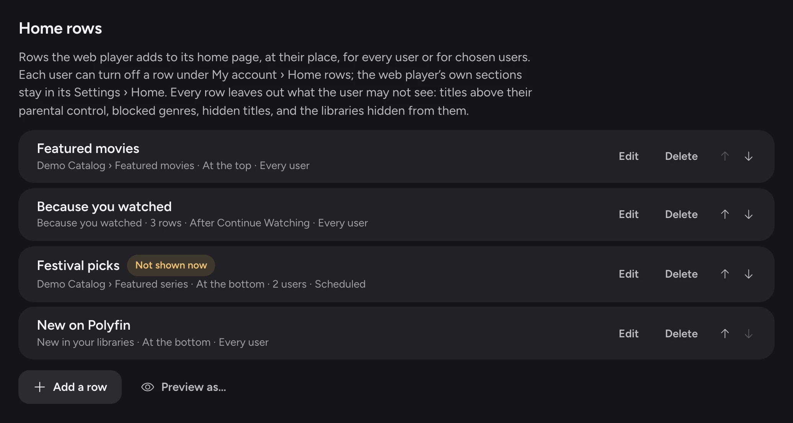
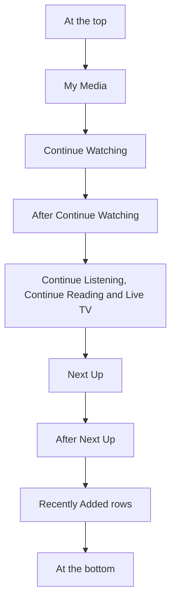

# Home rows

Home rows are rows an administrator adds to the web player's home page: a catalog, a collection, the user's Watchlist, or picks made for them. This page is for administrators, and for users who want to know why a row lists what it does. It also covers the taste profile behind **Top picks for you**.

## The Home rows list

**Settings › Web player › Home rows** adds rows to the web player's home page.

- The list is empty by default. It holds up to 20 rows, in order.
- Each row has **Edit**, **Delete** and arrows to move it.
- **Not shown now** shows beside a row its schedule hides at the moment.
- "Scheduled" shows beside a row with a schedule.

Each row has these fields:

| Field | Default | What it does |
|---|---|---|
| **Name** | | The row's title on the home page. |
| **Kind** | | What the row lists (see [Row kinds](#row-kinds)). |
| **Place** | | Where the row goes on the home page (see [Where a row goes](#where-a-row-goes)). |
| **Shown to** | | **Every user**, or **Chosen users**. |
| **Also a library in other apps** | Off | Makes the row a library too (see [Rows as libraries in other apps](#rows-as-libraries-in-other-apps)). |
| **Schedule** | Empty: the row shows all the time | When the row shows (see [Row schedules](#row-schedules)). |

## Row kinds

| Kind | What it lists |
|---|---|
| **A catalog** | The first page of a catalog of the server's addons, a library or not, such as a trending one. |
| **A collection** | A collection made by users, a smart list shown as a collection, or an addon's collection. |
| **Because you watched** | One row for each of the last movies and series the user played, of the titles similar to it. |
| **New in your libraries** | The titles that came into the catalogs of the user's libraries in the last 7 days, newest first. |
| **Now available** | The titles of the user's [Watchlist](tracking.md#the-watchlist) they have not started that versions were found for, the latest found first. |
| **Still waiting** | The titles of the user's Watchlist they have not started that no version was found for yet, or that are not out yet, the latest added first. |
| **Recommended on Trakt** | The movies and series Trakt recommends to the user, for the users who connected Trakt only. |
| **Top picks for you** | The movies and series of the first page of each of the user's libraries that their taste profile ranks first, without those they played. |

### Because you watched

- The row follows up to the number of titles chosen: 3 by default, 10 at most.
- Its titles are those [movie recommendations](jellyfin-compatibility.md#movie-recommendations) give, without those already played.
- Each row is the name followed by the title it follows, such as "Because you watched Example Movie".
- There are none while **Similar titles** is off.

### New in your libraries

A title is new from the first time Polyfin saw it in each catalog. Polyfin sees titles as apps list the libraries, and as it reads their first pages every hour.

- The titles a catalog held when Polyfin first read it, or first read a page of it, were there before: they are not new.
- A library narrowed to a genre counts that genre's titles.
- Smart lists, IPTV sources and local folders are left out.
- A title that leaves a catalog and comes back after 180 days is new again.

### Now available and Still waiting

How often the Watchlist titles behind **Now available** and **Still waiting** are checked, and what a version found means: see [Now available and Still waiting](tracking.md#now-available-and-still-waiting).

### Recommended on Trakt

**Recommended on Trakt** lists what Trakt recommends to each user (see [Recommended on Trakt](tracking.md#recommended-on-trakt)).

- Polyfin reads it with the user's Trakt connection, and again every 12 hours.
- The titles they played are left out, as **Because you watched** leaves them out.
- Titles are found by their IMDb, TMDB or TVDB identifier. Those found by none are left out.
- A user without a Trakt connection, or whose connection waits for **Connect again**, sees no such row and no library of it. This holds even when the row is shown to them.
- The first time, the row shows once Trakt has answered, at the next visit of the home page.

## Where a row goes

A row's **Place** is **At the top**, **After Continue Watching**, **After Next Up** or **At the bottom**. Each row goes at its place among the sections the user chose in the web player's **Settings › Home**. With jellyfin-web's default sections:

When a user's home page doesn't show Continue Watching or Next Up, the row takes the place before it: after the rows above it, or at the top.

The rows look like the library rows: posters, played marks, counts of unplayed episodes and progress bars, with the ⋮ menu and the play button.

- A card opens the title's page, and the row's name opens its full list.
- Polyfin's script asks for the rows each time the home page shows, and puts them back when jellyfin-web redraws the page.
- It changes nothing elsewhere.

## Who sees a row

Every row leaves out, for each user, what their other lists leave out:

- titles above their [parental control](user-limits.md#parental-control);
- their blocked genres;
- the titles they hid;
- the libraries of the server hidden from them, whose catalog or collection makes no row.

A catalog row needs the user to use the server's addons. A row without any title isn't shown.

### Rows each user turns off

**My account › Home rows** lists the rows the administrator added to the user's home page, each with its kind and place, and a switch.

- A row with a schedule is listed outside its schedule too, so that the user can turn it off beforehand.
- Off, the row leaves the user's home page. When it is also a library in other apps, it leaves their libraries there too.
- Other users keep it.
- jellyfin-web's own home sections stay in the web player's **Settings › Home**.
- **Reset my preferences** turns every row on again (see [Your own preferences](users.md#your-own-preferences)).

## Rows as libraries in other apps

No app can be given a new kind of home section. **Also a library in other apps** makes the row a library of its own too, without type, as the Watchlist is (see [Tracking](tracking.md)).

- Other apps list it among the user's libraries, and show its latest titles on their home.
- The web player shows it too, in its libraries and with its own "Recently Added" row.
- A **Because you watched** row is then one library for each title it follows.

API details: [Home rows](jellyfin-api.md#home-rows-for-apps).

## Top picks for you

**Top picks for you** lists, for each user, the titles their taste profile ranks first. It reads the movies and series of the first page of each of the user's libraries, smart lists seen as libraries included, without those they played.

### The taste profile

Polyfin builds a taste profile for each user, in the background, every hour and at start. The scheduled task is "Build taste profiles". It reads up to the user's 300 latest movies and series, from their watch data and hidden titles. Each title is weighed by what the user did with it:

| What the user did | Weight |
|---|---|
| Finished a movie | 1, plus half as much for each time it was watched again, twice at most |
| Finished episodes of a series | 1, plus a quarter for each further episode, six at most |
| Stopped a movie, or every started episode of a series, before a tenth, and never finished it | -1, once 3 days passed |
| Marked it a favorite | 1.5 more |
| Liked it | 2 more |
| Disliked it | 1.6 less |
| Hid it | 1 less |

Each weight halves every 180 days after the user's last activity with the title.

The profile adds each title's weight to its genres, directors, first five actors, decade and language. It ranks a title by the values it shares with them:

- each value's weight is brought within -1 and 1;
- genres and directors count fully;
- actors, decade and language count half.

Addons describe titles with genres, years and sometimes their directors and cast, rarely their language. The profile weighs what they give.

### When the profile is confident

The profile is confident once the titles the user liked, three at least, weigh 2.5 together: three movies finished in the last months, say.

Until then, **Top picks for you** lists the libraries' first titles as their catalogs give them, the most popular first, one library after the other. Nothing else is reordered.

Once confident:

- **Top picks for you** lists the titles in the order of the profile. Those it ranks the same keep the order above.
- Similar titles, **Because you watched** rows and [movie recommendations](jellyfin-compatibility.md#movie-recommendations) are ordered half by how close each title is, and half by the profile. The sum of the two ranks decides.
- `/Items/Suggestions` puts the titles the profile ranks first first, and the others at random as before.
- A movie's or series' page starts its taglines with why it is for the user: "87% for you · because you like Thriller".

The tagline:

- is in the user's metadata language when Polyfin speaks it, else the server's;
- has a percentage from 60 to 98;
- gives as its reason the genre, director or actor of the title the user likes most;
- is never saved by the metadata editor, which sends the taglines it was shown.

### Vetoed genres

A genre is vetoed, confident or not, once its weight is -1.5 or less and two titles at least weigh against it.

- One disliked "Horror, Drama" title vetoes neither genre.
- A vetoed genre's titles leave **Top picks for you**, and come last in the other lists.

### What the user sees of their profile

The profile stays on the server. Only its user sees it, under **My account › Taste profile**, an administrator included. Deleting the user deletes it.

**My account › Taste profile** shows:

- when the profile was built, and from how many titles;
- how well it knows the user;
- of genres, directors, cast, decades and languages, up to eight values they like and eight they like less, the weightiest first;
- a genre whose titles leave **Top picks for you**, which says so.

Before the profile is confident, the section says the lists keep their usual order.

| Setting | Where | Default | What it does |
|---|---|---|---|
| **Tell me why a title is for me** | **My account › Taste profile** | On | Starts a title's page with "87% for you · because you like …" once the profile is confident. Off, no title's page says it. |

**Compared with Jellyfin**

- Jellyfin has no taste profile. Its suggestions are at random ([SuggestionsController.cs, lines 82 to 93](https://github.com/jellyfin/jellyfin/blob/v12.4/Jellyfin.Api/Controllers/SuggestionsController.cs#L82-L93)), and its similar titles are ordered by their score alone ([SimilarItemsManager.cs, lines 245 to 249](https://github.com/jellyfin/jellyfin/blob/v12.4/Emby.Server.Implementations/Library/SimilarItems/SimilarItemsManager.cs#L245-L249)). Polyfin orders them by the user's taste once it knows it, and the row reaches other apps through **Also a library in other apps**.
- jellyfin-web already shows "Ends at" on a title's page, which the tagline does not repeat.

## Row schedules

A row's **Schedule** tells when it shows, in the server's time zone, as users' [allowed hours](user-limits.md#allowed-hours) do.

| Field | What it does |
|---|---|
| **From** and **Until** | The row's first and last dates, both included. Either may be left empty. |
| **Days** | The days of the week it shows on. None chosen is every day. |
| **Hours** | **All day**, or **Certain hours**: from the start of one hour to the start of another, such as 18:00 to 23:00. |

An end before the start passes midnight, and that night belongs to the day it starts on.

- From 22:00 to 02:00 on Fridays shows the row from Friday 22:00 to Saturday 02:00.
- An **Until** date keeps its last night.

Outside its schedule, the row is not on the user's home page, and its list does not open.

A row that is also a library in other apps follows its dates only, so that libraries don't come and go by the hour.

- Other apps keep the libraries they listed until they ask again.
- Its library and its row show from its first date to the end of its last.
- The form hides **Days** and **Hours**, and keeps them for when the row is no longer a library.

## Preview as a user

**Preview as…**, under the list, shows a user's home rows as their web player shows them now.

1. Choose the **User**.
2. The preview lists the rows they see, under their places. Each shows its name there and its first 20 titles, as Polyfin answers them to their web player.

The preview applies what the user's home page applies:

- their parental control, blocked genres and hidden titles;
- the libraries hidden from them;
- the rows not shown to them, or turned off;
- the schedules.

jellyfin-web's own sections, such as Continue Watching, are not in it.

**Compared with Jellyfin**

- Jellyfin has no home rows that the server adds, so no schedules for them. Its libraries never come and go by themselves. That is why a row that is also a library follows its dates only.
- Jellyfin's dashboard has no preview of a user's home page.
