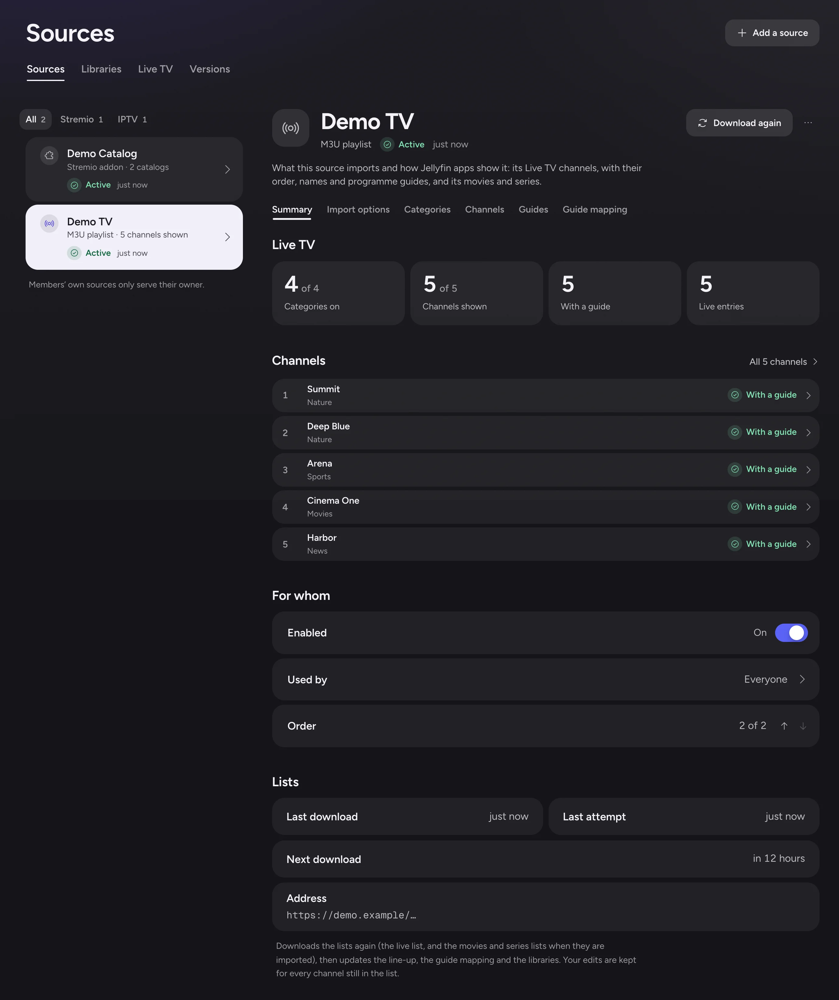

# IPTV sources

This page is for administrators, and for users who add their own sources. It shows how to import an M3U playlist or an Xtream Codes account directly, without a Stremio addon. It then covers how to shape the source's channels.

- HDHomeRun tuners have their own page: [HDHomeRun tuners](hdhomerun.md).
- Request headers, user agents and DASH channels have theirs: [IPTV stream headers and encryption](iptv-streams.md).
- Past programmes and imported titles have theirs too: [Replay](iptv-replay.md) and [IPTV movies and series](iptv-movies-and-series.md).
- For the programme guide, recordings and how channels play, see [Live TV](live-tv.md).

## Adding a source

Open **Add a source**, then choose **IPTV source** under **Kind of source**. It is in **Content › Sources** for the server's sources, and in **My sources** for your own.

Adding a source takes two steps: the **Account**, then **What to import** and its categories.

Sources follow the same rules as addons (see [Addons and libraries](addons-and-libraries.md)):

- A user may add their own sources only with **Allow users' own addons** on, and the user's **Can add their own addons** (see [Users](users.md)).
- Only an administrator's source may reach a local network address, or read a file of the server (see [Lists and guides that are files of the server](#lists-and-guides-that-are-files-of-the-server)).

### M3U playlists

An **M3U playlist** source takes these fields:

| Field | Required | What it takes |
|---|---|---|
| **Name** | Yes | The source's name |
| **Playlist address** | Yes | The list's address. Administrators see **Playlist address or file**, which also takes a file of the server. |
| **User agent (optional)** | No | See [Headers and user agent](iptv-streams.md#headers-and-user-agent) |
| **Programme guide address (XMLTV, optional)** | No | An XMLTV guide. Administrators see **Programme guide address or file (XMLTV, optional)**. |

Polyfin reads these lines of the list:

| Line | What it gives |
|---|---|
| `#EXTINF` | The channel's `tvg-id`, `tvg-name`, `tvg-logo`, `tvg-chno` and `group-title`, and its name after the comma |
| `channel-number` or `tvg-channel-no` on `#EXTINF` | The channel's number, when the line has no `tvg-chno` |
| Header attributes of `#EXTINF`, `#EXTVLCOPT` and `#EXTHTTP` lines, and the end of an address after a `\|` | The headers its stream is requested with (see [Headers and user agent](iptv-streams.md#headers-and-user-agent)) |
| `#KODIPROP` | A DASH stream's manifest type, and how it is encrypted (see [DASH channels and encryption](iptv-streams.md#dash-channels-and-encryption)) |

- Attribute values may be quoted with double quotes, single quotes or none.
- A byte order mark, CRLF line ends and `#EXTGRP` lines are accepted.
- A decimal number, such as `104.5`, shows as written in apps. The channel sorts after 104 and before 105.
- An Xtream account's decimal `num` works the same way.

**Compared with Jellyfin**

- Polyfin keeps a decimal channel number, as Jellyfin does ([M3uParser.cs](https://github.com/jellyfin/jellyfin/blob/v12.4/src/Jellyfin.LiveTv/TunerHosts/M3uParser.cs#L170-L181)).

### Lists and guides that are files of the server

An administrator may give an M3U list or an XMLTV guide as a file of the server, instead of an address. Write it in one of these forms:

- an absolute path, such as `/iptv/custom.m3u`, or `C:\IPTV\custom.m3u` with Polyfin Desktop on Windows;
- a `file://` address, such as `file:///iptv/custom.m3u`.

Polyfin reads the file as it reads a list or a guide from an address. Parsing, categories, headers and guide matching are the same.

| Case | What happens |
|---|---|
| No file at the path, a folder, or a file Polyfin may not read | Refused when the source or the guide is added, with the reason |
| A relative path | Refused. Give the whole path. |
| The file changed | Read again within 5 minutes. Polyfin checks its modification time every 5 minutes. |
| The file was modified with a date older than its last read | Read again at the next refresh |
| The file is gone, or Polyfin can no longer read it | Shown within 5 minutes on the source's row, its page and **System › Health**. The channels or programmes stay. |

- The file is also read again at each refresh (see [Refreshing](#refreshing)).
- A file that cannot be read is tried again as a failed download is (see [When guides are fetched](live-tv.md#when-guides-are-fetched)).
- The path is shown in full, as a path holds no credential.
- Only administrators may give a file, for the server's sources or for their own.
- A member's source or guide is refused any file of the server, whether the file exists or not.
- A source whose owner is no longer an administrator stops reading its file.

With Docker, Polyfin sees only the files of the volumes mounted in its container. Give the path inside the container. Mount the folder that holds the file, read-only, in the `polyfin` service of `compose.yaml`:

```yaml
services:
  polyfin:
    volumes:
      - ./iptv:/iptv:ro
```

Run `docker compose up -d` so that the container gets the volume, then give `/iptv/custom.m3u`. User 65532 must be able to read the file.

**Compared with Jellyfin**

- Jellyfin's M3U tuners and XMLTV guides also take a file or an address. Anything that does not start with `http` is opened as a file ([M3uParser.cs](https://github.com/jellyfin/jellyfin/blob/v12.4/src/Jellyfin.LiveTv/TunerHosts/M3uParser.cs#L52-L55), [XmlTvListingsProvider.cs](https://github.com/jellyfin/jellyfin/blob/v12.4/src/Jellyfin.LiveTv/Listings/XmlTvListingsProvider.cs#L118-L124)).
- Both refuse a missing file when the tuner or the guide is saved ([M3UTunerHost.cs](https://github.com/jellyfin/jellyfin/blob/v12.4/src/Jellyfin.LiveTv/TunerHosts/M3UTunerHost.cs#L133-L138), [XmlTvListingsProvider.cs](https://github.com/jellyfin/jellyfin/blob/v12.4/src/Jellyfin.LiveTv/Listings/XmlTvListingsProvider.cs#L342-L346)).
- Polyfin takes absolute paths only, whose meaning does not depend on how it was started. Jellyfin also takes a path relative to its working folder.
- Polyfin reads a list or a guide file again once it changed, and at each refresh. Jellyfin reads a guide file again once its copy is an hour old ([XmlTvListingsProvider.cs](https://github.com/jellyfin/jellyfin/blob/v12.4/src/Jellyfin.LiveTv/Listings/XmlTvListingsProvider.cs#L30)).

### Xtream Codes accounts

An **Xtream Codes account** source takes a **Name**, the **Server address**, a **Username** and a **Password**.

- Optionally, it takes a **User agent (optional)** (see [Headers and user agent](iptv-streams.md#headers-and-user-agent)) and an XMLTV guide address.
- By default, the guide is the one the server publishes for the account: **Use the provider's programme guide**.
- Polyfin reads the account through its player API: its live categories and streams.
- Its channels stream in MPEG-TS, or in HLS when the account allows only HLS.

### What is read

- Lists are read as they arrive, up to 100 MB and 100,000 channels.
- A list that cannot be read is not added.
- Headings that lists put between channels are skipped. These are names without a letter or digit, or drawn with a run of three or more decoration characters, such as `##### NAME #####` or `=== NAME ===`.
- Addresses and logins are stored as manifest addresses are. They are never shown in full, only the server's scheme and host, and never logged.
- The archive of past programmes a list gives for a channel (catch-up) is read on every download. Its programmes play from Replay (see [Replay](iptv-replay.md)).
- An Xtream account's connection limit, which its login gives, bounds the channels played at once (see [Connection limits](live-tv.md#connection-limits)).

Polyfin paces its requests to a provider's server: its lists, its guide, and the details of a title.

| The server | Polyfin |
|---|---|
| Any request | Starts requests to the same server at least a second apart |
| Answers "too many requests" for a list or a title's details | Asks again when the server says, or after 2 seconds. At most twice, and only for a wait of 30 seconds or less. |
| Still refuses a list or a guide | Says the server asked Polyfin to slow down, and tries again after a few minutes (see [Refreshing](#refreshing)) |

## HDHomeRun tuners

An HDHomeRun tuner on the local network is a source too. Administrators add it with **Add a source**, choosing **HDHomeRun tuner** under **Kind of source**. See [HDHomeRun tuners](hdhomerun.md) for finding tuners, their channels and how they are shared.

## What to import

The add flow's second step starts with **What to import**:

| Type | Default | What it imports |
|---|---|---|
| **Live TV channels** | On | The provider's live channels, as a Live TV catalog |
| **Movies** | Off | The provider's movies, as a library |
| **Series** | Off | The provider's series, as a library |

With **Movies** and **Series** off, an M3U playlist's movies and episodes stay channels.

The step then previews the **Categories to import**, to include or leave out:

- Channel categories **By group** or **By country**, with their channel counts.
- With movies or series on, their categories for each type, with title counts and search, and **Include all** and **Exclude all**.
- The preview downloads the list once, and reuses it for 5 minutes.

The step also shows the [import options](#import-options). For movies and series, it shows the libraries choice, and whether the metadata addons describe titles (see [Movies and series libraries](iptv-movies-and-series.md#movies-and-series-libraries)).

## Import options

**Import options** turn the list into the source's line-up. You choose them when you add the source, and can change them later on the source page.

- On the source page, they apply to the list already downloaded.
- **Save and rebuild** applies them, and **Discard changes** drops them.

| Option | Default | What it does |
|---|---|---|
| **Categories** | **As the provider groups them** | Categories from the provider's groups, or **One per country** |
| **Channels** | **One per entry** | One channel per entry, or **Merge quality variants** |
| **Categories to import** | All included | The groups and countries left out |
| **Turn on new channels** | On | Whether channels a refresh finds arrive turned on or off |
| **Numbering** | **The provider's numbers** | The list's number (`tvg-chno`, or Xtream's `num`). With **In line-up order**, apps number channels by their place. |

### Categories by country

A channel's country comes from the group's name first, then from the channel's name.

- Polyfin reads a flag, or a prefix such as `FR|`, `[FR]`, `(FR)`, `FR:` or `FR -`.
- `UK` counts as GB.
- Channels without a country go under Other, last.

### Merged channels

With **Merge quality variants**, entries of a category with the same name become one channel, with a stream per entry.

- Names are compared without country prefixes and quality tags.
- The channel's name keeps the brackets that belong to it, such as "Zeb (Prime)".
- Streams are ordered best quality first: 4K, UHD, FHD, HD, SD, then the others.
- A merged channel's details offer one version per turned-on stream, best first.
- Playing it tries them in order, past those that fail, up to **Versions tried when one does not work**. Only streams that fit the user's quality group are tried (see [Playback](playback.md)).

**Compared with Jellyfin**

- Polyfin merges quality variants into one channel, whose streams apps offer as versions. Jellyfin's tuner channels each have one source.

## The source page

Each source has its own page, titled with the source's name and kind: **M3U playlist** or **Xtream Codes account**. Select its row in **Content › Sources** or **My sources**: the page opens beside the list.



- The page's head holds **Download again**, on every section, and the more-actions menu with **Edit the account** and **Remove**.
- The page has six sections, as words under its name: **Summary**, **Import options**, **Categories**, **Channels**, **Guides** and **Guide mapping**.
- **Summary** shows a failed download first, with **Download again**, then the Live TV figures, the first channels, **Enabled**, **Used by**, the order, and the lists' downloads.
- While **Live TV channels** is off, the four Live TV sections are hidden: **Categories**, **Channels**, **Guides** and **Guide mapping**.
- **Content › Live TV** also lists each IPTV source's channel counts; its row opens the source's **Channels**.

### Summary

The **Summary** shows the counts, movies and series included, and the last and next download.

- When channels keep their past programmes, a notice counts those apps show.
- Its **See them** lists them under **Channels**.

<a id="import-options-1"></a>

### Import options on the source page

The same choices as when adding the source, applied to the list already downloaded. They include **What to import**, the libraries choice and enrichment.

### Categories

Add, rename, reorder, turn on or off, and delete categories.

- Reorder by drag and drop, or with the arrows.
- Only categories you added can be deleted. Their channels go back to their own categories.

### Channels

The channel list loads from the server 100 at a time. It filters by category, state, visibility in apps, guide and archive.

- A channel whose provider keeps its past programmes shows for how many days, such as **Replay, 7 days**.
- On/off switches turn a channel on or off. A selection turns several on or off.
- **Change by keyword** shows a count of what would change, then applies it.
- Channels move within a category, or to another category or place.
- An editor sets the name, logo, description, category, fixed number, streams and guide. Streams can be reordered, turned off or added.

Edits work one by one, or in bulk by selection, category or keyword.

- A bulk edit first counts what would change.
- The server pages and searches the lists, so line-ups of tens of thousands of channels stay quick.
- An added stream's address follows the source's rule for local network addresses. It is never shown in full.

#### Stream health

Each stream shows how it last answered when its channel was opened.

| State | Meaning | What Polyfin does |
|---|---|---|
| **No live stream** | An error, a web page, an empty answer or bytes of no video | Leaves the stream out of its channel for an hour, then 6 hours, then a day while it keeps failing |
| **Nothing came** | The stream sent nothing in time | Leaves it out for 10 minutes once nothing came twice in a row. After one silence, tries it again at the next start, after the channel's other streams, whether it played before or not. |
| **Refused by the provider** | The provider would not serve it then: connections in use, or too many requests | Tries it again at the next start |
| **Needs a DRM Polyfin does not support** | See [DASH channels and encryption](iptv-streams.md#dash-channels-and-encryption) | Leaves it out as a dead stream |
| **The list's keys do not decrypt it** | See [DASH channels and encryption](iptv-streams.md#dash-channels-and-encryption) | Leaves it out as a dead stream |

- A stream can be silent once when its provider was slow, or when a proxy was starting the channel for its first viewer.
- Streams that failed come after the others in their channel.
- A stream that plays is healthy again. So is a stream the list gives a new address.
- A stream analyzed before plays without another analysis. It counts as played once it answers with a live stream.
- A start stopped or replaced while the stream opens or is analyzed tells nothing of the stream. An example is a viewer who switches channels on a source of one connection. No failure is recorded, and the next start tries the stream again.
- **Try every stream again** forgets it all for the channel. Its next start tries every stream, including those that failed within the last 15 minutes.

### Guides

The catalog's XMLTV guides in order, with their status and the automatic mapping. See [XMLTV guides](live-tv.md#xmltv-guides).

### Guide mapping

The guide channel each channel takes its programmes from. Set it by hand from a search across the guides, which shows what airs now. See [Remapping and mapping by hand](live-tv.md#remapping-and-mapping-by-hand).

A Stremio addon's Live TV catalog has the same **Guides** and **Guide mapping** views. Open them with **Guides and mapping** on its row in **Content › Live TV** (see [Live TV](live-tv.md)).

## How the line-up is kept

Polyfin keeps the line-up, and reconciles it with the list on every download and option change. It matches by stable keys:

- a category by its group or country;
- a channel by its entry, or by its category and name when merged;
- a channel by any of its former streams, when the **Channels** option changes.

Reconciling keeps your edits and follows the provider:

- The administrator's edits stay.
- The provider's names, logos, numbers and guide identifiers update underneath.
- What the list dropped, or what the options now leave out, goes away with its edits.
- A source added before line-ups existed keeps what it showed. The groups it did not show become turned-off categories.

### What apps show

Apps list the turned-on channels of turned-on categories that have a turned-on stream.

- They list them in category order, then channel order.
- A channel's category is its genre.
- **Channels read per Live TV catalog** counts only these channels.
- A channel no longer in the line-up, or turned off, is no longer listed nor played.

### A source behaves as an addon

A source behaves as an installed addon with one TV catalog:

- It is listed, ordered, turned off and removed with the addons.
- Its catalog is enabled in **Content › Libraries**, where its guide panel is, whatever the number of libraries.
- Its channels play, record, and follow the **Live TV** permission, quality groups, parental control and allowed hours as any channel (see [Users](users.md) and [Live TV](live-tv.md)).
- **Edit the account** renames it, and changes its address, login or user agent.
- A new address or user agent is fetched first. A password left empty keeps the current one.

## Refreshing

The list is downloaded:

- when the source is added;
- again, with the guides, once the hours set in **Refresh Live TV lists and guides every (hours)** have passed (see the table below);
- when you press **Refresh** on the source's row, or **Download again** in its page's header;
- for a list that is a file of the server, within 5 minutes once the file changed or became unreadable (see [Lists and guides that are files of the server](#lists-and-guides-that-are-files-of-the-server)).

| Setting | Where | Default | What it does |
|---|---|---|---|
| **Refresh Live TV lists and guides every (hours)** | **Settings › Live TV** | 12 | How often lists and guides download again, from 1 to 168 hours. See [When guides are fetched](live-tv.md#when-guides-are-fetched). |

- A download that fails keeps the previous channels, and tells why.
- It is tried again as a guide is (see [When guides are fetched](live-tv.md#when-guides-are-fetched)).
- After every list refresh and change of options, channels are mapped to the guides again.

## Past programmes, movies and series

The past programmes a provider keeps play from a Replay view: see [Replay](iptv-replay.md). A source's movies and series become libraries: see [IPTV movies and series](iptv-movies-and-series.md).

## Using Dispatcharr

Dispatcharr is an IPTV channel and guide manager. It gathers providers' lists into channels with numbers, logos, groups and a guide.

- It shares one provider connection per channel between every app that watches it.
- It keeps within each provider's connection limit.
- It fails over to a channel's next stream when one breaks.

Polyfin takes its channels in three ways: as an [M3U playlist](#as-an-m3u-playlist-with-its-guide-advised) (advised), an [Xtream Codes account](#as-an-xtream-codes-account) or an [HDHomeRun tuner](#as-an-hdhomerun-tuner). In the addresses below, replace `nas.lan:9191` with Dispatcharr's address and port.

### As an M3U playlist with its guide (advised)

Add an **M3U playlist** source with:

- **Playlist address:** `http://nas.lan:9191/output/m3u`, or `http://nas.lan:9191/output/m3u/<channel profile>` for a profile's channels only.
- **Programme guide address (XMLTV, optional):** `http://nas.lan:9191/output/epg`, with the same profile when the playlist has one. Its channel ids match the playlist's `tvg-id`, so every channel takes its guide.

Dispatcharr's options go in the addresses' query:

| Option | What it does |
|---|---|
| `tvg_id_source` | What `tvg-id` holds: `channel_number` (its default), `tvg_id` or `gracenote`. Give the playlist and the guide the same one. |
| `cachedlogos=false` | Gives the provider's logo addresses instead of Dispatcharr's cached logos |
| `direct=true` | Gives the provider's own stream addresses. Dispatcharr then neither shares connections nor fails over. Leave it off. |
| `days`, `prev_days` | Bound the guide |

- Dispatcharr serves these addresses only to local networks by default.
- Polyfin reaches a local network address only from a source an administrator adds to the server.
- Channels keep Dispatcharr's numbers, decimals included, its logos, its groups as categories, and its guide.

This is the advised way. It carries everything Dispatcharr curates, needs no login, and lets Dispatcharr enforce the connection limits itself.

### As an Xtream Codes account

Add an **Xtream Codes account** with these settings:

- the server `http://nas.lan:9191`;
- a Dispatcharr user, and that user's XC password, set on the user in Dispatcharr;
- **Use the provider's programme guide**.

Polyfin then knows the connection limit Dispatcharr gives the user (`max_connections`). It may also import Dispatcharr's movies and series. Dispatcharr rounds decimal numbers here: 104.5 shows as 105.

### As an HDHomeRun tuner

Add an **HDHomeRun tuner** by address: `http://nas.lan:9191/hdhr`, or `http://nas.lan:9191/hdhr/<channel profile>` (see [HDHomeRun tuners](hdhomerun.md)).

- **Find tuners** does not see Dispatcharr, which does not answer HDHomeRun's discovery.
- Its line-up gives numbers and names only, and the channels have no groups.
- Add the XMLTV guide `http://nas.lan:9191/output/epg` to the tuner's catalog in **Content › Live TV**. Its icons give the channels their logos.
- Its tuner count is the sum of Dispatcharr's account limits, or 10 when one has none.

### Connection limits and failover

Dispatcharr shares one provider connection per channel between Polyfin and its other apps. It keeps within each provider account's limit.

| Case | What happens |
|---|---|
| Every connection is in use | Dispatcharr refuses a new channel (HTTP 503). Polyfin tells the app no stream suits. The stream shows **Refused by the provider**, but is not left out. |
| An M3U source | Polyfin knows no limit, and lets Dispatcharr decide |
| An Xtream account | Polyfin also keeps within the user's `max_connections` (see [Connection limits](live-tv.md#connection-limits)) |

Dispatcharr fails over inside the one channel address. A stream that breaks while playing switches to the next one without Polyfin noticing. Keep **Merge quality variants** off for its sources, as Dispatcharr's channels are already merged.

Dispatcharr sends nothing until it holds about 1 MB of a channel. A low-bitrate channel can take 10 seconds or more to fill it. Dispatcharr also waits on a silent stream before it fails over.

- Polyfin waits 20 seconds for a channel's first bytes (see [How a channel plays](live-tv.md#how-a-channel-plays)).
- A channel that took longer is tried again at the next start, rather than left out.
- Dispatcharr keeps starting the channel meanwhile, so the next try is quick.

### Recording

Record with Polyfin's DVR from any Jellyfin app's guide, as for any channel (see [Recordings](live-tv.md#recordings)).

- Each recording takes one Dispatcharr connection while it runs.
- It shares that connection with anyone watching the same channel.
- Dispatcharr's own recordings are not shown in Polyfin.

<div class="moved-sections">

<a id="tuners-in-use"></a>*Tuners in use* moved to [HDHomeRun tuners](hdhomerun.md#tuners-in-use).

<a id="replay"></a>*Replay* moved to [Replay](iptv-replay.md#replay).

<a id="dash-channels-and-encryption"></a>*DASH channels and encryption* moved to [IPTV stream headers and encryption](iptv-streams.md#dash-channels-and-encryption).

<a id="headers-and-user-agent"></a>*Headers and user agent* moved to [IPTV stream headers and encryption](iptv-streams.md#headers-and-user-agent).

</div>
