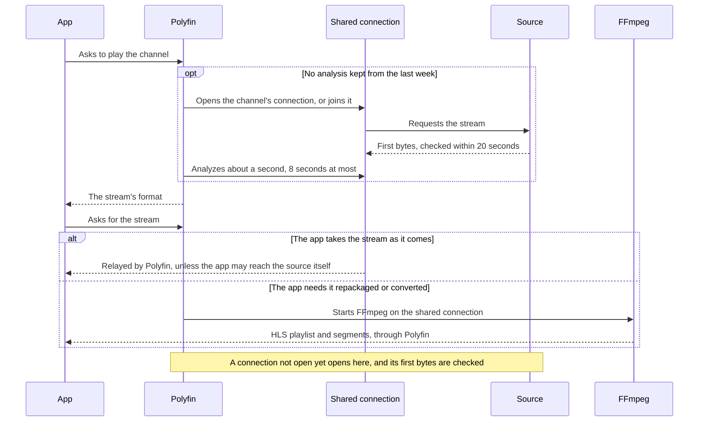

# Live TV

This page is for administrators, and for viewers curious about what they see. It covers the channels of addon TV catalogs and IPTV sources, and those Polyfin airs from your own titles. It also covers the programme guide and reminders, while [Recordings](recordings.md) have a page of their own.

- To import an M3U playlist or an Xtream Codes account directly, see [IPTV sources](iptv.md).
- The past programmes an IPTV provider keeps play from a Replay view, described under [Replay](iptv-replay.md#replay).

## Channels from addons

Enable a Stremio TV catalog (the `tv` type) under **Content › Libraries**, and its channels become Jellyfin Live TV (see [Addons and libraries](addons-and-libraries.md)). The catalog adds no library: its channels appear in the Live TV view of Jellyfin apps, with their logos. They are numbered in the order the catalogs list them.

- **How many:** Polyfin reads at most **Channels read per Live TV catalog** channels from each TV catalog, and as many programmes from each day of its guide.
- **Who can watch:** users with the **Live TV** permission, set per user on [Users](users.md).
- **Which channels:** **Live TV channels** sets which channels of the server's sources a user, or a group's members, see: all, only some groups and channels, or all but some (see [Live TV channels](user-limits.md#live-tv-channels)). It can also hide the groups sources add later.
- **Hidden channels:** a hidden channel does not play. It is left out of the channel lists, the guide, searches, Replay, timers, reminders and the recordings shown.
- **IPTV channels:** a channel of an IPTV source plays by its identifier, the one its line-up gives in the admin app. It does so as soon as the source is added, before any app listed the channels.

### The Live TV page

**Content › Live TV** gathers Live TV in the admin app.

| Part | What it lists | Buttons |
|---|---|---|
| **TV catalogs** | Each addon TV catalog, its guide state (such as **Guide complete** or **Guide download failed**), and how many of its channels have a guide. A catalog not shown as a library is marked **Not in Live TV**. | The catalog's row opens its guides and mapping. **Open Libraries**, for a catalog not in Live TV. |
| **IPTV channels** | Each IPTV source's live entries, and how many channels are on, shown in apps and with a guide | The source's row opens the **Channels** of [its source page](iptv.md#the-source-page) |
| **Recordings** | The recordings under way and scheduled (see [Recordings](recordings.md)) | |
| **Channels of your titles** | The channels aired from your titles (see [Channels of your titles](#channels-of-your-titles)) | **Add a channel** |

**Live TV settings** and **Recording settings** open those settings sections.

| Setting | Where | Default | What it does |
|---|---|---|---|
| **Channels read per Live TV catalog** | **Settings › Catalogs** | 10,000 (100 to 50,000) | Most channels read from each TV catalog, and most programmes read from each day of its guide. |

### How a channel plays

A channel plays as its source streams it, when the app takes that stream. Otherwise FFmpeg repackages the stream into HLS as it comes, or converts what the app cannot take (see [Transcoding](transcoding.md)).

| The source streams | How it reaches the app |
|---|---|
| HLS | Relayed through Polyfin, with the headers the source needs, unless the app can reach the source itself |
| MPEG-TS, played as it is (by apps such as Android TV) | Relayed from the channel's connection. When the app can reach the source and the source has no connection limit, the app is sent to the source. |
| DASH (an MPD manifest), from an IPTV source or an addon | Always converted: FFmpeg reads the manifest and its segments through Polyfin, and repackages them into HLS |

- **jellyfin-web:** it always gets HLS relayed, as browsers cannot read other sites' playlists.
- **Headers:** IPTV channels are requested with the user agent and headers their list or source gives, else a web browser's user agent (see [Headers and user agent](iptv-streams.md#headers-and-user-agent)).
- **DASH:** a ClearKey stream is decrypted with the keys its list gives. Widevine and PlayReady streams are not played. An app that sends no device profile is offered no DASH stream (see [DASH channels and encryption](iptv-streams.md#dash-channels-and-encryption)).
- **Running time:** FFmpeg runs from the moment the app opens the channel until it leaves it. A minute without requests stops it.

Interlaced channels, such as most TV sports in 1080i50, are converted for apps that do not take interlaced video, jellyfin-web among them.

- They are deinterlaced to 25 frames a second by default, which looks jerky in sports.
- **Double the frame rate**, under **Settings › Conversion (transcoding) › Interlaced video**, makes them 50 frames a second (see [Transcoding](transcoding.md)).
- It costs 55 to 65% more processor time on a 1080i50 stream converted to H.264 on the processor, with either deinterlacer, as the encoder gets twice the frames. The deinterlacer alone costs about 55% more with Yadif, the default, and 10 to 15% more with Bwdif.

When FFmpeg makes the HLS stream, it starts this way:

- **Segments:** converted video has a keyframe every 3 seconds, where its segments are cut. Video copied as it is can only be cut at the source's keyframes.
- **First playlist:** the app gets it once it lists the segments the app asks for (`MinSegments`: jellyfin-web asks for 1, and for 2 on Apple's systems). Polyfin also waits for a lead of at least two segments, of 4 seconds or more in all.
- **Why a lead:** players start a live stream at the first segment its playlist lists. With the lead they stay a few seconds behind FFmpeg, so a source that pauses a moment, or a conversion briefly behind, does not stall the picture.
- **Start time:** playback starts about 4 seconds after FFmpeg does, or up to two keyframe intervals for copied video with keyframes far apart. That is a few seconds more than with one segment, for a picture that holds through short pauses.
- **Connection already open:** FFmpeg starts from what the connection kept, and the lead is there at once. Playback then starts within a second or two for copied video, a few seconds sooner for converted video. The lead itself is no shorter.
  - The connection is open after the stream's analysis, after a play prepared ahead from the title's page, or on a return to the channel within 20 seconds.
- **After a restart:** once FFmpeg was started again (see [When a live stream fails](#when-a-live-stream-fails)), a playlist is answered as soon as it lists a segment.

The files of an HLS stream reach FFmpeg, and relayed apps, through Polyfin. Polyfin undoes what some providers do to pass their segments off as something else:

| The provider sends | What Polyfin does |
|---|---|
| Segments named oddly, such as `1234.png`, `1234.jpg`, `seg.php?n=1234`, or `1234` without an extension | Names them as video segments, adding `.ts`. FFmpeg 7.0.3, 7.1.1 and later refuse a segment whose name does not fit what it holds, with "Invalid data found when processing input". |
| A picture (PNG, JPEG, GIF or WebP) in front of a segment's MPEG-TS | Skips the picture, as other players do, when the MPEG-TS starts within the segment's first 64 kB. FFmpeg would read the picture instead. |

FFmpeg still checks what each segment holds: a picture or a web page is not read as video.

Each channel's stream is read through one connection to its source, whoever reads it: the check at its start, FFmpeg, relayed apps, a recording, and every user watching.

- **Open time:** the connection stays open 20 seconds after its last reader left, so a quick return to the channel starts at once.
- **Buffer:** it keeps the last 6 MB it received.
- **Slow readers:** a reader that falls behind those 6 MB is dropped, rather than holding the others back. That is about 8 seconds on a 6 Mb/s channel.
- **Starting to read:** whoever starts reading an MPEG-TS stream, first or joining, starts at a keyframe, after the tables that describe the stream. So it decodes from its first bytes.

The keyframe a reader starts at is the first of these that comes, always with 1 MB of the 6 left before the connection overwrites it:

1. the oldest keyframe kept within 6 seconds of the latest one, by the stream's own times;
2. for a stream whose times are not told, the first keyframe within the last 3 MB.

#### Connection limits

An Xtream account tells at its login how many streams it plays at once, and Polyfin keeps within that number. When every connection is taken, opening a channel:

1. closes a stream no one watches any more;
2. else closes the user's own oldest stream;
3. else, when other users' channels take every connection, is refused at once. The app says it could not play.

- **Streams being closed:** a stream being closed, as when its 20 seconds end, counts until its connection is closed. A channel opening meanwhile waits for it, a second at most.
- **Refusals right after a close:** the provider's refusal is tried again every second for 5 seconds, as providers count a connection a little while after it closed.

An HDHomeRun tuner plays as many channels at once as it has tuners, as its `discover.json` tells. Each channel watched or recorded takes one tuner, whoever reads it, and Polyfin keeps within them the same way (see [HDHomeRun tuners](iptv.md#hdhomerun-tuners)).

When another app took the tuners, the tuner answers that all are in use:

- the channel is refused;
- its stream counts as refused by the provider, for this start only;
- the tuner shows no problem under **System › Health**.

How recordings share tuners and connections is under [Recordings and tuners](recordings.md#recordings-and-tuners).

#### Starting a channel

Before a channel plays, Polyfin checks the first bytes of its stream.

| The source sends | Result |
|---|---|
| An error, a web page, JSON or text, an empty or short body (under 1 KB), or bytes of no video container | Fails as soon as it arrives. The channel's next stream is tried at once. |
| Nothing within 20 seconds of the request, and at least 3 seconds after its answer | Fails as silent. The next stream is tried. |
| Video | Polyfin analyzes about a second of it, and keeps what it learned for a week. |

The 20 seconds leave time for:

- providers that redirect to the stream, which take several seconds;
- proxies that share a channel between apps. They send nothing until they buffered it, which can take 10 seconds or more on a low-bitrate channel.

The analysis and FFmpeg's start:

- **Analysis time:** at most **Maximum time to analyze a version**, in **Settings › Playback**, and never more than 8 seconds.
- **Kept analysis:** later starts of the channel skip the analysis for a week, even after a restart. Once the kept analysis is an hour old, Polyfin analyzes the stream again on the way, from the stream already read.
- **FFmpeg's probe:** at most a second and a half. That is enough for audio that comes a second after the video, as in streams FFmpeg itself muxed. FFmpeg keeps what it probed as the start of what it writes.
- **FFmpeg failing early:** if FFmpeg fails within 10 seconds, the stream is analyzed again in full.

### When a live stream fails

A live stream has no end. FFmpeg reads it again, and the playlist goes on with a discontinuity instead of ending, when:

- its source closes the connection, or sends nothing for 10 seconds;
- FFmpeg made no segment for 20 seconds while the app plays, as when the source answers each segment with an error or a page. FFmpeg skips the segments it cannot read, and would otherwise wait for good.

| Restarts | What happens |
|---|---|
| After a run of 10 seconds or more | FFmpeg starts again at once. |
| After runs that each ended within 10 seconds of their start | FFmpeg waits 1, 2, then 4 seconds. |
| Past 5 restarts in 2 minutes | FFmpeg gives up until the app asks again. The log says `A live encoding gave up: its stream failed too often`. |
| Past 5 restarts, when the source refused the stream, as when a recording took the tuner | The app is told the stream is refused, instead of the line above. The log says so at Info level. |

Polyfin keeps streams that fail away from the next start:

- **IPTV sources:** how each stream answered is kept (see [Stream health](iptv.md#stream-health)). A stream found dead is left out of its channel for a while, so the next start goes to one that works.
- **Any live stream:** a stream that failed to play in the last 15 minutes is left out of PlaybackInfo meanwhile. That holds for IPTV sources, addon channels and live videos. The log says `A channel's stream is left out: it failed lately`, with why it failed.

While the stream is analyzed, a file of an HLS stream (a playlist, a key or a segment) may answer no media: an error, a web page, JSON, text or nothing. The failure then says which file, and what it answered.

- **The file's name:** only its name is shown. A name without an extension, which may be a token, is not shown.
- **An example:** `nothing came from the source in time: …; 1234.ts answered text (HTTP 404, text/plain, 4 bytes)`.
- **A segment FFmpeg refuses by its name:** FFmpeg's own line is kept, the address cut to the file name.
- **Log lines:** `A channel's stream failed` names the stream (`stream`). `A channel's stream could not be analyzed` names the channel (`channel`).

Once a channel plays through FFmpeg, converted or repackaged, the same holds for what its source answers.

| What happens | Log line |
|---|---|
| FFmpeg fails | `A live encoding failed` |
| FFmpeg stalls | `A live encoding stalled` |
| The stream ends and is read again | `A live stream is read again` |

The failure and the log line add two things:

- the last file of the stream that answered no media since FFmpeg last made a segment, by its name only. An example: `FFmpeg made no segment of the live stream for 20s; source unavailable: 1234.ts answered text (HTTP 404, text/plain, 4 bytes)`;
- the channel (`channel`).

- A file that answered no media before the last segment is not named, as FFmpeg read on past it.
- What FFmpeg writes keeps the names of the files it read, never their addresses, which hold the source's. Nor does it keep the host and port of Polyfin's relay it reads them through.
- `A segment could not be served in time: its source is slow or failed` and `A live stream was refused by its source` name the channel too.

**Compared with Jellyfin**

- Polyfin waits for its own lead of two segments of 4 seconds before it answers the first live playlist, besides the segments the app asks for. Jellyfin waits only for the latter, and jellyfin-web asks for one on most systems, which leaves the player right behind FFmpeg. Jellyfin's `DynamicHlsController.GetLiveHlsStream` calls `HlsHelpers.WaitForMinimumSegmentCount` ([lines 325-329](https://github.com/jellyfin/jellyfin/blob/v12.4/Jellyfin.Api/Controllers/DynamicHlsController.cs#L325-L329)).
- Polyfin plays segments named oddly, or starting with a picture: it names the segments it relays, and skips the picture. Jellyfin 12.4 repackages a channel's HLS stream with FFmpeg's defaults, so FFmpeg refuses those segments ([M3UTunerHost.cs](https://github.com/jellyfin/jellyfin/blob/v12.4/src/Jellyfin.LiveTv/TunerHosts/M3UTunerHost.cs#L161-L167)).
- Polyfin keeps FFmpeg's last lines in the server's log, without addresses, with what the source answered. Jellyfin 12.4 writes FFmpeg's output for each conversion or repackaging to a file of its own in its log folder, such as `FFmpeg.Transcode-…log`. The file starts with the version's media source and FFmpeg's command line, addresses included, and does not tell what the source answered ([TranscodeManager.cs](https://github.com/jellyfin/jellyfin/blob/v12.4/MediaBrowser.MediaEncoding/Transcoding/TranscodeManager.cs#L451-L486)).

API details: [Channel start and PlaybackInfo timing](jellyfin-api.md#channel-start-and-playbackinfo-timing).

### Searching

An app's search finds the user's channels by name, as their apps list them, from TV catalogs and IPTV sources alike.

- **Programmes:** a search that asks for programmes also finds those of the guides that have not ended, airing now or in the guide's days ahead.
- **Case and accents:** they do not count. "tele" finds "Télé Orbe".
- **Permission:** a user without the **Live TV** permission finds no channel or programme.
- **Listed channels only:** Polyfin searches the channels it lists, not the addons' own searches. A channel no TV catalog lists, or one turned off in an IPTV line-up, is not found.

jellyfin-web 12.4 lists the results by where the search starts. Selecting a channel found plays it, from either search.

| Searched from | Channels under | Programmes under |
|---|---|---|
| The home page | "Channels" | "Programs" |
| The Live TV page | "Channels" | "Movies", "Episodes", "Sports", "Kids", "News" and "Programs", by their guide categories |

Polyfin adds nothing to the web player for this. From the home page, jellyfin-web asks for channels in the same request as movies, shows, music and the other types. It lists each type found under its own heading, which it labels itself.

jellyfin-web's search also asks for every video but movies, episodes and channels, listed under "Videos". Polyfin leaves programmes out of that answer, so that each programme shows once, under "Programs".

API details: [Live TV in item search](jellyfin-api.md#live-tv-in-item-search).

## Channels of your titles

Polyfin can air channels of its own, around the clock, from the movies and episodes Jellyfin apps list. Add one under **Content › Live TV**, in **Channels of your titles**, with **Add a channel**.

| **Built from** | What the channel airs |
|---|---|
| **Collection** | A collection made in a Jellyfin app, or an addon's, its titles listed as a collection row lists them |
| **Smart list** | One of the server's smart lists (see [Smart lists](smart-lists-and-search.md#smart-lists)) |
| **Series** | Its episodes, season after season, without specials or episodes not aired yet |
| **Titles** | Movies and series you pick by searching them. A series airs its episodes. |

| Option | What it does |
|---|---|
| **Shuffle** | Off, titles air one after the other, in their order, round after round. On, they air in a new order each round, the same on every computation. |
| **Time blocks** | Times of the day that air titles of their own (see below). |
| **Number** | The channel's number. Empty, the channel follows the other channels. |
| **Shown in apps** | Off hides the channel from every user. |
| **Read the titles again** | Reads the channel's titles anew when you save it. |

The titles and the schedule:

- **Titles read:** at most 5,000 movies and episodes, read when the channel is saved and kept as they were. Titles added to a collection later air only once you save the channel with **Read the titles again**.
- **Schedule:** a pure function of the channel's start, its seed and its titles. The start is the midnight of the day the channel was saved, in the server's time zone.
- **Stability:** the schedule survives restarts, gives the same guide whenever it is computed, and is stored nowhere. Changing the sources or the shuffle starts it again today, shuffled anew.
- **Runtime:** each title airs for its runtime, as its description gives it. Without one, a movie gets 90 minutes; an episode gets its series' runtime, else 30 minutes.

Time blocks:

- Each block airs its own titles each day, from its start to its end, in the server's time zone. The channel's own titles fill the rest of the day.
- A channel has at most 12 blocks, apart from each other.
- Each block, and the channel's own titles, go on each day from where they stopped.
- A programme cut by the end of its time airs in full at the start of its next time, unless it started that time.

The channel is an ordinary channel for apps:

- it is listed after the channels of TV catalogs, to the users with the **Live TV** permission;
- its programmes show in the guide, in searches, in recommended programmes and as what airs now;
- its programmes are movies or series as their category, with their episode title, season and number, and their title's image;
- recordings, timers, series timers and [reminders](#programme-reminders) work on it as on any channel.

Some users do not see it:

- **Parental control and blocked genres:** a user sees the channel only when these let them reach every movie and episode it airs. They are judged by the ratings and genres the titles had when the channel was saved, as a stream other users watch cannot leave a programme out.
- **Hidden titles:** the programmes of a title a user hid are left out of their guide.

### How a channel of your titles plays

A player tuning in starts the programme airing from where it is: tuned 90 seconds after a programme started, the channel starts 90 seconds into it. The next programmes follow as one live HLS stream, with a discontinuity at each programme.

FFmpeg converts that stream in real time:

- **Video:** H.264, at the source's size up to what the converter allows: 1080p on the processor, 4K on a GPU. **Maximum quality of converted video**, in **Settings › Conversion (transcoding) › General**, can lower it.
- **Audio:** stereo AAC.

The stream plays as an IPTV channel's HLS stream does (see [How a channel plays](#how-a-channel-plays)). It is relayed to apps, converted again only for an app that cannot take it, and recorded from the same playlist.

- **One FFmpeg per channel:** it airs the channel whoever watches or records it, from the first player on, and stops a minute after the last one left.
- **Limits:** it counts among the server's 16 live encodings, and among the **Video conversions at once (0 = no limit)**.
- **Quality groups:** a user whose group is below the shared stream, such as 720p for a 1080p programme, gets it converted down by a live encoding of their own. The same holds for any channel taller than their group (see [Quality groups](user-limits.md#quality-groups)). Without the permission to convert video, the channel is refused to them.

Each programme plays from its title's versions:

- **Order:** versions of local folders first, then the others in the order of the [version rules](playback.md).
- **How many:** at most **Versions tried when one does not work** of them, in **Settings › Playback**.
- **A version failing:** at its start or later, it passes the programme to the next version, from where it stopped.
- **None playing:** a black and silent slate airs for a minute at most, and the versions are tried again.
- **A programme shorter than its runtime:** the slate follows it until its time ends.
- **Log lines:** `A version of a programme could not air`, and `No version of a programme plays: a slate airs instead`.

**Compared with Jellyfin**

- Polyfin airs channels of your own titles, which Jellyfin has not. Apps see these channels and their programmes as Jellyfin's `TvChannel` and `Program` items, and play them as live streams.

API details: [Channels of your titles in the admin API](jellyfin-api.md#channels-of-your-titles-in-the-admin-api).

## Programme guide

Without a guide, the programme guide is empty and the channels play all the same, as in Jellyfin without guide data. A guide comes from the addon itself (Native EPG), or from XMLTV files you attach to the catalog.

### Native EPG

Addons that publish a guide fill the programme guide. Stremio calls it Native EPG: a TV catalog that takes a date.

- **Days read:** Polyfin reads the guide a day at a time, from yesterday to 7 days ahead.
- **Refresh:** a day's guide is read again once it is older than **Refresh catalogs after (minutes)**, in **Settings › Catalogs** (60 by default, 1 to 1,440). Apps never wait: the older guide shows meanwhile, and is kept a day more.

### XMLTV guides

Some IPTV addons publish no Native EPG guide, while their provider publishes one as an XMLTV file. Attach such guides to any TV catalog once the libraries are saved: the server's, under **Content › Live TV**, or a user's own, under **My sources**.

- **Where:** a Stremio addon's catalog opens its **Guides** page with **Guides and mapping**, on its row under **Content › Live TV**. An IPTV source has the same views on [its source page](iptv.md#the-source-page).
- **How many:** up to 10 guides per catalog, in order, saved with **Save and download**. The catalog's row shows the first one.
- **Credentials:** a guide address may hold the provider's credentials. Like manifest addresses, it is never shown in full.
- **Local guides:** only administrators can use a guide on a local network address, or a file of the server by its path. They enter it in **Guide address or file** (see [Lists and guides that are files of the server](iptv.md#lists-and-guides-that-are-files-of-the-server)). A file's path is shown whole.
- **Native EPG first:** a channel with Native EPG programmes keeps them. The XMLTV guide only fills the channels without.
- **Removing a guide:** its mappings go with it.

#### When guides are fetched

| Setting | Where | Default | What it does |
|---|---|---|---|
| **Refresh Live TV lists and guides every (hours)** | **Settings › Live TV** | 12 hours (1 to 168) | How often guides, and IPTV lists, are downloaded again. Failed downloads are tried again sooner. |

| Polyfin fetches a guide | When |
|---|---|
| Its address is saved | At once |
| Its refresh is due | Once **Refresh Live TV lists and guides every (hours)** has passed. Polyfin looks for the guides due every 5 minutes. |
| Its download failed | After 5 minutes, then 15 minutes, then every hour, never later than the setting. Later when the server asked to wait. |
| It is a file of the server that changed, or became unreadable | Within 5 minutes |
| You press **Download again** on the **Guides** page | At once, with every guide of the catalog |

The catalog's row then shows when its first guide was last fetched and will be fetched next. It also shows how many of its channels are mapped to a guide channel, and why the last fetch failed, if it did. The **Guides** page shows the same for each guide, with the channels and programmes it held.

#### Guide files and limits

A guide may be plain XML, compressed with gzip, or a ZIP archive. Polyfin tells which by its content, not its name.

| Limit | Value |
|---|---|
| Download size | 300 MB |
| Size once uncompressed | Four times the download |
| Time to answer | 30 seconds |
| Stall | Never a minute |
| Whole download | 10 minutes |

- **Plain and gzip guides:** read as they arrive, never whole.
- **ZIP archives:** read only once complete. The archive is first written to a temporary file in Polyfin's cache folder (`cache` in `POLYFIN_DATA_DIR`, see [Configuration](configuration.md)), removed as soon as it is read or fails.
- **Inside a ZIP archive:** its `.xml` file, the largest if it holds several, is read the same way. An archive without one is reported as not a guide.

#### What a download keeps

- **Channels:** the guide's channels, with their names and icons. A channel its programmes name without declaring it counts as one without a name.
- **Programmes:** from a day before the fetch to eight days after it, with their title, episode title, description, categories, season and episode numbers, and image.
- **New or not:** whether the guide marks a programme new (`<new/>`) or previously shown (`<previously-shown>`). A programme marked both is new.
- **Past programmes:** guide channels of IPTV channels whose provider keeps past programmes keep theirs as far back as that archive, 30 days at most (see [Replay](iptv-replay.md#guides-and-the-archive-window)).
- **Failed fetches:** a failed fetch keeps those of the last one.

#### How channels are matched to the guide

Each channel takes one guide channel. Several channels may share one, such as a channel and its timeshift copy. Polyfin tries in this order:

1. **Identifier.** A guide channel takes the channel when its identifier is the channel's Stremio ID. For a channel of an IPTV source, it is the channel's own guide identifier: its list's `tvg-id` or `epg_channel_id`.
2. **Identifier, loosely.** Lists often write that identifier in another case, or with a feed after an `@` (`Name.fr@SD`). Failing an exact match, a guide channel takes it when its identifier is the same ignoring case. Then one equal to the part before the last `@` takes it, exactly, then ignoring case.
   - This comes before any name match.
   - Ties are ranked by country, then programmes, as below.
3. **Number.** For a channel of an HDHomeRun tuner, a guide channel takes it when its display name is the channel's number ("5.1"), alone or before its name ("5.1 Name").
   - "5.1" is neither "5.10" nor "15.1".
   - Guides of terrestrial channels often name them so.
   - A channel given a fixed number under **Channels** is matched by its name.
4. **Name.** Otherwise the guide channel's display names are compared with the channel's name.
   - HTML entities left in them are decoded first.
   - Set aside: case, accents, punctuation, separators such as "|", list prefixes such as "FR:", "FR|" or "KIDS|", and marker characters such as ᴴᴰ or ★.
   - "+" reads as "plus", as identifiers write it.
   - An exact match keeps quality tags such as HD, FHD, UHD, 4K or SD. A loose one sets them aside too, with the "+", which lists sometimes leave out ("Zeb Sport" for "Zeb+ Sport").
   - French lists write the public networks "France 2" to "France 5" as "F2" to "F5", followed by a region. On a French server, or under a French prefix, Polyfin reads them in full: "F3 Zebria" matches "France 3 Zebria". "F1" is left as it is.
5. **Identifier as a name.** Failing a display name, a guide channel takes the channel when its identifier, without its country suffix, writes the channel's name. "ZebPlus1.fr" matches "Zeb +1", and "ZebAndCo.fr" matches "Zeb & Co". Guides keep identifiers when a channel is renamed, so a list still using the old name finds it.

Many guides list the same channel for several countries, so the candidates are ranked:

1. **Country:** those of the channel's own country come first. That is the one its prefix names ("FR:"), else the one the server language suggests (France for French, none for English). A guide channel's countries are those of its identifier ("Name.fr") and of its display names' prefixes ("FR|").
2. **Match:** exact matches come before loose ones, and loose ones before identifiers read as names.
3. **Guide order:** the catalog's guide listed first wins.
4. **Programmes:** within a guide, the guide channel with the most distinct programme titles in the window kept wins. A placeholder repeating one title ("No Data", or "Name 4K" advertising itself) loses to a real guide.
5. **List order:** the first one listed wins.

#### Logos from the guide

A channel whose catalog or line-up gives no logo, such as a tuner's, shows the icon of the guide channel it is mapped to. Polyfin keeps the logo the source, or the administrator, gives.

#### Remapping and mapping by hand

Channels are mapped again from what is kept, without downloading:

- after every download, list refresh and change of an IPTV source's options;
- from **Automatic mapping**, on the **Guides** page. **Map channels without a guide** maps only the channels without a mapping. **Remap every channel** remaps every channel, after asking.

The **Guide mapping** page lists the catalog's channels with their mapping: all, with a guide, without a guide, or set by hand.

- **Searching:** it searches the guides' channels by name or identifier, showing what each airs now.
- **By hand:** **Choose a guide channel** maps a channel by hand, to a guide channel or to no guide at all.
- **Keeping it:** a choice made by hand survives downloads, refreshes and **Map channels without a guide**. Only **Remap every channel**, or **Back to automatic**, returns the channel to automatic mapping.

#### Where XMLTV programmes appear

XMLTV programmes appear wherever Native EPG programmes do, with the same filters: the programme listings, recommended programmes, searches, a programme's details, and the programme each channel airs now.

- **Categories:** a guide category such as "Movie", "News" or "Sports" marks programmes as a Native EPG genre does.
- **Recommended programmes:** those airing now are listed by channel number, those to come by start time.
- **Reading:** XMLTV programmes are read from the guide when asked. A guide page reads only its channels' programmes. A listing by start time, such as the upcoming rows of the Live TV page, reads no further than it shows.
- **Storage:** XMLTV programmes are not stored apart from the guide. A programme opened by its identifier is found again in the guide.
- **Images:** a programme's image, its guide's `icon`, is relayed for the programmes listed in the last day, as images are served without signing in.
- **Native EPG programmes:** those listed are kept, and deleted two days after they end, unless a recording or a timer names them.

**Compared with Jellyfin**

- Polyfin attaches a guide to a TV catalog. Jellyfin's XMLTV guides belong to its tuner setup.
- Polyfin keeps a channel's own logo over the guide's icon. Jellyfin uses the guide's icon even over the channel's own logo ([ListingsManager.cs](https://github.com/jellyfin/jellyfin/blob/v12.4/src/Jellyfin.LiveTv/Listings/ListingsManager.cs#L303-L305)).

API details: [Programme guide fields for apps](jellyfin-api.md#programme-guide-fields-for-apps).

### On Now

jellyfin-web's home page shows a Live TV section, with what airs now (On Now), to users with the **Live TV** permission. It fills none of its other rows, Continue Watching, Next Up and each library's latest titles, before that section has its answer.

So what airs now never waits for an addon:

- **What it lists:** the programmes of the channels and guide days Polyfin keeps, and those of IPTV sources and of channels of your titles.
- **What it lacks:** a catalog never read yet, a day's Native EPG guide not read yet, or a catalog whose addon does not answer. Polyfin reads them in the background, and they show from the next load of the page, once read.
- **Other pages:** the guide, the list of channels and the Live TV page's other rows still wait for a catalog or a guide day not read yet, as before.

## Programme reminders

A user with the **Live TV** permission can be told before a programme starts, without recording it.

- **Remind me:** on the page of a programme that has not started, the web player shows it after the record buttons.
- **Remind me of every airing:** in its menu, it sets a series reminder. That covers the programmes of the same title on the same channel at the same time of day, within ten minutes, as a series timer finds them.
- **Finding airings:** a series reminder looks for them in the guide when it is set, and every half hour.
- **Reminder set:** a programme with a reminder shows it. It removes the reminder, or the series reminder that made it.
- **Who gets reminders:** reminders follow parental control and blocked genres, as scheduled programmes do. A user who loses the permission, is disabled, or whose account ends gets none.

The user's own targets receive **Programme starting** as long before the programme as **Remind me before** says, under **My account › Notifications** (see [Programme reminders](notifications.md#programme-reminders)). Their apps receive it too, when the user chose so.

**My account › Reminders** lists the user's reminders and series reminders, with each programme's channel and start, and **Delete**.

A reminder is checked against the guide when it is due.

- **Moved programmes:** a programme the guide moved within the hour keeps its reminder at its new start, also when it moved earlier. During the hour before a reminder is due, the guide is looked at every few minutes.
- **Removed programmes:** a programme gone from the guide sends nothing.
- **Restarts:** reminders are kept in the database. A restart neither sends one twice nor forgets one.
- **Polyfin off:** a reminder due while Polyfin was off is sent on start, only before its programme begins.

**Compared with Jellyfin**

- Reminders set in the web player reach the user wherever their targets are. Jellyfin's API has nothing for reminders, and Jellyfin apps show no button for them.

API details: [Programme reminder routes](jellyfin-api.md#programme-reminder-routes).

## Recordings

Polyfin records Live TV programmes, as Jellyfin's DVR does, once **Record Live TV** is on under **Settings › Recordings**. Turning it on, the recordings folder, who can record, scheduling, the settings and smaller recordings are on [Recordings](recordings.md).

*Smaller recordings* moved to [Recordings](recordings.md#smaller-recordings).

