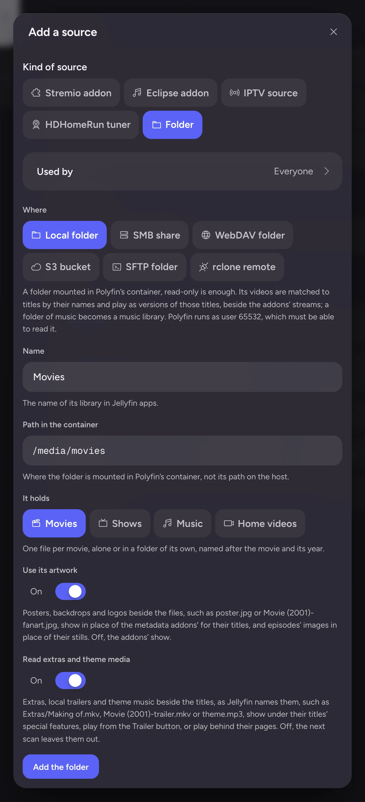

# Local folders

This page is for administrators who want Polyfin to serve their own video files. It covers adding folders and network shares, scanning them, changing what they hold, and home videos.

Each file is matched to a title and becomes one more version of it, beside the addons' streams. It gets the same version picker, subtitles, audio tracks and transcoding. Each folder is also a library that apps see, listing the titles found in it.

- How files are named and matched: [Naming and matching files](naming-and-matching.md).
- Files left unmatched, Identify and plain videos: [Unmatched files](unmatched-files.md).
- How a show's files map to the catalog's episodes: [Episode numbering](episode-numbering.md).
- Blu-ray discs, DVDs and disc images: [Discs](discs.md).
- Music folders: [Music, audiobooks and podcasts](music.md#music-folders).

Folders on a NAS or another computer can be mounted on the host and added as local folders. Polyfin can also read them itself, with no mount: see [Network shares](network-shares.md).

## Mounting folders

Mount each folder in the container. Read-only is enough. With Docker:

```sh
docker run … -v /srv/media/movies:/media/movies:ro -v /srv/media/shows:/media/shows:ro ghcr.io/moodiness/polyfin:latest
```

With compose, add the volumes to the `polyfin` service:

```yaml
  polyfin:
    volumes:
      - polyfin_data:/data
      - /srv/media/movies:/media/movies:ro
      - /srv/media/shows:/media/shows:ro
```

Then add the folder in the admin app:

1. Open **Content › Sources**, choose **Add a source**, then **Folder**.
2. Keep **Local folder**.
3. Give its name, which is the library's name in apps.
4. Give its path in the container, such as `/media/movies`, not the host's path.
5. Under **It holds**, choose **Movies**, **Shows**, **Music** or **Home videos**.



What a folder holds can change later: see [Changing what a folder holds](#changing-what-a-folder-holds).

### On Windows and macOS

Outside Docker, as with Polyfin Desktop, there is nothing to mount. A local folder is a folder of the computer Polyfin runs on, given by its full path. The admin app's form names the paths of the system Polyfin runs on.

- **Windows:**
  - A drive's folder, `D:\Movies`, or a share's, `\\nas\media\Movies`, with backslashes or slashes, in any letter case.
  - A drive's root, such as `E:\` for a disk of movies, may be a folder. The system's drive, `C:\`, may not, just as `/` may not elsewhere.
  - A mapped network drive exists only in the session that mapped it. Give the share's path rather than its letter.
  - The folders Windows makes at a drive's root, `$RECYCLE.BIN` and `System Volume Information`, are always left out.
- **macOS:**
  - Give a full path, such as `/Users/me/Movies`. An external disk's folders are under `/Volumes`, such as `/Volumes/Media/Movies`.
  - macOS asks once whether Polyfin may read Desktop, Documents, Downloads and removable disks. Allow it, or **System › Health** reports such a folder as `unreadable`.

Everything else works as in Docker: names, NFO and subtitle files, discs and images, links, scans and [watching for changes](#watching-for-changes). A music folder's M3U playlist may name its tracks by Windows paths, `D:\Music\…`, or `file:///D:/Music/…` addresses, in any letter case.

API details: [Local folders in the admin API](jellyfin-api.md#local-folders-in-the-admin-api).

### Permissions

Polyfin runs as user 65532, group 65532. It must be able to read every file and open every folder under the path.

- On the host, files need "read" and folders need "read" and "execute", for that user, its group or everyone: `chmod -R a+rX /srv/media`.
- Polyfin never writes to these folders.
- Outside Docker, Polyfin reads the folders as the account it runs as. With Polyfin Desktop, that is yours.

A folder Polyfin cannot read is reported on its page in the admin app, and under **System › Health**:

| Status | Meaning |
|---|---|
| `missing` | The path does not exist in the container. This is usually a share that is not mounted. |
| `unreadable` | The path exists, but Polyfin may not list it: a permissions problem. |
| `not_folder` | The path is a file. |

The files found before stay in the library while the folder cannot be read. A share unmounted for a while empties no library.

A folder Polyfin cannot watch for changes is listed under **System › Health** as a warning: see [Watching for changes](#watching-for-changes).

## Scanning

Folders are scanned:

- at startup;
- on the schedule of **Scan local folders every (hours, 0 = never)**, in **Settings › Catalogs**: 6 by default, and 0 turns the schedule off;
- when an administrator chooses **Scan now** on a folder;
- when an administrator runs **Scan local folders** under **System › Schedule**, which scans every folder.

A scan reads only what changed:

- A file is new or changed by its path, size and modification time. Files gone are forgotten.
- Files whose title is known keep it without asking the addons again.
- An NFO file is read when it is new or changed. One added, changed or removed matches its movie, disc or show again, even when the videos did not change. One removed leaves the title to its name and the search.
- Subtitle files and images added, changed or removed are offered as they are now from the next scan on.
- Files left unmatched are matched again at each scan.
- On a share, NFO and subtitle files and images are listed with the folders. Only the new or changed NFO files are read.
- A video of a movies or shows folder is read with ffprobe once, when it is new or changed, for how long it plays. A movie or an episode whose description gives no length, and TMDB none either, shows that one with its "Ends at" time (see [Lengths and "Ends at"](collections-people-and-ratings.md#lengths-and-ends-at)). A disc's title has the length its disc gives. A video ffprobe cannot read has none, until it changes. After an update, the first scan reads every video found before, once.

A few titles are looked up at once, so a large first scan takes a while. The folder's figures follow it.

Symbolic links to files of the folder are followed. Links leading out of the folder, and links to folders, are not.

### Watching for changes

Folders mounted in the container are watched for changes, with inotify on Linux. When files are added, renamed or removed in a folder or any folder under it, Polyfin waits until they stop changing for a few seconds. Then it scans that folder again. A movie copied into a folder shows in its library within a minute of the copy's end, without **Scan now**.

- **Watch folders and shares for changes**, in **Settings › Catalogs**, turns watching on or off for folders and network shares alike. It is on by default.
- The schedule and **Scan now** stay, as a safety net for changes a watch misses.
- A folder that disappears is scanned, which reports it missing. When it is back, it is scanned and watched again within a minute.
- Hidden folders and the folders a scan leaves out, such as a home videos folder's `Extras`, are not watched.
- Only changes to these files start a scan: videos, theme songs, disc images, NFO files, subtitle files, images (see [Artwork](naming-and-matching.md#artwork)), a DVD's `.IFO` and `.VOB` files, and a Blu-ray disc's playlists.
- The extras folders of movies and shows folders are watched as their titles' folders are (see [Extras and theme media](naming-and-matching.md#extras-and-theme-media)), whether the folder reads extras or not.
- In a music folder, subfolders named `Extras` or `Other` are watched, as its scans read them. Its audio files, artwork, lyrics files and playlists start a scan.

| Share | Watched by |
|---|---|
| SMB | The server's change notifications (below) |
| WebDAV | Listing its folders again every 2 minutes |
| S3 bucket, SFTP folder, rclone remote | Listing its folders as often as **Look for changes every (minutes, 0 = only at scans)** asks |
| Share mounted on the host, added as a local folder | inotify, which sees only the changes made through that host, not those made on the NAS |

**System › Health › Network shares** tells which shares are notified and which are polled, and why (see [Health](network-shares.md#health)).

### SMB change notifications

An SMB server tells Polyfin of changes on a share. Polyfin asks it to report each change in the share's folder and every folder under it. After a change, Polyfin waits until changes stop for a few seconds, then scans the share again, reading only what changed. A movie copied onto the share, renamed or removed shows within seconds of the copy's end. When the server had too many changes to tell one by one, the share is scanned all the same.

- **Safety net:** the share's folders are still listed every 10 minutes, as for polled shares (below), in case a change goes untold.
- **Samba:** it tells of every change made through the network. Of changes made on the server's own disk, such as by a download client on the NAS, it tells only those in the share's top folder. When a listing finds an untold change in a folder of the share, Polyfin keeps the notifications and also lists the share every 2 minutes.
- **Server restarts:** when the server ends Polyfin's session, Polyfin signs in again, asks again for changes, and scans the share for what changed meanwhile. While the server cannot be reached, Polyfin retries every 30 seconds and lists the share every 2 minutes.
- **Windows servers:** they were seen to accept a watch of a whole share from its top folder and never answer it. When a listing finds an untold change in the top folder, Polyfin watches the top folder and each folder in it apart, which Windows answers. When that watch is silent too, or the top folder holds more than 256 folders, the share is listed every 2 minutes until Polyfin restarts. An address naming a folder of the share, such as `smb://nas.local/media/Movies`, avoids this.
- **Open to others:** the folders watched can still be renamed, moved or deleted. Polyfin never writes to a share.

### Polled shares

WebDAV servers give no notice of changes, nor do S3 buckets, SFTP servers, rclone remotes and SMB servers that refuse to. Polyfin lists those shares' folders again every 2 minutes. It compares each listing with the one its last scan read:

- the names of its folders;
- the names, sizes and modification times of its videos, NFO and subtitle files, and the other files a scan reads.

When one differs, the share is scanned again a few seconds later, reading only what changed. A movie copied onto such a share shows within a few minutes of the copy's end.

- **Rounds:** each round lists the top folder first, where a new movie's folder lands, then the folders under it in turn. A round makes at most 100 listings, half a second apart. A larger share is listed over several rounds, each starting where the last stopped. With 1,000 folders, a change deep in it is seen within 20 minutes, a new folder at the top within 2.
- **Folders listed:** those the last scan read. Hidden folders and those a scan leaves out are not. A new folder is seen through its parent's listing.
- **First round:** 2 minutes after Polyfin starts or the share is added. Both scan the share anyway.
- **Copies under way:** they may be scanned before they end. The next round sees the size change and scans again.
- **Errors:** a share that cannot be listed is reported under **System › Health** (see [Health](network-shares.md#health)), and scanned again once it answers.

**S3, SFTP and rclone:** each is listed as often as **Look for changes every (minutes, 0 = only at scans)** asks, on the folder's form.

| Kind | Default |
|---|---|
| SFTP folder, rclone remote | 2 minutes |
| S3 bucket | 30 minutes, as S3 providers may bill each listing. A round lists one folder per request, and each page of 1,000 entries is a request. |

0 lists the folder only at its scans, from its schedule and **Scan now**. A change of this setting applies at once.

**`rclone serve`:** a storage served through `rclone serve` (`webdav`, `s3` or `sftp`) answers from rclone's directory cache. It keeps each listing for 5 minutes by default (`--dir-cache-time`). A file added on the storage behind it shows only once rclone lists that folder again, up to 5 minutes later. Start `rclone serve` with a shorter cache, such as `--dir-cache-time 30s`, for changes to show sooner.

### Watch limits

**Linux:** it limits the folders one user may watch, with `fs.inotify.max_user_watches`. Polyfin watches each folder of a tree, so a large library may reach it.

- A folder that cannot be watched is still scanned on its schedule.
- **System › Health** lists it with why, and Polyfin tries again every 10 minutes.
- The container shares the host's limits, so raise it on the host:

```sh
echo fs.inotify.max_user_watches=524288 | sudo tee /etc/sysctl.d/90-inotify.conf
sudo sysctl --system
```

When **System › Health** says the limit of watchers or open files is reached, raise `fs.inotify.max_user_instances` the same way. Or raise the container's limit of open files (`--ulimit nofile=…` with Docker).

**macOS:** Polyfin watches each folder and file of a tree through a file it keeps open. A very large library may reach the process's limit of open files. **System › Health** then says `open_files_limit`. Raise the limit, which lasts until the Mac restarts:

```sh
sudo sysctl kern.maxfiles=524288 kern.maxfilesperproc=262144
```

**Windows:** it has no such limit. A folder it cannot watch is reported as a failure, and tried again every 10 minutes too.

**Compared with Jellyfin**

- Polyfin also scans folders at startup, on its schedule and on demand. Both watch folders for changes.
- Polyfin also watches the network shares it reads itself, by listing them again every few minutes.

API details: [Local folder routes](jellyfin-api.md#local-folder-routes).

## Changing what a folder holds

On a folder's page under **Content › Sources**, **Edit the folder** changes **It holds**: movies, shows, music or home videos. Before changing anything, the admin app says what follows and what is dropped, and asks.

The folder keeps:

- its library, which apps know by its identifier, with its place in their home screens and menus;
- its address, user and password, and its other settings.

A scan under way stops. The folder is scanned again as the new kind, in the background.

What users did follows the videos as follows:

- **Between movies, shows and home videos**, what users did with a video follows it, as an import adds it (see [How the data merges with Polyfin's](moving-to-polyfin.md#how-the-data-merges-with-polyfin-data)):
  - a played mark is added, the newer resume point is kept, and a favorite is set;
  - a home video that becomes a movie or an episode gives it its watch state, resume point and favorite, and the reverse;
  - a file the new scan does not match gets them once it is matched, by hand or by a later scan.
- **Played marks and favorites are given:** the former titles keep theirs.
- **A resume point moves:** as it was recorded through the file, which the former title no longer plays. The former title loses it once the new one has it, or a newer one, so Continue Watching lists the file once. A new title played before the resume point was set takes none, as with an import, and the former title keeps it.
- **Away from home videos:** the folder keeps its videos' identifiers for 30 days (see [Titles](#titles)). Meanwhile they leave Continue Watching. If the folder holds home videos again within that time, it lists them as the same titles, with what users did with them.
- **Links made by hand** and the episodes given to shows' discs are dropped: each was made for one kind.
- **To or from music:** nothing follows: songs and videos are other files. What users did with the former titles stays with them and no longer shows.

## Versions

A matched file is one more version of its title, or of each of its episodes. The version is named after the folder, with the resolution its name gives and its size, such as `Movies · 1080p · 4.2 GB`.

- Polyfin reads it from the disk or the share, with byte ranges.
- It plays like any other version: direct play, repackaging or conversion.
- It has its embedded audio and subtitle tracks, and the subtitle files beside it.
- A Blu-ray disc's playlist, a DVD and a disc image play over HLS only. A Blu-ray disc's video is copied when the app takes it, a DVD's is converted (see [Discs](discs.md)).
- The folder's library lists its titles, the latest found first.

Episodes the files hold that the catalog does not list: see [Episodes the metadata addon does not list](episode-numbering.md#episodes-the-metadata-addon-does-not-list).

**Compared with Jellyfin**

- Polyfin takes titles and their descriptions from the metadata addons. A local file adds a version, and its artwork when the folder holds some. Jellyfin reads metadata from files and providers of its own.

API details: [Local files in the Jellyfin API](jellyfin-api.md#local-files-in-the-jellyfin-api).

### Listing local files first

A folder's versions take its place among the sources. Moving it up under **Content › Sources** puts its files before the addons' streams, while no criterion orders versions.

With criteria, such as **Preferred audio language**, a local file often ranks low. A scan reads how long a file plays, not its tracks, so a file's audio languages are known only once it was played, or from its name or RemuxDB's description.

To list local files first for everyone, or for some users with **Play local files first**, see [Local files first for some users](versions.md#local-files-first-for-some-users) and [Version order](versions.md#version-order). **Add a criterion** adds a criterion last: move it up with its arrow.

### Titles your catalogs list too

A folder's movie or show matched or linked to an IMDb identifier is the title of that identifier. It is the same title a catalog lists under that IMDb identifier.

- It is one item, with the same seasons, episodes, watch state, favorites and resume points.
- The folder's files are versions of it, or of its episodes, beside the addons' streams.
- Two libraries list it: the catalog's and the folder's. It shows in both, in the "My Media" row and in each library's row of the home screen, as Jellyfin shows a movie twice when two libraries hold it.
- Continue Watching, Next Up, search and the title's page list it once.

A catalog may list a title under another identifier than IMDb's, such as a TMDB one (`tmdb:…`) or an anime database's. That entry is a title of its own:

- it has its own watch state;
- it plays the addons' streams only, never the folder's files, as a folder answers only for the titles it lists by their own identifiers (see [Identifiers addons accept](addons.md#identifiers-addons-accept));
- Next Up and Continue Watching may list the show twice, once for each.

To tell whether two entries are one title, open each in the web player. The address of a title's page ends with `id=` and its identifier. The same identifier is the same title. Two identifiers are two titles.

| To get | Do this |
|---|---|
| Local files first | See [Listing local files first](#listing-local-files-first). It applies to every user, or to some users with **Play local files first**. |
| Only the folder's library for these titles | Under **Content › Libraries**, turn on **Leave out the titles local folders hold** in the catalog library's row. For every user who sees the folder's library, only that library lists them, and they stay one title (see [Titles local folders hold](addons-and-libraries.md#titles-local-folders-hold)). |
| The catalog's entry off the home screen | In the web player, open **Settings › Home** and, under the catalog's library, untick "Display in home screen sections such as 'Recently Added Media' and 'Continue Watching'". The library's row leaves the home screen. So do the titles only that library lists, from Next Up and Continue Watching. A title the folder's library lists too stays (see [Home screen sections](jellyfin-compatibility.md#home-screen-sections)). Untick "Display on home screen" instead to leave the library out of the menus too. Each user chooses for themselves. The library still opens from the "My Media" row. |
| The catalog's library out of a user's libraries | Under **Users**, on the user's or their group's page, untick the library in [Visible libraries](user-limits.md#visible-libraries). Its titles stay reachable through the folder's library and search. |
| Only the catalog's entry of one show listed under another identifier off the lists | "Hide this title" in its ⋮ menu takes it off the user's lists. The folder's entry stays (see [Watch state](watch-state.md#watch-state)). For a title of the same identifier, it would hide the folder's entry too, as they are one. |

## Home videos

A folder or share added as holding **Home videos** (fr « Vidéos personnelles ») lists videos no metadata addon knows: recordings of a family, a concert or a school play.

- Each video is a title of its own, which the folder names, dates and plays itself.
- Nothing is sent to the metadata addons, and nothing is ever unmatched.
- What a folder holds can change (see [Changing what a folder holds](#changing-what-a-folder-holds)). Its videos' watch state follows them to the movies and episodes they become, and back.

```
/media/family/Beach.mp4
/media/family/School play 2018/play.mp4
/media/family/School play 2018/play.nfo
/media/family/Trip/day 1.mov
/media/family/Trip/day 2.mov
/media/family/Trip/day 2-poster.jpg
```

### Titles

- **Names:** a video alone in a folder of its own, with its side files, is one title named after the folder (`School play 2018`). Several videos in one folder are as many titles, each named after its file without its extension (`day 1`, `day 2`). So is a video at the folder's top (`Beach`). Names are kept as written: no year or quality is read out of them.
- **NFO file:** the video's own (`play.nfo`), else `movie.nfo` in the video's own folder. Its `<title>` names the title and its `<plot>` describes it. Its date is `<premiered>`, else `<aired>`, else `<releasedate>`.
- **Date without an NFO date:** the creation time the video tells, as phones and cameras write it (`creation_time`, or the time Apple's devices write with its time zone). Else the file's modification time. A creation time before 1971, from a clock never set, is ignored. An NFO file giving a `<year>` alone keeps the video's own date when it is of that year, and is January 1 of that year otherwise.
- **Artwork:** the images beside the video, with the names a movie's take (see [Artwork](naming-and-matching.md#artwork)): `day 2-poster.jpg`, or `poster.jpg` in its own folder. Without a poster, it shows a frame of the video taken a tenth into it, as Jellyfin takes one. The frame is at most 640 pixels wide, as chapter images are, kept with the scan and made again when the video changes.
- **Subtitles:** subtitle files beside a video are offered with it, as for any local file.
- **Discs:** discs and disc images are left out, as in a shows folder.

A title's identifier stays with its video through scans and restarts, and follows it when it is renamed or moved. What users did with it stays with it: watch state, resume point, favorites and collections. Apps' links to it still lead to it.

A scan reads the size of each video and a hash of its first and last MiB, once, when it first finds it or the file changes. A video found with the size and hash of exactly one video gone is that video again. This covers a video:

- renamed, moved into a subfolder, or in a renamed folder, as `Trip/day 2.mov` becoming `Summer 2019/Beach.mov`;
- moved into another Home videos folder, whichever folder is scanned first. If the folder it went to is scanned first, the video is briefly a new title. The scan of the folder it left then gives it back its identifier. That is unless users already did something with the new title (played, marked, rated, made a favorite, added to a collection or playlist, given a subtitle file or edited it), which then stays as it is.
- copied then deleted, with scans in between, as a slow move between disks: it counts as a move;
- moved out and back within 30 days. Videos gone from every Home videos folder of the server are remembered for 30 days, including those of a folder removed, given another path or now holding something else.

Some cases make a new title:

- A copy is a title of its own while its original is still there. It stays one when the original goes later, its folder scanned after the copy was found.
- Several videos gone, or several found by one scan, with the same contents, are new titles.

A video replaced at the same path, its contents changed, keeps its title. A video found again keeps the time it was first found: the weekly summary does not count it as added.

### In apps

The folder is a library of Jellyfin's `homevideos` type, and its titles are `Video` items, as Jellyfin's home videos are.

- The web player shows it with its Folders and Videos views, newest recording first in the Folders view.
- Search, watch state, resume points, Continue Watching, collections, the libraries a user sees, allowed hours and downloads work as for other titles.
- The videos play, seek and show their scrubbing thumbnails as other local files do.

A home video no folder holds any more leaves Continue Watching and the lists of resumable, favorite and played items. That covers a video deleted from disk, or in a folder that now holds something else.

- What users did with it stays. Found again within 30 days (see [Titles](#titles)), it shows again with its watch state and resume point.
- A movie or episode a home video became stays listed, as its addon still describes it. Its resume point goes back to the video with the file (see [Changing what a folder holds](#changing-what-a-folder-holds)).

Parental control judges home videos as Jellyfin judges its videos: unrated, of the **Other** kind. A user blocking unrated **Other** items sees none of them. A highest rating alone hides none.

Tracking services and scrobbling never hear of them: they have no identifier a service knows. The [weekly summary](notifications.md#weekly-summary) counts the videos a scan first finds among the files added, as videos, never as movies.

The folder's page counts its videos, and how many are dated by an NFO file, by their recording and by their file. It has no unmatched files and no links.

<a id="limits-1"></a>

### Home video limits

- Polyfin reads no other field of NFO files, such as people, tags or ratings, and does not write them.
- A video is one title. Several files of one recording are not joined, and a folder holding several videos is no title of its own.
- A frame is made once per video as it is. One that cannot be made, from an unreadable video, is tried again only once the video changes.
- A video renamed or moved and changed at once, or before a scan read its contents, is another title.
- After an update, the first scan reads the contents of the videos found before.

<a id="notes-for-jellyfin-users-and-app-developers"></a><a id="compared-with-jellyfin"></a><a id="for-app-developers"></a>

**Compared with Jellyfin**

- Polyfin also dates home videos by the recording's creation time. Both list them as `Video` items of a `homevideos` library, judged as **Other** by parental control, with a frame of the video when no image is beside it.
- Polyfin lists no photos nor photo albums in such a library.
- Polyfin makes a video alone in its folder a title named after the folder.
- Polyfin keeps a video's item when it is renamed or moved. Jellyfin makes another.

API details: [Home videos in the API](jellyfin-api.md#home-videos-in-the-api).

<div class="moved-sections">

<a id="blu-ray-discs"></a>*Blu-ray discs* moved to [Discs](discs.md#blu-ray-discs).

<a id="disc-images"></a>*Disc images* moved to [Discs](discs.md#disc-images).

<a id="discs-on-shares"></a>*Discs on shares* moved to [Discs](discs.md#discs-on-shares).

<a id="dvd-folders"></a>*DVD folders* moved to [Discs](discs.md#dvd-folders).

<a id="shows-on-discs"></a>*Shows on discs* moved to [Discs](discs.md#shows-on-discs).

<a id="absolute-episode-numbers"></a>*Absolute episode numbers* moved to [Episode numbering](episode-numbering.md#absolute-episode-numbers).

<a id="episode-numbers"></a>*Episode numbers* moved to [Episode numbering](episode-numbering.md#episode-numbers).

<a id="how-a-shows-files-are-numbered"></a>*How show files are numbered* moved to [Episode numbering](episode-numbering.md#how-show-files-are-numbered).

<a id="music-folders"></a>*Music folders* moved to [Music, audiobooks and podcasts](music.md#music-folders).

<a id="artwork"></a>*Artwork* moved to [Naming and matching files](naming-and-matching.md#artwork).

<a id="extras-and-theme-media"></a>*Extras and theme media* moved to [Naming and matching files](naming-and-matching.md#extras-and-theme-media).

<a id="matching"></a>*Matching* moved to [Naming and matching files](naming-and-matching.md#matching).

<a id="nfo-files"></a>*NFO files* moved to [Naming and matching files](naming-and-matching.md#nfo-files).

<a id="subtitle-files"></a>*Subtitle files* moved to [Naming and matching files](naming-and-matching.md#subtitle-files).

<a id="video-files"></a>*Video files* moved to [Naming and matching files](naming-and-matching.md#video-files).

<a id="network-shares"></a>*Network shares* moved to [Network shares](network-shares.md#network-shares).

<a id="identify-in-the-web-player"></a>*Identify in the web player* moved to [Unmatched files](unmatched-files.md#identify-in-the-web-player).

<a id="unmatched-files"></a>*Unmatched files* moved to [Unmatched files](unmatched-files.md#unmatched-files).

</div>
