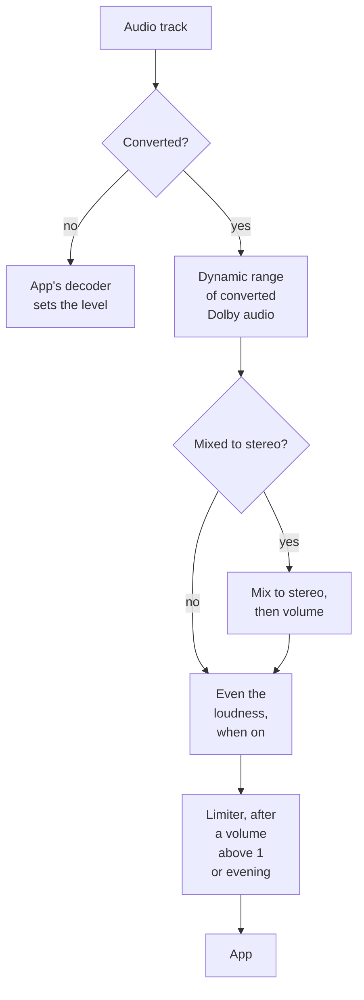

# Loudness

This page explains how loud a title plays and which settings change it. It is for administrators tuning converted audio, and for users who find some titles too quiet.

## Where the level is decided

How loud a title plays is decided in one place, which depends on how it plays:

| How it plays | Who sets the level |
|---|---|
| Direct play, or audio copied into HLS | The app's decoder. No server setting changes it. |
| Audio converted | The server, through FFmpeg and the settings on this page |

**Direct play and copied audio:** Polyfin sends the track as it is, byte for byte. The app's decoder sets the level:

- It mixes surround sound down to its own speakers.
- For AC-3 and E-AC-3 (Dolby Digital and Dolby Digital Plus), it decides whether to apply the track's dialogue level (dialnorm) and its dynamic range compression.
- Dolby decoders, in TVs, receivers, Apple devices and some phones, apply both. A track stating its dialogue at -27 dB plays 4 dB lower there than in a player built on FFmpeg, which ignores dialnorm.

**Converted audio:** FFmpeg's decoder ignores dialnorm. It applies the track's dynamic range compression as **Dynamic range of converted Dolby audio** says, **As encoded** by default.

- **Same channels** (5.1 to 5.1, or stereo to stereo): the audio keeps the source's level, to 0.1 dB, unless **Even the loudness of converted videos** is on.
- **Mixed down to stereo:** this happens when an app asks for 2 channels of a surround track. The audio goes through **Mix to stereo**, then **Volume when mixing to stereo**, then **Even the loudness of converted videos** when it is on. A limiter comes last, when the volume is above 1 or the loudness is evened.

### Which path an app takes

The app chooses the path:

- **jellyfin-web in Chrome, Firefox and Android's web view:** these cannot decode AC-3 or E-AC-3, so their audio is converted (see [Dolby audio in browsers](transcoding.md#dolby-audio-in-browsers)). It is converted to stereo when the browser reports 2 speakers.
- **jellyfin-web's Maximum allowed audio channels:** this setting, in the app's playback settings and kept by each browser, overrides what the browser reports.
- **E-AC-3 as it is:** the Jellyfin app for Android's integrated player, Android TV with bitstream output, and the iOS app's default web player receive it untouched.
- **The iOS app's native player:** it receives E-AC-3 as it is too. The exception is HEVC video with **Prefer fMP4 in HLS** on, where E-AC-3 is converted to AAC 5.1 (see [Two players in the Jellyfin iOS app](transcoding.md#two-players-in-the-jellyfin-ios-app)).

To tell which path a play takes, look at the end of its version's name: "(direct play)", "(direct stream)" or "(converted: audio)". jellyfin-web's Playback Info says it too (see [Seeing how a play goes](transcoding.md#seeing-how-a-play-goes)).

### What sets the level in direct play

In direct play, nothing on the server changes the level. The app sets it:

- **The file:** Polyfin sends it byte for byte, with the same fields as Jellyfin 12.4. Neither server sends a `NormalizationGain` on videos. Jellyfin computes it from a loudness it measures on songs and albums only ([`DtoService.cs`, lines 1295 to 1303](https://github.com/jellyfin/jellyfin/blob/v12.4/Emby.Server.Implementations/Dto/DtoService.cs#L1295-L1303); [`AudioNormalizationTask.cs`, lines 89 and 169](https://github.com/jellyfin/jellyfin/blob/v12.4/Emby.Server.Implementations/ScheduledTasks/Tasks/AudioNormalizationTask.cs#L89-L169)). jellyfin-web applies it in its audio player alone ([`htmlAudioPlayer/plugin.js`, lines 125 to 130](https://github.com/jellyfin/jellyfin-web/blob/v12.4/src/plugins/htmlAudioPlayer/plugin.js#L125-L130)).
- **The browser's decoder:** Chrome decodes AAC and HE-AAC, stereo and 5.1, to the same level as FFmpeg, to 0.1 dB. This was measured with HE-AAC 5.1 and stereo test files. Chromium mixes 5.1 down to a stereo device without lowering it: center, surround and LFE are added to the front at 0.707 ([`channel_mixing_matrix.cc`, lines 270 to 279](https://github.com/chromium/chromium/blob/d1a70bc/media/base/channel_mixing_matrix.cc#L270-L279)). A 5.1 file is not quieter there.
- **jellyfin-web's volume:** its video player plays at 100% at most, as a browser's media element cannot go higher. It keeps the last volume set, in each browser and in each Jellyfin app separately ([`htmlMediaHelper.js`, lines 7 to 12](https://github.com/jellyfin/jellyfin-web/blob/v12.4/src/components/htmlMediaHelper.js#L7-L12)). A volume lowered once stays lower for every title there.
- **Android 12 and older:** when the phone mixes 5.1 down itself, each channel is halved, 6 dB quieter. This happens with the Jellyfin app for Android's integrated player playing a 5.1 file. Android 12L and later mix at full level ([`ChannelMix.h`, lines 44 to 64](https://android.googlesource.com/platform/system/media/+/refs/heads/main/audio_utils/include/audio_utils/ChannelMix.h#44)).
- **Players that sound louder:** they usually boost by default. They use an audio normalizer that raises quiet passages and voices, or a volume that goes above 100%. To compare fairly, turn such a normalizer off and set every player to 100%.

## Audio settings

| Setting | Where | Default | What it does |
|---|---|---|---|
| **Mix to stereo** | **Settings › Conversion (transcoding) › Audio** | FFmpeg's own | How loud voices are against effects in a stereo mix. See [Mixing to stereo](#mixing-to-stereo). |
| **Volume when mixing to stereo** | **Settings › Conversion (transcoding) › Audio** | 2, as in Jellyfin (range 0.5 to 3) | Volume of the stereo mix. 1 changes nothing; above 1, a limiter follows it. |
| **Even the loudness of converted videos** | **Settings › Conversion (transcoding) › Audio** | Off | Brings converted video and channel audio to -16 LUFS. See [Evening the loudness](#evening-the-loudness). |
| **Dynamic range of converted Dolby audio** | **Settings › Conversion (transcoding) › Audio** | **As encoded** | How converted AC-3 and E-AC-3 apply their stored compression. See [Dynamic range of Dolby audio](#dynamic-range-of-dolby-audio). |

The other audio settings, **Most audio channels** and **Audio bitrate per channel in kb/s (0 = automatic)**, are on [Transcoding](transcoding.md#audio).

## Mixing to stereo

FFmpeg's own downmix adds the channels without lowering them. It uses the center and surround levels an AC-3 track states. A 5.1 track's voices, in the center, thus end up to 3 dB under the source's.

- **Volume when mixing to stereo:** 2 by default, it raises the mix by 6 dB.
- **A limiter:** it then holds the peaks of the stereo mix 1.5 dB under full scale. Loud scenes thus end at or under -1 dBTP once encoded. Without it, they would overload the encoder, which distorts them.

On a 5.1 test scene, voices sit at -26.8 LUFS in the center and effect bursts peak at -2.7 dBTP. The stereo mix measures:

| Volume | Voices alone | Whole scene | Peaks |
|---|---|---|---|
| 1 | -28.3 LUFS | -16.9 LUFS | -2.6 dBTP |
| 2 with the limiter, the default | -22.3 LUFS | -13.3 LUFS | -1.3 dBTP |
| 2 without a limiter, as in Jellyfin | -22.3 LUFS | -13.0 LUFS | +0.9 dBTP |

Each **Mix to stereo** choice sets how loud voices are against effects, before the volume. These were measured on the same scene against FFmpeg's own mix, the track stating a -4.5 dB center level:

| Mix | Left channel | Voices | Whole scene |
|---|---|---|---|
| FFmpeg's own | FL, C at the track's center level, SL at its surround level | 0 | 0 |
| Dave750 | 0.707 FL + 0.5 C + 0.707 SL + 0.5 LFE | -1.5 dB | -3.6 dB |
| Night mode (clearer voices) | C + 0.3 FL + 0.3 SL | +4.5 dB | -5.9 dB: effects in front and behind 10.5 dB lower |
| RFC 7845 | 0.53 FL + 0.37 C + 0.46 SL + 0.26 SR + 0.37 LFE | -4.0 dB | -6.1 dB |
| AC-4 | FL + 0.707 C + 0.707 SL | +1.5 dB | -0.6 dB |

- The right channel mirrors the left.
- Night mode suits speech at a low volume.
- RFC 7845 and Dave750 lower everything to stay under full scale.
- The mixes apply to the layouts Jellyfin lists for each, 5.1 and 7.1 among them.
- Music and audiobooks converted to stereo go through the same mix, volume and limiter.

**Compared with Jellyfin**

- Jellyfin 12.4 mixes down with the same filters at the same volume, 2 by default, but without a limiter. Its loud scenes pass full scale, and the encoder distorts them ([`EncodingOptions.cs`, lines 21 to 22](https://github.com/jellyfin/jellyfin/blob/v12.4/MediaBrowser.Model/Configuration/EncodingOptions.cs#L21-L22); [`EncodingHelper.cs`, lines 2975 to 2977](https://github.com/jellyfin/jellyfin/blob/v12.4/MediaBrowser.Controller/MediaEncoding/EncodingHelper.cs#L2975-L2977)).

## Evening the loudness

**Even the loudness of converted videos**, off by default, brings converted audio to -16 LUFS. It covers the movies, episodes and channels the server converts.

- **How:** FFmpeg's EBU R128 normalization (`loudnorm`), in one pass. Peaks stay at -1.5 dBTP at most, and the loudness range at 11 LU at most.
- **Order:** it comes after the stereo mix and its volume, and the limiter comes after it. The normalizer measures what the volume made.
- **Volume:** with it on, **Volume when mixing to stereo** no longer changes the level, only the balance **Mix to stereo** sets.
- **Left alone:** direct play, copied audio, music and audiobooks never go through it. Music has its own evening, **Even the volume between songs**, which apps apply.

Measured through Polyfin:

| Source | Sent | Off | On |
|---|---|---|---|
| Test scene, voices alone | Stereo | -22.3 LUFS | -15.9 LUFS |
| Test scene, voices alone | 5.1 | -26.8 LUFS | -15.9 LUFS |
| Test scene, 1 minute, loudness range 15 LU | Stereo | -13.3 LUFS | -18.2 LUFS |
| Test scene 12 dB quieter | Stereo | -22.9 LUFS | -18.2 LUFS |
| E-AC-3 7.1 from a movie | Stereo | -17.3 LUFS | -16.0 LUFS |
| E-AC-3 stereo from a series | Stereo | -27.7 LUFS | -16.0 LUFS |
| AC-3 stereo from a movie, peaks 19 dB above its loudness | Stereo | -31.5 LUFS | -20.8 LUFS |

Limits of the one pass:

- The normalizer reads 3 seconds ahead and settles over the first seconds of each conversion.
- A short scene with a wide loudness range ends up to 2 LU under the target.
- The sound of a live channel starts some 3 seconds later.
- A track whose peaks stand far above its loudness rises only as far as its peaks allow under -1.5 dBTP.
- Each seek starts a new conversion, which settles again.

**Compared with Jellyfin**

- Jellyfin has no normalization of converted video's audio. Its own loudness normalization is for music, as `NormalizationGain`.

## Dynamic range of Dolby audio

**Dynamic range of converted Dolby audio** sets how converted AC-3 and E-AC-3 apply the compression stored in the track. That compression lifts quiet passages and lowers loud ones.

| Choice | What it does |
|---|---|
| **As encoded** (default) | Applies it as stored, as FFmpeg and Jellyfin decode these tracks |
| **None (full range)** | Leaves it out (`-drc_scale 0`) |
| **Night (quiet passages louder)** | Lifts quiet passages twice as much as encoded, and lowers loud ones as encoded (`-drc_scale 2`) |

Night lowers loud passages only as encoded, because FFmpeg's decoder applies a scale above 1 to lifts alone ([`ac3dec.c`, lines 988 to 995](https://github.com/FFmpeg/FFmpeg/blob/n9.0.2/libavcodec/ac3dec.c#L988-L995)). It is a decoder option:

- It never touches direct play or copied audio, nor other codecs.
- It comes before the mix and the normalizer.

The table below was measured through Polyfin, in a browser taking stereo, on FFmpeg's test samples from movies and series. Each figure is against **None**, as the gain on the loudest and the quietest tenth of their 100 ms windows:

| Track | As encoded: loud / quiet | Night: loud / quiet | Range of levels, none / encoded / night |
|---|---|---|---|
| E-AC-3 7.1 from a movie | -0.3 / +5.8 dB | -0.2 / +11.6 dB | 16.8 / 14.0 / 11.5 dB |
| AC-3 stereo from a movie | -0.3 / +5.5 dB | -0.2 / +11.6 dB | LRA 19.7 / 14.0 / 8.9 LU |
| E-AC-3 stereo from a series | +0.1 / +0.6 dB | +0.2 / +1.1 dB | 22.8 / 22.4 / 21.9 dB |

Tracks made by FFmpeg's own encoder carry no compression, and play the same with each choice.

**Compared with Jellyfin**

- Jellyfin decodes AC-3 and E-AC-3 with FFmpeg's defaults, as **As encoded** does, and has no choice of dynamic range.

## Louder sound

Some players sound louder than the web player. They normalize the sound, or let the volume go past 100%, which jellyfin-web never does. Two options, both off by default, make a user's videos louder, each with its cost.

- **Who sets them:** the user, under **My account › Sound**. An administrator sets them in the **Playback and access** section of the user's page or of a group's page.
- **Groups:** a member who follows their group keeps the group's. **My account** shows them, with "Your group sets these".

| Option | What it does | Cost |
|---|---|---|
| **Boost the volume in the web player** | Makes videos louder in the web player, in a browser and in the Jellyfin apps for Android and iOS that show it: about 8 dB on quiet passages and 5 dB on loud ones. | Addon streams go through the server, taking its bandwidth. No effect in apps' own players, nor on HLS that Safari, an iPhone or an iPad plays. See [Loudness in the web player](#loudness-in-the-web-player). |
| **Convert the sound to even it** | The server converts the audio of the user's videos and channels and evens it at -16 LUFS, the picture copied. Every app plays it louder and evenly. | Nothing plays directly for that user. Each play takes a little of the server's processor. Surround sound reaches a receiver converted. See [Louder sound for one user](#louder-sound-for-one-user). |

**Boost the volume in the web player** works through a gain and a compressor in the browser itself. The player's volume still works, and its settings menu gets **Boost the volume**, which turns it on and off. The browser can boost only sound it reads from the page's own server, or from another site that allows it. So, for a user who boosts, on a device where the web player has started, the server sends addon streams itself.

**Compared with Jellyfin**

- Jellyfin has neither option: its web player plays videos at most at 100%, and it normalizes music only.

## Louder sound for one user

**Convert the sound to even it**, a user's option (see [Louder sound](#louder-sound)), sends every app of that user its sound converted and evened. It uses the same normalization as **Even the loudness of converted videos**, at -16 LUFS with the limiter, whether that setting is on or not.

- **Versions that played as they are:** they stream over HLS instead, video copied and audio converted, with the app's channels, 5.1 included. The name ends "(converted: audio)". Its `TranscodeReasons` say `DirectPlayError`, as Jellyfin has no reason for a choice of the user.
- **Versions already converted:** one whose video is converted anyway gets its audio converted and evened too.
- **No video conversion for it:** the audio is converted only where it costs no video conversion. These versions play as they do for other users:
  - one whose video the app plays only converted over HLS, such as an MPEG-TS file whose keyframes are not read;
  - one whose subtitle would then be burned in;
  - one whose keyframe index cannot be read.
- **Users without conversion:** every version plays as for other users when the user may not use conversion.
- **Prefer versions the app plays without conversion:** it counts a version whose video is copied as one without conversion for that user. Every version they play has its audio converted.
- **Channels:** they follow, converted as they come. Their sound starts some 3 seconds later (see [Evening the loudness](#evening-the-loudness)). A source a play switches to keeps the normalization.
- **Left alone:** music and audiobooks, which apps even with their own normalization. DLNA devices and guests of share links play as before.

The cost is direct play:

- Each play takes a little of the server's processor.
- A torrent's first play waits for its keyframe index.
- Surround sound reaches a receiver as converted AAC or AC-3, rather than as the original track.

Measured through Polyfin with jellyfin-web 12.4's Chrome profile, a stereo scene at -29.6 LUFS plays at -17.3 LUFS, peaks at -1.6 dBTP, its H.264 copied. Its one-pass normalization settles under the target on a one-minute scene with loud bursts, as above.

**Compared with Jellyfin**

- Jellyfin has no such option.

## Loudness in the web player

For a user with **Boost the volume in the web player**, Polyfin's script in the web player sends the sound of each video through Web Audio. It applies a gain of 2, then a compressor that holds the peaks. The user turns it on as in [Louder sound](#louder-sound).

Measured in Chrome on jellyfin-web 12.4, with the player's volume at 100%:

| Passage | Before | After |
|---|---|---|
| Quiet | -28.9 dB RMS | -20.8 dB RMS (+8.2 dB) |
| Loud | -15.1 dB RMS | -10.3 dB RMS (+4.8 dB) |
| Peaks | -2.8 dBFS | +0.2 dBFS at most |

- **Volume:** the player's volume applies before the boost. At 50%, the sound is 6 dB lower, boosted or not.
- **When it applies:** the script asks the server for the user's choice as they sign in and as each video starts. It builds the boost for a video's element once, as it starts playing.
- **Turning it on and off:** **Boost the volume**, in the player's settings menu, applies at once and saves the choice, as **My account › Sound** does.
- **A video already playing:** one started before the boost was turned on in the menu is boosted from the next one, and a message says so.
- **Turning it off:** once boosted, an element stays in Web Audio. Turning the boost off sends its sound straight to the speakers.

**Safari and iOS:** Safari lets a page's audio start only inside a click or a tap. A video starts playing later, once the web player has asked the server how to play it.

- For a user who boosts, the script starts the page's audio at their first click or tap, the one on Play included. The first video after the page loads is thus boosted too.
- That audio is suspended again 3 seconds after a click, a pause or the end of a video while no boosted video plays. It then holds nothing of the device, such as an iPhone's sound for another app. It resumes as a boosted video plays.
- Measured in Safari on iOS 27, the first video after the page loads, one played again after a pause and the next ones rise as much as in Chrome.

**Which streams it boosts:** A browser plays silent the sound of another site's stream that Web Audio reads without that site's consent (CORS). So the script boosts only:

- streams the page plays through its HLS player, hls.js, which fetches them itself;
- files fetched with CORS, as the web player fetches the server's own;
- streams the server relays and marks so (`PolyfinRelay=1` in their address).

For a user who boosts, the server relays the streams of addons once the web player of a device has asked for their choice. It would otherwise send the player to fetch them from their source. Relaying takes the server's bandwidth.

It never boosts HLS the browser plays itself, as Safari, an iPhone and an iPad do, whose sound Web Audio may not get. There, and in the apps' own players, nothing changes.

**Compared with Jellyfin**

- jellyfin-web on a Jellyfin server plays videos at most at 100%. It sends only music through Web Audio, for its normalization.
