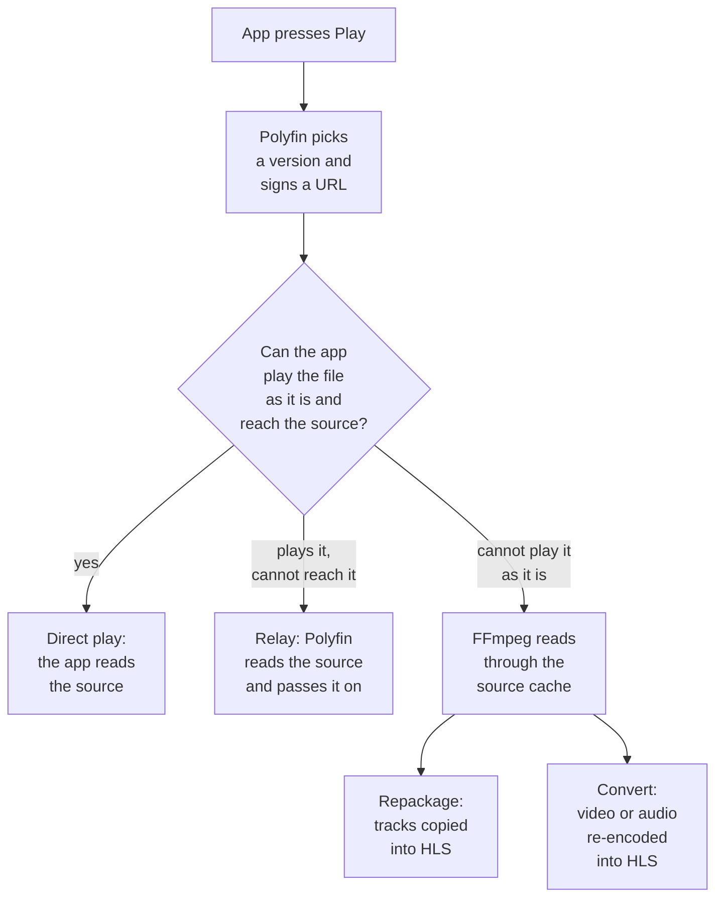

# Playback

How a title plays in Jellyfin apps, how analysis picks a working version, chapters, and Watch together.

See also [Versions](versions.md), [Audio and subtitle tracks](audio-and-subtitle-tracks.md), [Reading the sources](reading-the-sources.md) and [Scrubbing thumbnails](scrubbing-thumbnails.md).

## How a title plays

Polyfin handles sign-in, accounts, browsing, metadata, source choice and playback state. Apps get Polyfin's stream URLs, signed for the user, never the addons' URLs:

| Mode | When | What the server does |
|---|---|---|
| Direct play | The app plays the version as it is | Redirects to the provider's URL; the stream skips the server |
| Relay | The app cannot reach the source: request headers, local network address, torrent, or unfollowable redirect | Reads the stream and passes it on |
| Repackage or convert | The app cannot play the file as it is | FFmpeg reads through the source cache; Polyfin serves HLS. See [Transcoding](transcoding.md) |

The mode decides server bandwidth.

API details: [Direct play and media source paths for apps](jellyfin-api.md#direct-play-and-media-source-paths-for-apps).

## Versions and analysis

A title's details list each addon stream as a version (see [Title pages](versions.md#title-pages)). On first play, Polyfin analyzes a version with ffprobe in a few seconds and keeps the result. Like a Jellyfin server, it then tells the app whether it can play the version as it is.

### Addon order of versions

Versions keep the addons' order: the server's sources as in **Content › Sources**, folders included, then the user's own addons. The [version order](versions.md#version-order) settings can reorder them, also by source, or hide some. Picking or playing a version never moves it.

### Skipped versions

When the app picked no version, Polyfin skips and leaves out of its list any version that cannot be read, does not play on the app, or needs HLS but has an unreadable keyframe index. The rest keep their order from the chosen one, for apps that let the user pick there.

### Analysis timing

Up to 3 versions are analyzed at once, taken in order. When a later one is ready, Polyfin waits 3 more seconds for earlier ones, then plays it. A silent source thus costs 3 seconds, not the whole analysis. Unfinished analyses continue in the background for the next play.

### Which version plays

The title's page plays the version the app sends. Most apps (the web player, Android TV, Swiftfin) send the title's identifier, which names the first version, so Polyfin chooses among all versions. Only a version picked in the version menu, under its own identifier, plays alone.

### Other app features

- Saved playback preferences (audio and subtitle languages, subtitle mode) pick the default tracks; otherwise the server's [default languages](audio-and-subtitle-tracks.md#default-audio-and-subtitle-languages) apply. See [Subtitles](subtitles.md).
- Apps that keep titles for offline viewing can download movies and episodes whose versions they were shown: the version's file under its name, sent to the source or relayed, or a smaller copy with [Converted downloads](transcoding.md#converted-downloads).
- Jellyfin apps' dashboards show active playback.
- Apps can control one another (play, pause, seek, messages) if the controlled app keeps Jellyfin's live connection (WebSocket) open.
- Skip intro, recap and credits buttons come from four community databases, the version's chapters and, for local folders' episodes, their audio (see [The four databases](skip-segments.md#the-four-databases)). The databases get only titles' IDs, episode numbers and runtimes.
- **Describe versions from RemuxDB** shows versions' tracks before play, from what the community database [RemuxDB](https://remuxdb.1632022.xyz) found in the same files. It gets only titles' IDs. See [Tracks from RemuxDB](versions.md#tracks-from-remuxdb).

**Compared with Jellyfin**

- Jellyfin 12.4 lists first the version an app opens, so jellyfin-web's menu reorders after a pick. Polyfin keeps the menu as it was.
- Jellyfin's PlaybackInfo lists unreadable and unplayable versions too.
- If the app names no audio track and none is flagged default, Polyfin checks the first track against the app's profile. An undecodable track is converted, and drops "(direct play)".
  - Jellyfin 12.4 checks no audio then, and plays the file as it is ([`StreamBuilder.cs`, lines 675 to 707](https://github.com/jellyfin/jellyfin/blob/v12.4/MediaBrowser.Model/Dlna/StreamBuilder.cs#L675-L707) and [1362 to 1372](https://github.com/jellyfin/jellyfin/blob/v12.4/MediaBrowser.Model/Dlna/StreamBuilder.cs#L1362-L1372)).
  - jellyfin-web never hits this on Jellyfin, which always lists tracks. An unanalyzed Polyfin version lists none, so jellyfin-web names no track, and browsers played AC-3, E-AC-3 or DTS silently. Channels too.
- Video without audio is logged at Info once per version as "A version has no audio track", with the number of tracks found.

API details: [Version picking in PlaybackInfo for apps](jellyfin-api.md#version-picking-in-playbackinfo-for-apps).

## Chapters

Analysis also reads chapters, which apps show and let you skip through. Apps get the chapters of the version opened or played; an unplayed version has none yet.

- Chapters named intro, recap, preview or credits also give skip buttons (see [Segments of each version](skip-segments.md#segments-of-each-version)).
- Chapter images are off unless you turn them on (see [Scrubbing thumbnails and chapter images](scrubbing-thumbnails.md)).
- Chapters are always sent; they come with the first-play analysis, so never delay playback.

## Watching together

Watch together (SyncPlay in Jellyfin), the web player first, plays titles in step across devices and users. Each person joins from their own device: nobody can add someone else to a group.

1. One person opens the SyncPlay menu, the people icon at the top of the web player, and chooses "Create a new group".
2. The others open the same menu on their own device and join that group, named after the person who created it.
3. Whoever then plays a title starts it for everyone. Pause, Play and seeking also act for the whole group.

**From a title's page:** "Watch together" in the ⋮ menu of a movie or an episode does the first step with that title.

- It creates a group, or uses the one the device is already in, and opens the title paused at its start.
- A message says how the others join. Once they are in, press Play: it starts for everyone at once.
- It shows to users whose **Watch together** access is Create and join (see [Watch together](user-limits.md#watch-together)), in a web player that offers SyncPlay.
- A message says why it can't start: SyncPlay turned off for the user, an access that only joins groups, a title with no source yet, or a group where someone can't play the title.

How groups behave:

- Any member can set what plays (up to 5,000 entries), play, pause and seek.
- Groups start and resume on Polyfin's clock, slightly ahead so every app is ready.
- Groups wait up to 30 seconds for loading or buffering apps.
- Every user may create and join groups, but only users who can see everything a group plays can see or join it. Nothing hidden from a member is queued.
- A session leaves when its app disconnects or is signed out (by the app, a password change, or an administrator).
- A group ends once everyone has left it, and when Polyfin restarts. A new watch together then starts with a new group.
- Apps need Jellyfin's live connection (WebSocket) open.
- Some Jellyfin apps don't support SyncPlay, so they can neither create nor join a group. The web player does, and so do the Jellyfin apps that show it, on computers and phones.

**Compared with Jellyfin**

- Like Jellyfin, Polyfin keeps the groups in memory.
- Jellyfin has no "Watch together" entry: its web player starts a group from the SyncPlay menu only.

*Default audio and subtitle languages* moved to [Audio and subtitle tracks](audio-and-subtitle-tracks.md#default-audio-and-subtitle-languages).

*Regional audio* moved to [Audio and subtitle tracks](audio-and-subtitle-tracks.md#regional-audio).

*Remembered track choices* moved to [Audio and subtitle tracks](audio-and-subtitle-tracks.md#remembered-track-choices).

*Carrying a play on* moved to [Reading the sources](reading-the-sources.md#carrying-a-play-on).

*Keeping the files read across restarts* moved to [Reading the sources](reading-the-sources.md#keeping-the-files-read-across-restarts).

*Preloading the next episodes* moved to [Reading the sources](reading-the-sources.md#preloading-the-next-episodes).

*Sources that fail* moved to [Reading the sources](reading-the-sources.md#sources-that-fail).

*When images are made* moved to [Scrubbing thumbnails](scrubbing-thumbnails.md#when-images-are-made).

*Label rules* moved to [Versions](versions.md#label-rules).

*Live videos* moved to [Versions](versions.md#live-videos).

*Local files first for some users* moved to [Versions](versions.md#local-files-first-for-some-users).

*Title pages* moved to [Versions](versions.md#title-pages).

*Version names* moved to [Versions](versions.md#version-names).

*Version order* moved to [Versions](versions.md#version-order).

*Versions of a title* moved to [Versions](versions.md#versions-of-a-title).

*Versions of another title* moved to [Versions](versions.md#versions-of-another-title).

*Which streams become versions* moved to [Versions](versions.md#which-streams-become-versions).

