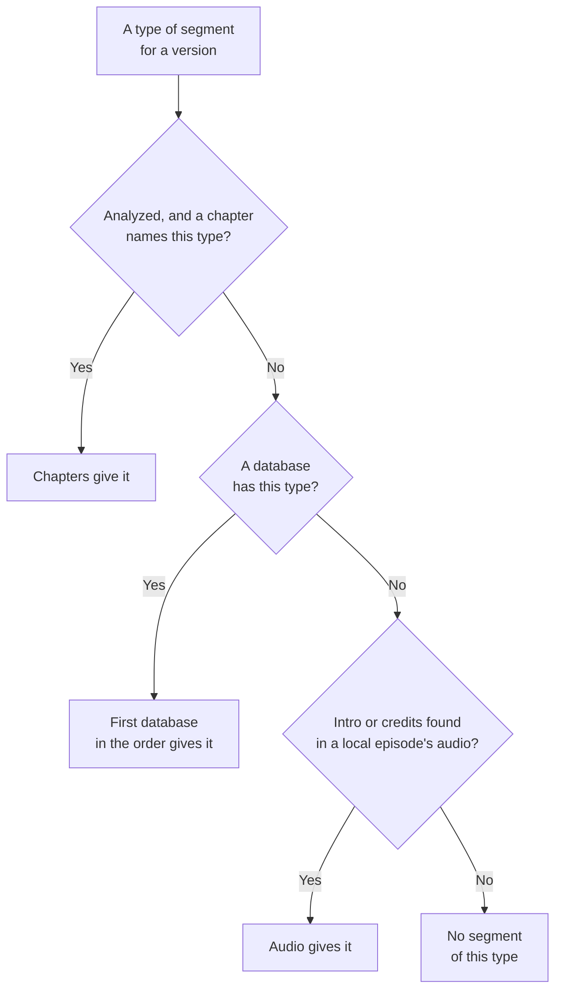

# Skip segments

This page is for administrators who set up skip buttons. Viewers use them to skip intros, recaps, credits, previews, and the commercials of recordings. The page covers where the segments come from, how Polyfin finds intros and credits in the audio of local episodes and commercial breaks in Live TV recordings, and how to set up the databases.

## How skip buttons work

**Skip intro and credits buttons** gives apps the intros, recaps and credits to skip.

| Setting | Where | Default | What it does |
|---|---|---|---|
| **Skip intro and credits buttons** | **Settings › Content** | On | Gives apps the segments to skip. Off, apps get none, no segment database is asked, no episode's audio is read, and the commercials found in recordings are not given. |

For each type of segment, a movie or an episode takes it from the first source that has one:

1. the version's own chapters, once the version is analyzed (see [Segments of each version](#segments-of-each-version));
2. the databases, in the order set under **Skip marker sources** (see [Source order](#source-order));
3. the audio, for intros and credits of episodes in local folders (see [Intros and credits found in the audio of local episodes](#intros-and-credits-found-in-the-audio-of-local-episodes)).

A Live TV recording gets only the commercial breaks found in it (see [Commercials of recordings](#commercials-of-recordings)).

**Compared with Jellyfin**

- Turned off, the server behaves as a Jellyfin server without a segment provider.

API details: [Media segments for apps](jellyfin-api.md#media-segments-for-apps).

## The four databases

The segments come from four community databases: TheIntroDB, IntroDB, PublicMetaDB and SkipDB. Polyfin asks them about a title the first time an app asks for its segments.

- For each type of segment (intro, recap, credits, preview), the first database that has one gives it.
- The other databases fill the gaps.

| Database | Key | Segment types |
|---|---|---|
| TheIntroDB | Optional (see [TheIntroDB key](#theintrodb-key)) | Intros, recaps, credits and previews |
| IntroDB | None | Intros, recaps and credits |
| PublicMetaDB | Required: without one it is not asked (see [PublicMetaDB key](#publicmetadb-key)) | Intros and credits, and also recap and preview markers on episodes |
| SkipDB | None (see [SkipDB](#skipdb)) | Intros, recaps, credits and previews |

## Segments of each version

The databases time a title once, but the versions addons offer may be cut differently. Once Polyfin has analyzed a version, at its first play, it fits the segments to that version.

- A file's own chapters win, for that file. Chapters that name an intro, a recap, a preview or credits give that version's segments of that type, in place of the databases'.
- Other versions keep the databases' segments.
- Segments never pass the end: a segment ends at the latest where the version ends.
- A segment starting at or after the version's end is left out.
- Credits that run to the end stop 1 second early, so that the web player (jellyfin-web) offers its skip button.
- Skipping then lands a second before the end, and the next episode starts, or the movie ends.
- When the title's listed runtime is shorter than the file, such credits end exactly at the file's end instead. The web player then shows its "Up Next" card rather than a skip button.
- The web player shows neither while its controls are on screen when the credits start: it offers a segment only once, as playback enters it.
- Credits that run over a scene, during or after them, are split around it, so that skipping lands on the scene (see [Scenes during and after the credits](#scenes-during-and-after-the-credits)).
- A version not analyzed yet gets the databases' segments as they are.
- Asking for a version's segments never starts an analysis.

**Chapter names:** Polyfin follows the default names of Jellyfin's Chapter Segments Provider plugin, adds French, and leaves out its commercial breaks. Names count in any letter case, with or without accents, as whole words.

| Segment | Chapter names |
|---|---|
| Intro | intro, introduction, opening, OP, "générique de début", "générique d'ouverture", "ouverture". "Opening Credits" is an intro. |
| Preview | preview, "next time on", "next on", "next episode", "sneak peek", "aperçu", "prochainement", "prochain épisode", "à suivre" |
| Recap | recap, previously, "last time on", "last on", "récapitulatif", "résumé", "précédemment", "épisode précédent" |
| Credits | credits (end or closing credits), closing, ending, ED, outro, "crédits", "générique de fin", "générique final" |

- A name is tried as an intro, then as a preview, a recap and credits, as the plugin does: "Credits and Preview" is a preview.
- OP and ED count only as the whole name, maybe followed by a number.
- "OP", "op 1", "ED2" and "ED - 2" count, while "Ed Wood" and "OP Center" do not.
- A chapter named as a scene during or after the credits, such as "Post-Credits Scene", is not credits (see [Scenes during and after the credits](#scenes-during-and-after-the-credits)).
- Chapters with other names, such as "Chapter 2", give no segment.
- Chapters give segments even with no database asked.
- A chapter's segment runs from its start to the next chapter's start, or to the version's end for the last chapter.
- Chapters of the same type in a row make one segment.

**Why credits stop early:** jellyfin-web shows no skip button for credits that reach the title's listed runtime, when something follows in its queue. Its video page shows its "Up Next" card instead, but only for credits that reach the end of the version it plays.

- Credits count as running to the end when they end within 2 seconds of it.
- They stop early only when the listed runtime is at least the version's length.
- They stop early only when they still last 3 seconds, as jellyfin-web ignores shorter segments.

### Scenes during and after the credits

A movie or an episode may hold a scene within its credits, between two parts of them, or after them. Credits running over it would have **Skip** jump past it. Once a version is analyzed, Polyfin splits its credits around such scenes.

- Skipping the credits lands on the scene.
- The web player offers the credits after the scene again as playback enters them.

Polyfin finds a scene in two places.

**In the version's chapters:** a chapter named as a scene during or after the credits.

- The names are "post-credits", "mid-credits", "after credits", "after the credits" and "stinger", with or without a hyphen or the s.
- In French, the names are "post-générique", "mi-générique" and "après le générique".
- Names count as the other chapter names do.
- Such a chapter is not credits, though its name says credits.
- It runs to the next chapter's start, or to the version's end for the last chapter.

**In its dialogue:** lines of dialogue that resume within the credits after 20 seconds without any, since the credits started or since the lines before.

- At least 3 lines are needed, with no such gap between them.
- The lines last 10 minutes at most: longer is the title itself, under credits timed too early.
- The scene starts 5 seconds before its first line, as a scene starts before its first word.
- The scene ends with its last line, which may come after the credits' end.
- Lines that are not dialogue are left out: lyrics, marked with a note (♪) or with "#", and descriptions in brackets, such as "[music]" or "(singing)".
- Credits over a song, with only its lyrics, are not split.

The dialogue is what Polyfin already has of the version: nothing is read or synced for it. It is the first of these:

1. a text track inside the version's file, read whole before (see [Text tracks inside files](subtitles.md#text-tracks-inside-files)), with at least 20 lines, forced tracks left out as they show only some lines;
2. else an addon subtitle synced to the version (see [Addon subtitles synced to the version](subtitles.md#addon-subtitles-synced-to-the-version)) and read lately, timed as synced, with at least 20 lines: the one with the most lines.

- A version without either has its credits split by its chapters only.
- Once its dialogue is at hand, apps asking for its segments again get them split by its dialogue too.
- A part of the credits shorter than 3 seconds, before or after a scene, is left out, as the web player ignores such segments.
- The last part of the credits follows the rules above: when it runs to the end, it stops a second before it, or ends at the file's end when the listed runtime is shorter.
- A chapter right after credits chapters needs no rule of its own: the credits chapters end where the next chapter starts.
- Credits found in the audio of local episodes are split too (see [Intros and credits found in the audio of local episodes](#intros-and-credits-found-in-the-audio-of-local-episodes)).
- A version not analyzed yet keeps the databases' credits whole.

**Compared with Jellyfin**

- Jellyfin finds no such scene, and its credits run over it. jellyfin-web offers each segment as playback enters it, several `Outro` segments included, and **Skip** seeks to the segment's end (jellyfin-web 12.4, `src/apps/legacy/features/playback/utils/mediaSegmentManager.ts`, lines 37-57 and 123-144).

API details: [Media segments for apps](jellyfin-api.md#media-segments-for-apps).

## Intros and credits found in the audio of local episodes

Polyfin finds intros and credits in the audio of local episodes that have none from their chapters or the databases. An intro is the stretch of audio the episodes of a season share near their start. Credits are the stretch they share near their end.

| Setting | Where | Default | What it does |
|---|---|---|---|
| **Find intros and credits in local episodes’ audio** | **Settings › Content** | On | Compares the audio of the episodes of a local season to find their intro and their credits. Off, or with the skip buttons off, no audio is read and the segments found are not given. |

**When:** an episode of a local folder played with no intro or no credits from its chapters or a database has its season compared in the background.

- The season's other episodes have their intro and credits at their next play.
- The episode just played has them from its next play.
- Only seasons someone watches are read: nothing is read ahead of a play.
- Seasons are compared one at a time.
- FFmpeg reads the audio at the lowest priority, so that playback goes first.
- An episode added to a season already compared is compared with the others the next time one of them is played.

**How:** Polyfin reads the start and the end of each episode of the season.

| Part | Read | Shared stretch kept |
|---|---|---|
| Start | The first quarter, 10 minutes at most | 15 seconds to 2 minutes: the intro |
| End | The last quarter, 10 minutes at most | 15 seconds to 3 minutes: the credits |

- FFmpeg decodes the audio, and Polyfin makes its fingerprint itself.
- Any build of FFmpeg serves: FFmpeg's `chromaprint` muxer is an optional part of its builds, missing from some.
- Polyfin compares the episodes in pairs: the longest stretch two episodes share is each one's intro, or credits.
- Credits end where the shared stretch ends: a scene after the credits, which differs from one episode to the next, is not skipped.
- Credits that run to the end follow the rules of [Segments of each version](#segments-of-each-version).
- They stop 1 second early for the web player's skip button, or end at the file's end for its "Up Next" card when the listed runtime is shorter.
- Two files of the same episode, such as two versions, are not compared with each other: they share all their audio.

**Kept:** fingerprints and the segments found are kept in the database by file, with its path, size and modification time.

- A file is read once, and again only when it changes.
- A file that changed has no intro or credits until its season is compared again.
- Once a scan of a local folder finds a file gone or changed, what was kept of it is deleted.

**Order:** the audio only fills the gaps, as the diagram in [How skip buttons work](#how-skip-buttons-work) shows. An episode whose chapters name credits but no intro gets its credits from its chapters and its intro from the audio.

**Limits:**

- A season needs two episodes sharing the intro, or the credits.
- An episode alone in its season, or the only one with this intro or these credits, gets none.
- An intro or credits whose music changes within a season may be missed, or found only between the episodes that share the same music.
- Only episodes of local folders read as one file are compared, on the server's disk or on a share.
- Discs and disc images, which FFmpeg reads through their input, are not compared.
- Addons' files are not compared: their start and end would have to be downloaded for every episode.
- An intro that starts after the first quarter of an episode, or after its first 10 minutes, is not found.
- Credits are found only within an episode's last quarter and its last 10 minutes.
- Credits that start earlier are found from there on. Credits that end earlier are not found.

## Commercials of recordings

Polyfin can find the commercial breaks of a Live TV recording, which apps then offer to skip as `Commercial` segments. A recording is the channel's stream as it aired, commercials included (see [How a recording is made](recordings.md#how-a-recording-is-made)).

| Setting | Where | Default | What it does |
|---|---|---|---|
| **Find commercials in recordings** | **Settings › Recordings** | Off | Reads each recording once it ends to find its commercial breaks. Off, no recording is read. |

**When:** a recording is read once it is finished, partial recordings included, in the background.

- Recordings are read one at a time.
- FFmpeg reads them at the lowest priority, so that playback and recording go first.
- **Find commercials in recordings**, a task under **System › Schedule**, reads the recordings not read yet.
- Those are recordings that ended while the setting was off or the server stopped, and those made before it was turned on.
- The task runs every day, and when started by hand. While the setting is off, it reads nothing.
- A recording is read once. One where nothing was found is not read again.

**How:** FFmpeg decodes the recording's video, scaled down to a small picture as soon as it is decoded, and its audio. It marks the moments that are both black (its `blackdetect` filter) and silent (its `silencedetect` filter, below -50 dB). Channels part a programme from its commercials, and the commercials from one another, with such moments.

- A break is a run of pieces between such moments, each 5 to 90 seconds long, lasting 30 seconds to 8 minutes in all.
- A longer run is not a break.
- The recording's start counts as such a moment: a recording that starts early, as with **Start recordings early (minutes)**, may open on a break.
- Two moments less than a second apart count as one, as a fade to black flickers.
- A break runs from the start of the moment before it to the end of the moment after it, so that skipping it lands on the programme.
- A black scene in silence within a programme is one moment alone: it parts no commercials, and gives none.

**Served:** while **Skip intro and credits buttons** is on, `/MediaSegments/{id}` lists a recording's breaks as `Commercial` segments.

- Its media source then says `HasSegments: true`.
- Apps act on them as each user chose in their app's playback settings.
- The web player, for one, skips commercials, asks first, or plays them, by its setting for that segment type.
- Users get the segments of the recordings they see, as for the recordings themselves.

**Kept:** what was found is kept with the recording, by its identifier. It stays when the recording's file is replaced, and is deleted with the recording.

**Limits:**

- A recording longer than 4 hours is not read, and gets none.
- A reading that takes longer than the recording lasts stops, and the recording gets none, as on a server too slow to decode its video.
- A recording without video or without sound gets none.
- On channels that do not part their commercials with moments both black and silent, breaks are missed.

## Source order

**Skip marker sources**, under **Settings › Content** below **Skip intro and credits buttons**, sets the order of the databases and which are on. It lists the four databases with arrows to move them and a switch to turn each on or off.

- The default order is TheIntroDB, IntroDB, PublicMetaDB, SkipDB, all on.
- At the first start, `POLYFIN_SEGMENTS` gives the order and which are on (see [Configuration](configuration.md)).
- PublicMetaDB, on without a key, is marked as needing one.
- A server upgraded from a version without SkipDB gets it last in its order, turned on.
- If every other database was turned off, SkipDB stays off too.
- The order and the switches apply at once when saved, to the answers already kept too.
- A database turned off is never asked, wherever it is in the list.

## PublicMetaDB key

PublicMetaDB is asked only with an API key. Create one on the PublicMetaDB website (Settings, then API), then paste it in **PublicMetaDB key**.

| Setting | Where | Default | What it does |
|---|---|---|---|
| **PublicMetaDB key** | **Settings › Content** | Empty | API key PublicMetaDB is asked with. Without one, PublicMetaDB is not asked. |

- Polyfin checks the key with PublicMetaDB before saving it.
- It refuses a key PublicMetaDB refuses, or cannot be asked about.
- The key is never logged, and never sent back with the settings.
- It shows as dots. Administrators can show it again with its eye (see [Showing a saved key](administration.md#showing-a-saved-key)).
- With `POLYFIN_SECRET_KEY` set, it is stored encrypted (see [Stored keys and tokens](configuration.md#stored-keys-and-tokens)).
- An empty field removes the key.
- Saving, changing or removing the key applies at once, without a restart.
- Titles asked about before a key was saved are asked again once one is.
- Should PublicMetaDB refuse the key later, Polyfin logs it once and asks no more until another key is saved.

### How PublicMetaDB matches titles

- PublicMetaDB knows titles by their TMDB identifier only: a movie's, or a series' with the season and episode numbers.
- It keeps one record per contributor and release.
- Polyfin uses the record of a streaming release giving the most segments, the latest first.

## TheIntroDB key

TheIntroDB answers without a key. **TheIntroDB key (optional)**, next to the PublicMetaDB key, is a TheIntroDB API key.

| Setting | Where | Default | What it does |
|---|---|---|---|
| **TheIntroDB key (optional)** | **Settings › Content** | Empty | Raises TheIntroDB's daily limit and includes your own submissions. |

With a key:

- TheIntroDB's daily limit goes from 500 requests per address to 1,000 per account;
- its answers include your own submissions, even pending ones, weighted more.

### How the key is checked

TheIntroDB's answers ignore a key they do not know. So Polyfin checks the key before saving it, with an empty submission that submits nothing.

- The check is `POST /v4/submit`, as submissions belong to TheIntroDB's current API, v4.
- Segment times are still read from `GET /v3/media`, which TheIntroDB keeps answering.

| TheIntroDB | The key is |
|---|---|
| Refuses only the empty submission | Saved |
| Refuses the key | Refused |
| Cannot be asked, or answers otherwise | Not saved |

- The key is kept secret, shown and stored like PublicMetaDB's, and applied at once.
- Should TheIntroDB refuse it later, Polyfin logs it once and keeps asking TheIntroDB without it until another key is saved.

## SkipDB

[SkipDB](https://skipdb.tv/) answers without a key. Polyfin only reads it, and has no setting for a key.

### How SkipDB matches titles

- SkipDB knows titles by their IMDb identifier only: a movie's, or a series' with the season and episode numbers.
- A title Polyfin knows only by another identifier, such as a TMDB one, is not asked about.
- Polyfin sends the title's runtime, in seconds, when it knows it, as it does to TheIntroDB.
- For each type of segment, SkipDB then gives the one timed on the release of the closest duration.
- When the durations differ by a few seconds, SkipDB moves the segment earlier, never later.
- A segment SkipDB matched `out-of-range`, timed on a release whose duration differs too much, is left out: its times may not fit the version played.
- The next database in the order may give that type instead.
- Its intro, recap, outro and preview become Jellyfin's `Intro`, `Recap`, `Outro` and `Preview` segments.
- SkipDB rates each segment from 0 to 1. Polyfin keeps that rating with the segment and gives it to Silo's apps (see [Silo's apps](silo-apps.md#skip-markers)).
- A rating outside 0 to 1 is left out.
- SkipDB allows 120 requests a minute. Beyond, it answers 429 with a `Retry-After`, which Polyfin waits out (see [Caching](#caching)).

### SkipDB data license

The skip segments from SkipDB are © SkipDB and its contributors, under the [Open Database License (ODbL) 1.0](https://opendatacommons.org/licenses/odbl/1-0/) with a Service Provider Reciprocity term (see [SkipDB's licenses](https://skipdb.tv/license)). Polyfin credits them here, as the license asks.

- The reciprocity term covers services that build their own database of skip segments from SkipDB's data.
- Reading SkipDB to show skip buttons, as Polyfin does, is not affected.

## Caching

Polyfin keeps the databases' answers:

| Answer | Kept for |
|---|---|
| Segments found | 30 days |
| No segment found | A day |
| A failure | An hour |

A database that answers 429 with a `Retry-After` is asked about no title until then, for at most a day.
