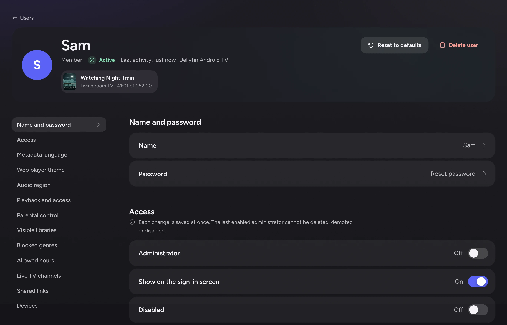

# Users and permissions

This page is for administrators. It covers user accounts, groups, and the limits you can set on each user: ratings, genres, libraries, hours, playback and quality.

## Accounts and permissions overview

Each user has their own account, and signs in with a password or Quick Connect, as on Jellyfin. Polyfin keeps watch state, favorites, resume points and Next Up for each user. Each user can be limited to titles up to a rating.

Create a user with **Create a user**, at the top of **Users**. Open a user from the list to set their limits.

| Section | What it sets | Saved |
|---|---|---|
| **Name and password** | Name, password | Its own save button |
| **Access** | Administrator, disabled, end date, permissions | Switches: at once. **Ends on**: **Save date** (see [Ending an account](#ending-an-account)) |
| **Metadata language** · **Web player theme** · **Audio region** | Per-user choices (see [Metadata language](watch-state.md#metadata-language), [Web player theme](themes-and-custom-code.md#theme-per-user), [Audio region](watch-state.md#audio-region)) | Its own save button |
| **Playback and access** | Playbacks at once, maximum quality, conversion, torrents and more | **Save playback and access** |
| **Parental control** | Highest rating allowed | **Save parental control** |
| **Visible libraries** · **Blocked genres** · **Allowed hours** | What the user sees, and when | **Save visible libraries**, **Save blocked genres**, **Save allowed hours** |
| **Live TV channels** | The channels the user sees | **Save Live TV channels** |
| **Shared links** | The share links the user made (see [Share links](invite-and-share-links.md#share-links)) | |
| **Devices** | Signed-in devices | Signing out a device asks first |

Administrators can set most of these from a Jellyfin app too. Each section below says where a setting lives.

- **Groups** give several accounts the same limits at once (see [User groups](#user-groups)).
- **Reset to defaults**, at the top of the page, puts the limits back to a new user's (see [Resetting settings to their defaults](#resetting-settings-to-their-defaults)).

Other ways to bring users and their history in:

- **Import from another server** brings the accounts of a Jellyfin, Emby or Plex server over, with what each user watched (see [Moving to Polyfin](moving-to-polyfin.md)).
- Users can import their own watch history too (see [Importing your own watch history](moving-to-polyfin.md#importing-your-own-watch-history)).
- **Import from an app** brings what users watched in an app built on addons, such as Stremio or Nuvio (see [Importing from an app](moving-to-polyfin.md#importing-from-an-app)).
- An invite link lets people create their own account, so you need not choose a password for each (see [Invite links](invite-and-share-links.md#invite-links)).
- Each user can connect their own tracking accounts (see [Tracking services](tracking.md)).

### Deleting a user

**Delete user**, on a user's page, deletes the account with its devices, sessions and everything kept for it. Deleting the user from a Jellyfin app does the same.

Polyfin also ends, in the background, what it opened for that user at apps and services outside Polyfin:

| What Polyfin opened or holds | What it does |
|---|---|
| Stremio auth keys it got by a link code or a password, for a connection or for an account held while the user chose what to import | Signs them out |
| A Stremio key the user pasted | Forgets it only, as signing it out would sign their browser out |
| Nuvio sessions it opened, its own only, for a connection (see [Staying connected](moving-to-polyfin.md#staying-connected)) or for an account held while the user chose what to import | Signs them out |
| Trakt and Simkl tokens of their tracking connections | Revokes them |
| Keys they typed for MDBList, PublicMetaDB and ListenBrainz, and their Last.fm session key | Forgets them (see [Tokens and keys](tracking.md#tokens-and-keys)) |

- The deletion never waits for an app or a service, and does not fail when one fails or does not answer.
- Polyfin logs a session it could not sign out, without its key or token.
- That session stays valid there until it expires, or the user signs it out there.

Stopping Polyfin also signs out the sessions it opened for accounts held while users choose what to import. It waits 5 seconds at most.

## User groups

A group gives several accounts, such as a family's children, the same limits. A change to the group reaches every member at once.

**Users › Groups** lists the groups and their member counts. **Create a group** asks for a **Name** and **Settings of**: a new user, as with **Create a user**, or a user whose settings the group copies at creation.

A group's page holds the limit sections of a user's page, each saved on its own:

- **Access**: **Can use conversion (transcoding)**, **Can download**, **Can add their own addons**, **Can manage collections**, **Can manage subtitles**, **Can share titles** and **Can play torrent streams**. **Administrator**, **Show on the sign-in screen**, **Disabled** and **Ends on** stay each user's own;
- **Playback and access**, with the **Quality group** and the two options of [Louder sound](loudness.md#louder-sound);
- **Parental control**, **Visible libraries**, **Blocked genres** and **Allowed hours**.

It also lists the **Members**, with **Add members**, and offers **Reset to defaults** (see [Limits of a group](#limits-of-a-group)) and **Delete group**.

### Members

- A user is in one group at most, set with **Group** in the **Access** section of their page. The default is **No group**.
- Joining asks first, as the group's values replace the user's.
- Adding a user from another group moves them.
- Administrators cannot join a group, as their permissions differ. A member made administrator leaves it and keeps its values.
- **Users** shows each user's group and filters by group.
- Users made by **Create a user** or **Create an invite link** can join a named group and follow it (see [Invite links](invite-and-share-links.md#invite-links)).

### Following the group

**Follow the group**, in the **Access** section of a member's page, is on by default. While it is on:

- the group's sections show its values read only, with "Set by the group Kids.";
- a group change reaches the member at once, as saving their page would;
- their signed-in apps get the new limits from their next request, downloads and allowed hours included;
- a member who may no longer share titles loses their share links.

Turned off, the member stays in the group, listed as **Own settings**. They keep the group's current values, their page can change them, and later group changes pass them by. Turned back on, after asking, they take the group's values again.

Leaving with **No group**, or deleting the group, works like turning **Follow the group** off: members keep its values. An invite link naming a deleted group creates accounts in no group.

**Turn off downloads for everyone** (see [Transcoding](transcoding.md)) also turns **Can download** off on every group, so members keep following.

### Server sources a group uses

A group has no addon setting. Each server source is used by everyone, or only by some groups and users (see [Who uses a server addon](addons.md#who-uses-a-server-addon)).

- A user uses a limited source when they or their group are ticked, following the group or not.
- A new user in no group uses no limited source.
- Deleting a group removes it from every source's list.
- A source a user does not use gives them nothing: no library, title only it knows, version, subtitle or channel. **Visible libraries**, by contrast, only hides libraries and leaves their titles reachable.

**Compared with Jellyfin**

- Jellyfin has no groups and no addons. Its closest setting, "Library access", is Polyfin's **Visible libraries**. jellyfin-web still lists the libraries of a source the user does not use, ticked or not; ticking them grants nothing.

### Groups and Jellyfin apps

- `GET /Users` and `GET /Users/{id}` show the values that apply to a member: the group's while they follow it.
- `POST /Users/{id}/Policy`, from an administrator's app, changes fields no group holds as for any user, such as `IsAdministrator`, `IsDisabled` and `IsHidden`.
- Sending a group-held field with a value other than the group's detaches the member, like turning **Follow the group** off. The policy is kept whole; nothing sent is lost.
- The activity log then says, for example, "sam no longer follows the group Kids: changed from Jellyfin Web".
- A policy sent back as read, with only `IsDisabled` changed for instance, leaves the member following.
- A hidden library the server no longer has is not a change, as apps cannot name it.
- Jellyfin has no groups: apps show neither the group nor **Follow the group**.

The activity log records groups created, changed (naming the sections) and deleted, and members added, removed or no longer following (see [Activity log](administration.md#activity-log)).

API details: [User groups](jellyfin-api.md#user-groups-for-apps).

## Resetting settings to their defaults

An administrator can put a user's or group's limits back to a new user's settings in one step. Each user can restore the server's defaults for their own choices.

### Limits of a user

**Reset to defaults**, at the top of a user's page, gives the limit sections the settings **Create a user** gives: **Access** permissions, **Playback and access** with the **Quality group**, **Parental control**, **Visible libraries**, **Blocked genres** and **Allowed hours**. It asks first, listing the sections that change, and the settings that change in **Access** and **Playback and access**, or saying nothing changes.

- Administrators get **Can control other users' apps**, **Can manage collections**, **Can manage subtitles** and **Can record Live TV** on, as **Create a user** does with **Administrator**. Other users get them off.
- Kept: name and password, **Administrator**, **Show on the sign-in screen**, **Disabled**, **Ends on**, the group, **Metadata language**, **Web player theme**, **Audio region**, the user's own addons, connections and tracking accounts, and everything they watched.
- Signed-in apps get the new limits from their next request, as after saving.
- A new user may not share titles, so the user loses their share links (see [Share links](invite-and-share-links.md#share-links)).
- A member following their group has no button: the group's page resets them.
- A member with **Own settings** gets a new user's settings and stays in the group, not following.
- The activity log records it, as "alex reset the settings of sam to their defaults".

### Limits of a group

**Reset to defaults**, at the top of a group's page, gives the group's sections the values **Create a group** gives from a new user's settings.

- It asks first, listing what changes and how many members follow the group, as they get the change at once.
- Members with **Own settings** keep theirs.
- The group keeps its name and members.
- The activity log records "alex reset the settings of the group Kids to their defaults".

### Your own preferences

**Reset my preferences**, at the top of **My account**, asks first, then restores the server's defaults for the user's own choices:

- **Metadata language** goes back to **The server's** (see [Metadata language](watch-state.md#metadata-language));
- **Web player theme** goes back to the server's, unless the administrator turned off **Let them change it** (see [Web player theme](themes-and-custom-code.md#theme-per-user));
- **Audio region** goes back to **None** (see [Audio region](watch-state.md#audio-region));
- every **Home rows** row shows again (see [Home rows](home-rows.md#home-rows));
- track choices on series and movies are forgotten (see [Track choices](watch-state.md#track-choices));
- **Remove from Continue Watching also takes the series off Next Up** turns off (see [Continue Watching and Next Up](watch-state.md#continue-watching-and-next-up));
- preferences Jellyfin apps saved in the account are forgotten: audio and subtitle languages, subtitle mode, home screen (library order and hidden libraries) and display preferences such as each library's sorting and view.

Signed-in apps read the new user's preferences from their next request. Settings an app keeps on the device stay: jellyfin-web keeps its home sections in the browser and still shows them there.

It never touches watch history, favorites, resume points, hidden titles, series taken off Next Up, connections, tracking accounts, imports, or the administrator's limits.

**Compared with Jellyfin**

- Jellyfin has no such button. jellyfin-web's only resets are a user's password, which an administrator's "Reset Password" empties ([UserPasswordForm.tsx, lines 116 to 137](https://github.com/jellyfin/jellyfin-web/blob/c06cb17b274c/src/components/dashboard/users/UserPasswordForm.tsx#L116-L137)), the filters of a library ([LibraryToolbar.tsx, lines 128 to 152](https://github.com/jellyfin/jellyfin-web/blob/c06cb17b274c/src/apps/modern/features/libraries/components/LibraryToolbar.tsx#L128-L152), and [filterdialog.js, lines 302 to 309](https://github.com/jellyfin/jellyfin-web/blob/c06cb17b274c/src/components/filterdialog/filterdialog.js#L302-L309) in the older views), and an item's metadata, whose "Reset" in the metadata editor empties the form before saving ([metadataEditor.js, lines 305 to 341](https://github.com/jellyfin/jellyfin-web/blob/c06cb17b274c/src/components/metadataEditor/metadataEditor.js#L305-L341)). In Jellyfin, an administrator resets each limit by hand, and a user each preference.
- Jellyfin apps see a reset user's new policy in `GET /Users` and `GET /Users/{id}`. Log entries use Jellyfin's `UserPolicyUpdated`, about the user, for a user's reset, and Polyfin's `GroupChanged` for a group's.

API details: [Resetting to defaults](jellyfin-api.md#resetting-to-defaults-for-apps).

## Ending an account

**Ends on** closes an account on a date, such as after a friend's weekend, so nobody must remember to delete it. Set it in the **Access** section of the user's page, then choose **Save date**.

- The date follows the server's time zone.
- The default, **Never**, clears it.

From that date the account is refused like a disabled one, but signs out less:

| | Disabled | Ended |
|---|---|---|
| Can sign in (Jellyfin apps, Silo's apps, Quick Connect with a Silo TV's code, admin app) | No | No |
| Its devices and admin sessions | Signed out | Kept, but refused until the account comes back |
| What the account has | Kept | Kept, its devices included |
| Undo | Turn **Disabled** off | A later date, or **Never**: the account comes back as it was |

- **Users** shows each end date, as "Ends on October 20, 2026", and **Ended** once passed, as does the user's page.
- An hourly scheduled task logs each ended account once, within the hour, as "The account of sam ended" (see [Scheduled tasks](administration.md#scheduled-tasks)). Given a later date, it is logged again on reaching it.
- Jellyfin apps see an ended account as disabled. Jellyfin has no end date: an app sending back the policy it read leaves **Disabled** off, and only the admin app changes the date.
- An administrator's account never ends, so the last administrator is never locked out. Administrators cannot get an end date, and becoming one clears it.
- Live TV recordings, new episode notifications, the weekly summary and imports from an app stop, as for a disabled account.
- Its devices still count as unused for **Sign out devices unused for (days, 0 = never)** (see [Signing out unused devices](sign-in-and-security.md#signing-out-unused-devices)).

API details: [Account end dates](jellyfin-api.md#account-end-dates-for-apps).

## User limits

Parental control, blocked genres, visible libraries, allowed hours, remote access, playback and access limits and quality groups are on [User limits](user-limits.md).

## DLNA devices

DLNA TVs and players cannot sign in. Each shows the libraries of the user an administrator chose for it under **Settings › DLNA**, or of **No one** until then (see [DLNA](dlna.md#devices-and-users)). **Show new devices the libraries of** sets the user for newly seen devices, **No one** by default.

A device browses and plays as its user, under their visible libraries, blocked genres, parental control, hidden titles, allowed hours, **Playbacks at once**, **Maximum quality**, quality group and **Can use conversion**.

- Its playbacks show under the user in **Now playing** on **Home** and count in their statistics.
- Deleting the user leaves the device showing **No one**'s libraries.
- **Blocked** gives it nothing at all.

*Taste profile* moved to [Home rows](home-rows.md#the-taste-profile).

*Invite links* moved to [Invite and share links](invite-and-share-links.md#invite-links).

*Share links* moved to [Invite and share links](invite-and-share-links.md#share-links).

*Louder sound* moved to [Loudness](loudness.md#louder-sound).

*How app titles are matched* moved to [Moving to Polyfin](moving-to-polyfin.md#how-app-titles-are-matched).

*How often connected accounts are imported* moved to [Moving to Polyfin](moving-to-polyfin.md#how-often-connected-accounts-are-imported).

*How titles are matched* moved to [Moving to Polyfin](moving-to-polyfin.md#how-titles-are-matched).

*Importing from an app* moved to [Moving to Polyfin](moving-to-polyfin.md#importing-from-an-app).

*Importing your own watch history* moved to [Moving to Polyfin](moving-to-polyfin.md#importing-your-own-watch-history).

*Letterboxd* moved to [Moving to Polyfin](moving-to-polyfin.md#letterboxd).

*Moving from Emby and Plex* moved to [Moving to Polyfin](moving-to-polyfin.md#moving-from-emby-and-plex).

*Moving from Jellyfin* moved to [Moving to Polyfin](moving-to-polyfin.md#moving-from-jellyfin).

*Nothing imported?* moved to [Moving to Polyfin](moving-to-polyfin.md#nothing-imported).

*Nuvio* moved to [Moving to Polyfin](moving-to-polyfin.md#nuvio).

*Plex, signing in* moved to [Moving to Polyfin](moving-to-polyfin.md#plex-signing-in).

*Progress and limits* moved to [Moving to Polyfin](moving-to-polyfin.md#progress-and-limits).

*Ratings, collections and playlists* moved to [Moving to Polyfin](moving-to-polyfin.md#ratings-collections-and-playlists).

*Signing in to Plex as the owner* moved to [Moving to Polyfin](moving-to-polyfin.md#signing-in-to-plex-as-the-owner).

*Staying connected* moved to [Moving to Polyfin](moving-to-polyfin.md#staying-connected).

*Stremio* moved to [Moving to Polyfin](moving-to-polyfin.md#stremio).

*Signing in with an identity provider* moved to [Sign-in and security](sign-in-and-security.md#signing-in-with-an-identity-provider).

*Two-step sign-in* moved to [Sign-in and security](sign-in-and-security.md#two-step-sign-in).

*Users' own addons* moved to [Sign-in and security](sign-in-and-security.md#users-own-addons).

*Web player theme* moved to [Themes and custom code](themes-and-custom-code.md#theme-per-user).

*Connections from outside the local network* moved to [User limits](user-limits.md#connections-from-outside-the-local-network).

*Live TV channels* moved to [User limits](user-limits.md#live-tv-channels).

*Audio region* moved to [Watch state and preferences](watch-state.md#audio-region).

*Continue Watching and Next Up* moved to [Watch state and preferences](watch-state.md#continue-watching-and-next-up).

*Metadata language* moved to [Watch state and preferences](watch-state.md#metadata-language).

*Watch state* moved to [Watch state and preferences](watch-state.md#watch-state).

