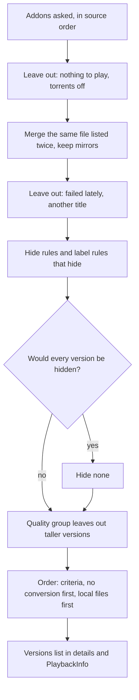

# Versions

This page, for administrators and curious users, covers which addon streams become versions, how title pages fill, how versions are described before play, and the settings that choose and name them.

A title's details list every addon stream as a version. Playing versions, and analysis trying the next on failure, is on [Playback](playback.md#versions-and-analysis).

## Which streams become versions

Polyfin changes addon streams only through these steps, in order. By default only steps 1 to 7 leave streams out, and the addons' order stays.

1. **The addons asked:** enabled, browsed addons listing streams (`stream` in their manifest) for the title's type and identifier, or another they accept (see [Identifiers addons accept](addons.md#identifiers-addons-accept)).
   - Server's sources first, in **Content › Sources** order, unless the user turned **Use the server's sources** off; then the user's **My sources**, in their order (see [Personal addons](addons.md#personal-addons)).
   - Users under parental control or blocking genres get server sources only.
   - Streams carried in a title's description come first; their addon is not asked (see [Streams in title details](addons-and-libraries.md#streams-in-title-details)).
2. **What is asked:** each addon, at its installed address with its configuration, for the title or episode (`/stream/<type>/<id>.json`).
   - It is asked by its own identifier or one it accepts: an anime catalog's `kitsu:<id>:3` goes to an IMDb-only addon as `tt…:2:3` when the anime mapping places it there.
   - Polyfin adds nothing and keeps the addon's order; the addon's configuration does any filtering, sorting or limits.
   - A failing addon, or one silent 15 seconds, gives no new version; versions kept from earlier answers may show (see [Title pages](#title-pages)).
3. **Nothing to play:** only `http` or `https` links and torrent files (an `infoHash` of 40 hexadecimal digits) play. A web page (`externalUrl`), YouTube video (`ytId`) or notice makes no version.
4. **Torrents:** left out unless **Play torrent streams** is on under **Settings › Torrents** and the user has **Can play torrent streams**. Both are off by default (see [Turning torrents on](torrents.md#turning-torrents-on)).
5. **The same file twice:** streams with the same file name and size are one version, the first listed, across addons, links and torrents.
   - Without both, a link is known by its address, a torrent by info hash and file index.
   - A torrent left out by step 4 gives its place to a later link to the same file.
   - Up to 3 later links to the file from other addons become hidden mirrors. They are listed nowhere and carry a play on when the source fails (see [Carrying a play on](reading-the-sources.md#carrying-a-play-on)). Torrents have and are no mirrors.
   - A user's version holds only links and mirrors from their own step 1 sources, even when asked for by identifier (see [Personal addons](addons.md#personal-addons)).
6. **Failed lately:** a source that could not be read or analyzed is left out for 15 minutes (see [Sources that fail](reading-the-sources.md#sources-that-fail)).
   - A torrent that did not start in time stays listed. Plays picking no version skip it for 15 minutes; picking it in the version menu retries at once (see [When torrents do not start](torrents.md#when-torrents-do-not-start)).
   - Stalled peers, a route that was down, the torrent limit or a host asking to slow down are not failures.
   - A restart forgets failures; changing a local folder's address or credentials forgets its files'.
   - Failures belong to the file: a failed torrent also hides its file's link for users without torrents, and vice versa.
7. **Another title:** streams whose labels name another episode, a season without the episode, or another movie of the same name are left out. There is no setting, and like hide rules it never leaves out every version (see [Versions of another title](#versions-of-another-title)).
8. **Hide rules:** **Hide versions larger than**, **Hide these video codecs**, **Hide versions whose labels contain** and **Hide low-quality releases**, under **Settings › Playback**. All are off by default, and none ever hides every version (see [Version order](#version-order)).
9. **Quality group:** the user's group leaves out taller versions while one fits. Default: **Original (no limit)** (see [Quality groups](user-limits.md#quality-groups)).
10. **The order:** the addons' order, unless **Order versions by** under **Settings › Playback** has criteria (none by default). Ties keep the addons' order. Then, both off by default:
    - **Prefer versions the app plays without conversion** puts those first, once Polyfin knows how the app plays (see [Prefer versions the app plays without conversion](#prefer-versions-the-app-plays-without-conversion)).
    - **Play local files first** puts a user's local folder and network share versions first (see [Local files first for some users](#local-files-first-for-some-users)).
11. **Plays without a pick:** `PlaybackInfo` leaves out versions passed over: unreadable, unplayable on the app, or torrents that did not start lately.

Polyfin keeps no maximum of versions, and ignores seeders, source, size and language unless a setting above says so.

**Why a stream is missing:** apps do not say. **Content › Versions** in the admin app tells it for a movie or episode (see [Versions of a title](#versions-of-a-title)). The log tells some causes:

| Cause | Log line | Level | Also logged |
|---|---|---|---|
| Addon failed or timed out | `An addon could not list streams` | Warn when a user waits (a title opened, a play), Info for background work alone | Addon, title type and identifier, error |
| Addon answered only notices | `An addon answered only notices, nothing to play` | Warn for a refusal for its rate, Info otherwise | Addon, title type and identifier, notices' text, counts of entries |
| Version could not be analyzed | `A version could not be analyzed` | Info | Addon, why |
| Stream names another title | `A version names another title` | Debug | Addon, marker (`S01E03`, `S02`, `1998`) |

- **System › Health › Addons** shows an addon's last failure.
- The failure line comes once per request, however many waited for it. Background work is the watchlist checks, home rows listed ahead and playback prepared in advance; when a user waits for the same request too, it is a warning. A re-asking that fails (see below) is logged at Debug only, as `An addon asked again for a list failed`: the list stays.
- The notices line comes once a day for the same addon, title and notices' text; repeats within the day are at Debug. Addresses and keys are hidden, links never logged.
- The notices line counts the answer's entries (`entries`), and those of each shape Polyfin cannot play: no link, as a notice, a web page or a YouTube video (`no_link`); Usenet downloads (`usenet`); archives' files (`archives`); links of another scheme than `http` or `https` (`other_schemes`); torrents whose info hash is not 40 hexadecimal digits, or whose file index is negative (`invalid_info_hash`). Polyfin plays none of these: when they outnumber the addon's notices, set the addon to send `http` links.
- A source failing later in a play logs why, never its address. A torrent route failing mid-play logs `the route for torrents does not answer`, without an addon.
- `A torrent did not start in time` is logged, and **System › Health** lists it under **To look at**, as it does a torrent its route stopped mid-play.
- The another-title line comes once while Polyfin remembers the version.
- Nothing is logged for streams with nothing to play, torrents left out, files listed twice, blocked files, the hide rules or the quality group: the Versions page shows them.
- `GET /Polyfin/Items/{id}/Versions` tells how many versions are known and how many addons are still asked (see [Title pages](#title-pages)).

### Versions of a title

**Content › Versions** finds a movie, or a series then an episode, as a user sees it: the signed-in administrator or one picked under **As user**, since versions depend on the user's addons, torrents, quality group and audio language. Per addon, in order, each stream shows:

- labels as read: height, codec, HDR, audio languages, MULTI, source tier, audio format, edition;
- once analyzed, what the version rules know, with size per minute of runtime;
- matching [label rules](#label-rules) and its score under them;
- its place, or the step that left it out: nothing to play, torrents off, same file listed before, mirror, blocked, failed lately with why (no address), the hide rule and what it matched, or the quality group;
- a torrent that did not start lately, marked so: still listed, skipped by plays that pick no version;
- a version whose host answers an error file instead of the videos, marked with the host's name and since when, as on **System › Health** (see [Hosts answering an error file](reading-the-sources.md#hosts-answering-an-error-file));
- the ordering: **Order versions by** criteria, quality group, and whether hide rules would hide every version, so none is hidden;
- the title's last 5 plays by any user, kept in memory for 24 hours after its last play and lost at a restart: user, device, app, whether the app picked from its version menu, the version chosen and how it plays, and each version tried with its result: plays, could not be read, did not start, torrent or conversion limit, conversion not allowed, not analyzed before, or still being read when the play went on with another.

Actions:

- **Pin** puts a version first for every user, in details and `PlaybackInfo`, ahead of the criteria; others keep their order. Play starts it, and fallbacks follow it.
  - A version picked in the version menu still plays.
  - A pin does not bring back versions failed lately, hidden by a rule or left out by the quality group.
  - It names the file by name and size, else link; if no addon lists it, the page shows it missing and the usual order applies. **Unpin** ends it.
- **Block** a file, with a reason, for **This title** or **Every title** (same name and size wherever listed).
  - It is listed nowhere: details, `PlaybackInfo`, downloads, trickplay. Its version is refused by identifier.
  - Unlike hide rules, blocks may leave no version. **Unblock** lifts it.
  - The page lists the title's blocks, including unlisted files; every-title blocks are under the search.
  - Pins and blocks are stored in the database without links, the file as a hash of its identity.
- **Analyze now** analyzes a version, forgetting its recent failure, and says why analysis failed. Torrents are analyzed only by plays.
- **Ask addons again** re-asks the user's addons, as `POST /Polyfin/Items/{id}/Versions/Search` does, at most once every 20 seconds; the page follows addons still asked.

**Compared with Jellyfin**

- Jellyfin 12.4 cannot explain, pin or block versions: they are the files in its folders, in its order. A pin only reorders `MediaSources`, which every Jellyfin app reads.

### Versions of another title

Gathering addons sometimes list another episode's release, or another movie of the same name. Polyfin reads each stream's name, title, description and file name line by line, leaving it out when a line contradicts the title.

- **An episode:** seasons and episodes named after the series' own words, any case: `S01E02`, `S01E02E03`, `1x02`, `S01 E02`, `Season 1 Episode 2`; ranges `S01E01-E04`, `S01E01-04`, `1x01-1x04`; seasons `S01`, `Season 1`, `S01-S03`, `S01-03`, `Seasons 1-3`.
  - If none holds the episode, the stream is left out. A pack or range holding it stays; the torrent's file is picked inside (see [Reading and storage](torrents.md#reading-and-storage)).
  - For S01E02: `Some.Show.S01E03.mkv`, `Some.Show.S02.COMPLETE`, `Some.Show.S01E05-E08` are left out; `Some.Show.S01.1080p`, `Some.Show.S01-S03`, `Some.Show.S01E01-03` stay.
  - A pack whose file names another episode is left out: `Some.Show.S01.1080p` with `Some.Show.S01E06.mkv`.
- **A movie:** a line naming the movie, as its addon does, whose next word is a year more than one year off.
  - For Some Movie (2008): `Some.Movie.1985.1080p` is left out; `Some.Movie.2007`, `Some Movie (2009)`, `Some.Movie.Remastered.2020` stay.
  - A name may hold a year: for 1917 (2019), `1917.2019.1080p` stays.
  - A line not naming the movie, such as a translated title, tells no year.

Names without markers stay: `Some Show Complete Series`, an addon's `4K` line, `Some Show - 25` numbered from the series' start.

- In a line naming the series, only words after the name count, so `1x1 Club` is not its first episode. Otherwise every word counts.
- If every version names another title, all stay, as with hide rules: the addon may number episodes differently.
- Local folder files are never left out: each is the episode its folder placed it at, perhaps mapped, as `Show S02E13.mkv` played as S02E01 (see [How show files are numbered](episode-numbering.md#how-show-files-are-numbered)).

**Compared with Jellyfin**

- Jellyfin 12.4 lists no addon streams, so it has no such step: versions are the files in its folders.

## Title pages

A title's page opens once its description is ready, without waiting for slow addons. It lists known versions, from IPTV sources and addons that answered within **Keep version lists for (minutes)**, and asks the others in the background.

After that, a reopened title shows old versions at once while addons are re-asked. Each addon's last list per title is kept 24 hours longer, in the database across restarts; listings may show it.

- Play uses the old versions and re-asks in the background; expired links are renewed when refused. Only if none plays does Play wait for the new answer.
- After a restart, saved versions show at once, as old versions.
- A new answer replaces the list. Versions it lacks stay listed after it, and playable, until re-asking stops (see below): gathering addons often answer partly first. Then they disappear.
- [Refresh metadata](jellyfin-compatibility.md#refresh-metadata) drops old lists. Addon subtitles are kept the same way.
- **Replace the address** and the task "Forget the version lists" drop them for every title at once (see [Forgetting the version lists](#forgetting-the-version-lists)).
- An empty answer replaces the list: the addon has nothing for the title any more.
- A notices-only answer is not kept: an addon limiting requests often answers this way, and some addons answer only their own summary once their filters left nothing. For a minute the addon is not asked for the title: its earlier versions stay, or it gives none. The next request after it asks again; **Try again** and [Refresh metadata](jellyfin-compatibility.md#refresh-metadata) ask at once. The log tells it once a day (see [Which streams become versions](#which-streams-become-versions)).

Gathering addons answer first with what arrived within their own time limit, and get the rest moments later. So Polyfin re-asks an addon 10 seconds after its first answer for a title, and again 30 seconds later if that answer listed more playable streams.

- It keeps the longer list, from then on for **Keep version lists for (minutes)**, never a shorter one, comparing with the addon's previous answer, not old versions still listed.
- It stops at an answer with no more streams, an error, or when the list is dropped, by [Refresh metadata](jellyfin-compatibility.md#refresh-metadata) or [forgetting the version lists](#forgetting-the-version-lists), or expires. Late answers never revive such lists.
- It re-asks only addons it asked itself, not kept lists, and never IPTV sources, whose streams are Polyfin's own.
- Addon subtitles are re-asked alike, keeping the longer list.
- Opening and playing never wait for these requests.
- Renewing an expired link asks as opening does, joining a request under way, then re-asks. If the answer lacks the file, Polyfin re-asks at once and waits up to 10 seconds before giving up the link. The title keeps listing every version meanwhile.

A version keeps its identifier across its addon's answers, and with it its place on an open page and what Polyfin learned of its file.

- A file is known by name and size when both are given, else by link.
- When an answer brings a new link (token links) or first tells name or size, the stream takes the same file's identifier from the replaced list.
- Same file: names and sizes agree where both are given, and the link, the file name, or all but a token matches. A token differs when host and last path part match, that part being the file name or coming with the same stream name and description.
- Matches must be unique on both sides, so no two versions share an identifier.
- Saved lists keep identifiers across restarts; link renewal finds versions the same way.

In apps:

- In the web player, versions join the version menu as each addon answers or lists more.
  - They are added in place, without reload; a picked version keeps its audio and subtitle choices.
  - Details reload only when the picked version is gone or changed, as when the placeholder gives way to the first version.
  - The selected version (the first, or the user's pick) stays selected when a new one is listed first: the title's identifier passes to the new first version, and the page reselects by the version's own identifier, even if renamed or sized later.
  - A version that loses its identifier anyway is reselected if it alone has its name, and size when known.
  - Nothing changes during a video or while the version menu has focus; versions come once it loses focus.
  - With **Add versions to an open title's page** off, under **Settings › Web player**, open pages get no new versions until reopened. A page opened before any was known still swaps its placeholder once, and its play buttons still wait.
- In the web player, the track menus (Video, Audio, Subtitles) fill once the selected version is analyzed, without reloading the tab: by a torrent version's first play, or a later [RemuxDB](#tracks-from-remuxdb) description.
  - Polyfin tells the page within a second; the page waits a second more, so versions analyzed together refresh it once.
  - The selected version and picked audio and subtitle tracks, by name, stay selected where listed.
  - Tracks found during a play show on return to the page. Nothing changes during a video or with a menu open.
  - A page is told for 2 minutes after it opened or last asked for versions.
- In the web player, a movie's or episode's Play, Resume and Play from the start buttons wait for a version.
  - While none is known and addons are asked, they are greyed and disabled, with a small spinner and the tooltip "Looking for sources…". They return with the first version, without reload.
  - The page asks Polyfin on opening; until it answers, the buttons wait whenever only the placeholder is listed.
  - If every addon answered without a version, they stay disabled above "No source is available for this title." and a **Try again** button.
  - **Try again** drops the title's lists for the user's addons and re-asks; the buttons wait meanwhile. Once every 20 seconds per title.
  - Text follows the web player's language: English, French, German, Spanish, Italian or Portuguese; else English.
  - Nothing changes during a video; leaving the page restores the buttons.
- Other Jellyfin apps cannot be told to refresh: they show versions known at opening, and all on Play or reopening. Titles show as playable before any version is known; Play waits for addons answering for the first time, then picks among all.
- In every app, with [Prepare playback in advance](reading-the-sources.md#preparing-playback-in-advance) on, Continue Watching and Next Up titles get versions listed when an app asks for these rows, and open with all of them. An addon failing, or silent 15 seconds, only leaves its versions out.
- Addon subtitles work alike: known ones at once, others on Play or reopening. Play waits for them 1 second at most after the versions; later ones come with the next play or track change.

| Setting | Where | Default | What it does |
|---|---|---|---|
| **Add versions to an open title's page** | **Settings › Web player** | On | Has the web player add the versions that come to a title's page while it is open. Off, it only has the placeholder give way to the versions known then. |

**Compared with Jellyfin**

- Jellyfin knows every version beforehand, so pages list all at once.
- Jellyfin analyzes files when scanning, so pages list tracks from the start. jellyfin-web fills track menus when building the page and when a version is picked, never otherwise. Polyfin's script refills them once Polyfin learns a listed version's tracks (`src/apps/legacy/controllers/itemDetails/index.js`, `renderTrackSelections`, at the 12.4 tag).

API details: [Version list progress for apps](jellyfin-api.md#version-list-progress-for-apps).

### Forgetting the version lists

Two actions drop addons' lists for every title at once, saved ones included, as [Refresh metadata](jellyfin-compatibility.md#refresh-metadata) does for one title:

- **Replace the address**, in a source's more-actions menu, drops that addon's lists: once reconfigured, it may list other streams. Other addons' lists stay.
- The task "Forget the version lists", under **System › Schedule**, drops every addon's lists, subtitles included. It runs only when started by hand, and the log tells how many lists it forgot.

Either way:

- Re-asking stops, and answers already on their way are left out: the addon is asked anew.
- Pages open on a title are told, as with **Ask addons again**.
- Pins and blocks stay. A file known only by a link that changes at each answer (token links) gets a new identifier, having no list to take it from: a pin on it shows the file missing, and a block on it no longer matches, until set again.
- Each title asks its addons again when opened or played. Its first play waits for them, as for a title never opened, and the addons get more requests for a while: those that refuse too many requests may refuse some.

## Tracks from RemuxDB

Before a play, Polyfin knows only what the addon says. With **Describe versions from RemuxDB** on, a title's page shows, for each version RemuxDB knows:

- video: resolution, codec, HDR or Dolby Vision;
- audio tracks: language, codec, channels;
- embedded subtitles: language, forced, for the deaf and hard of hearing;
- file size, length and bitrate.

[RemuxDB](https://remuxdb.1632022.xyz) is a community database of what probing release files found in them.

| Setting | Where | Default | What it does |
|---|---|---|---|
| **Describe versions from RemuxDB** | **Settings › Playback** | Off | Asks RemuxDB about the titles whose pages open, and describes their versions from its answers until they are analyzed. |
| **RemuxDB address** | **Settings › Playback** | `https://remuxdb.1632022.xyz` | The RemuxDB server Polyfin asks. |

- On page opening, Polyfin asks by IMDb identifier, plus season and episode for an episode, waiting 1 second at most. Later answers show on next opening in other apps; the web player fills the open page's menus (see [Title pages](#title-pages)). Titles known only by other identifiers are not asked.
- Versions match RemuxDB files by the addon's file name, folders and case ignored. Given sizes must agree within 64 MiB or 1%, whichever is larger, since addons round. Among same-name files the closest size wins; without a size, a shared name describes nothing.
- These describe nothing: files under a tenth of the runtime (samples), and files with video but no audio, which would show a silent version until analysis.
- Answers, known file or not, are kept in memory 6 hours; a newly listed version triggers a new request. After a failure, RemuxDB is not asked for a minute, or its `Retry-After`.
- Playback still analyzes with ffprobe, replacing the description. Tracks keep ffprobe's numbers, so a track picked before the first play stays the same.
- Until analysis, RemuxDB's height places the version in the quality group (see [How the height of a version is found](user-limits.md#how-the-height-of-a-version-is-found)).
- RemuxDB knows torrent and NZB files its contributors probed; a version is described only if its addon names the file and RemuxDB probed it.
- Polyfin sends only title identifiers and a server name derived from the server's identifier, which RemuxDB requires; never its own analyses.

API details: [Version descriptions from RemuxDB for apps](jellyfin-api.md#version-descriptions-from-remuxdb-for-apps).

## Live videos

An addon may list an endless video among other titles, such as a sports match on now: an HLS playlist without `#EXT-X-ENDLIST`, or a stream with no announced size and no duration.

- Before the first play, or when play is prepared as details open, Polyfin reads its first version's first answer. No announced size tells at once, without waiting for live bytes; otherwise the first bytes tell.
- A file of known size plays as any video.
- A playlist or sizeless stream is analyzed as a Live TV channel's (see [Live TV](live-tv.md)) and plays live when it has no duration. The analysis is kept for later plays.
- Interlaced sports, as most 1080i50 TV sports, play converted at 25 frames a second unless **Double the frame rate** is on (see [Starting a channel](live-tv.md#starting-a-channel)).

It plays as a channel:

- From the live edge, no duration or seeking. Apps get an infinite stream (`IsInfiniteStream`, no `RunTimeTicks`), relayed, repackaged or converted by FFmpeg as needed.
- No keyframe index, no conversion waiting for the end. It counts toward channels played through FFmpeg at once.
- No resume point, never marked played, no activity log line, no scrubbing thumbnails. Playbacks show on Home as any other.

A video whose stream ends, such as a recap, plays normally, with duration, resume point and played state.

**Compared with Jellyfin**

- Jellyfin also plays live items without duration or resume (`LiveTvChannel.SupportsPositionTicksResume` is false), but marks them played on start and on stopping without a runtime (`SessionManager.OnPlaybackStart`, `UserDataManager.UpdatePlayState`). Polyfin keeps no user data, so a match on now never shows as watched.

## Choosing a version

Three more settings change how Polyfin picks a version; two more, about converted video, are on [Transcoding](transcoding.md#video-conversions-at-once). Changes apply to the next request, without a restart.

| Setting | Where | Default | What it does |
|---|---|---|---|
| **Maximum time to analyze a version** | **Settings › Playback** | 20 seconds (5 to 120) | Bounds every ffprobe analysis, of files and live streams. |
| **Versions tried when one does not work** | **Settings › Playback** | 3 (1 to 10) | How many versions Polyfin analyzes when the app picked none. |
| **Prefer versions the app plays without conversion** | **Settings › Playback** | Off | Lists first, in each app's version menu, the versions it plays without conversion. |

- A torrent's analysis is not bounded: it waits for its pieces, as its play does (see [Torrents](torrents.md#deadlines)).
- A channel is analyzed for 8 seconds at most.
- A source that does not answer in time is given up for 15 minutes, so Polyfin moves on sooner.
- Versions tried counts titles and channels alike; titles get up to 3 analyzed at once.
- Later versions already analyzed are still tried, as they cost nothing.

### Prefer versions the app plays without conversion

The setting orders each app's version menu for that app, so **Play** starts the version the menu shows. "Without conversion" means played as it is, or repackaged with tracks copied.

- Item details and `PlaybackInfo` list these versions first, after the other steps of the [version order](#version-order).
- Polyfin learns how the app plays from the device's last `PlaybackInfo` profile since the server started, or its session capabilities. It keeps this in memory until the device signs out.
- It judges each version as [version names](#version-names) do, reading nothing. A version neither analyzed nor described by RemuxDB counts as needing conversion.
- Each app gets its own order: two devices of a user may list versions differently. The title's own identifier stands for the asking device's first version.
- A version above the user's **Maximum quality** never counts as playing without conversion.
- A title's first play may analyze more versions; nothing changes once they are known.

**Play** on the title's page starts the menu's first version, even when it needs conversion. jellyfin-web, and apps like it, send the title's own identifier for it, and Polyfin takes it as picked.

- The next versions are tried only when it cannot be read or does not play at all.
- A version picked further down the menu plays too.

A play that picks no version, from a card such as Next Up or an app that never names one, checks the first versions analyzed at once. It plays one needing no conversion, else the first that plays at all.

- Each time it passes over the first version, the log says at Info level: "Prefer versions the app plays without conversion passed over the first version, which the app plays only converted".

Before Polyfin knows the app, after a restart and until its first play, the app gets the server's order. **Play** then passes over a first version needing conversion, as a play picking no version does. Open the title again after a first play to get the app's order.

**Play local files first** wins: for its users, a local file that plays at all comes before a stream that plays without conversion. Among local files, those playing without conversion come first (see [Local files first for some users](#local-files-first-for-some-users)).

**Compared with Jellyfin**

- Jellyfin 12.4 keeps the version opened first however it plays, like Polyfin with this setting off. Its `PlaybackInfo` sorts versions for the device profile: the one asked for, then direct play or stream, then converted ([`MediaInfoHelper.cs`, lines 367 to 417](https://github.com/jellyfin/jellyfin/blob/v12.4/Jellyfin.Api/Helpers/MediaInfoHelper.cs#L367-L417), called from [`MediaInfoController.cs`, line 217](https://github.com/jellyfin/jellyfin/blob/v12.4/Jellyfin.Api/Controllers/MediaInfoController.cs#L217)). Its item details, which menus show, keep its own order; Polyfin orders them for the app too.
- Jellyfin 12.4's session capabilities carry a device profile too ([`ClientCapabilities.cs`, line 28](https://github.com/jellyfin/jellyfin/blob/v12.4/MediaBrowser.Model/Session/ClientCapabilities.cs#L28)); jellyfin-web sends none there.

### Version order

The **Version order** group of **Settings › Playback** orders and hides a movie's or episode's versions. By default it changes nothing: versions keep the addons' order.

| Setting | Where | Default | What it does |
|---|---|---|---|
| **Order versions by** | **Settings › Playback** | None | Up to six criteria, listed below. |
| **Order of video codecs** | **Settings › Playback** | AV1, HEVC, VP9, H.264, VC-1, MPEG-4 Part 2, MPEG-2 | Order for the codec criterion. |
| **Order of sources** | **Settings › Playback** | The order of **Content › Sources** | Order for the source criterion. |
| **Order of editions** | **Settings › Playback** | Theatrical cut, Extended cut, Director's cut, IMAX | Order for the edition criterion. |
| **Size per minute to aim at (MB, 0 = largest)** | **Settings › Playback** | 0 (up to 1,000) | Target for the size per minute criterion. |
| **Hide versions larger than (GB, 0 = no limit)** | **Settings › Playback** | 0 (up to 1,000) | Hides versions known to be larger. |
| **Hide these video codecs** | **Settings › Playback** | None | Hides versions known to be in these codecs. |
| **Hide versions whose labels contain** | **Settings › Playback** | None (up to 50 lines) | Hides versions whose labels hold one of these words. |
| **Hide low-quality releases** | **Settings › Playback** | None | Hides versions tagged as a kind ticked. |
| **Label rules** | **Settings › Playback** | None (up to 40 rules) | Hide versions or score them (see [Label rules](#label-rules)). |

- Each criterion groups versions, and the next sorts within them. Ties keep the addons' order.
- The criteria: **Preferred audio language**; **Resolution, highest first** or **Resolution, lowest first**; **File size, largest first**, **File size, smallest first** or **Size per minute of runtime, as set below**; **Video codec, in the order below**; **HDR and Dolby Vision first** or **HDR and Dolby Vision last**; **Source, in the order below**; **Source: disc copy, Blu-ray, web, DVD, then TV**; **Audio: lossless and Atmos first, then most channels**; **Edition, in the order below**; **Score of the label rules, highest first**.
- **Order of sources** lists the server's addons and folders giving movie and episode versions; reorder by drag or arrows.
- Size per minute counts megabytes of 10^6 bytes; 0 puts the largest a minute first.
- **Hide versions whose labels contain** reads name, description and file name, one word a line, any letter case. It serves addons whose labels say a file is not ready yet.
- **Hide low-quality releases** offers **Camera copies (CAM, HDCAM)**, **Telesyncs (TS, HDTS, TELESYNC)**, **Telecines (TC, TELECINE)**, **Screeners (SCR, DVDSCR)** and **Early copies (R5, WORKPRINT)** (see [Low-quality tags](#low-quality-tags)).

#### What the rules know of a version

Nothing is read from the source. Each property comes from the version's analysis, else its [RemuxDB](#tracks-from-remuxdb) description when on, else its addon's labels.

| Property | Read from labels as |
|---|---|
| Height | As [quality groups](user-limits.md#how-the-height-of-a-version-is-found) find it |
| Size | The addon's `videoSize` |
| Video codec | HEVC, x265 or H.265; H.264, x264 or AVC; AV1; VP9; VC-1; MPEG-2; Xvid or DivX |
| HDR | HDR, HDR10, HDR10+, HLG, DV, DoVi or Dolby Vision; height or codec without these is SDR |
| Audio languages | English names (French, German…), release words (TRUEFRENCH, VFF, Latino, Castellano…), capital ISO 639-2 codes (ENG, ITA, GER…), flags |
| Source tier, best first | Disc's full copy: a release's full-copy word, `BDMV`, `BD25` to `BD100`, `DVD5`, `DVD9`, `COMPLETE BLURAY`. Blu-ray: `BluRay`, `Blu-ray`, `BDRip`, `BRRip`. Web: `WEB`, `WEB-DL`, `WEBRip`. DVD: `DVD`, `DVDRip`. TV: `HDTV`, `PDTV`, `SDTV`, `TVRip`, `SATRip`, `DSR` |
| Audio format, best track | Lossless: `TrueHD`, `DTS-HD MA`, `FLAC`, `LPCM`. Object-based: `Atmos`, `DTS-X`, `DTS:X`. Channels: `5.1`, `7.1`, `DDP5.1`, `AAC2.0` |
| Edition, first named | `Theatrical`, `Extended`, `Director's Cut` or `Directors.Cut`, `IMAX`; none named is theatrical |
| Size per minute | Size divided by runtime: the analysis's, else the title's |

- Languages include regional variants (see [Regional audio](audio-and-subtitle-tracks.md#regional-audio)). MULTI and DUAL mean several languages.
- Subtitle languages (`Sub ITA`, `French Subs`) are not audio. A word of the movie's or series' name is never a language.
- Tier and edition are read after the title's words, as [low-quality tags](#low-quality-tags) are.
- A DVD's full copy is a disc's full copy: the tier tells the source, not the height. Of several tiers named, the best counts, so `BluRay` with a full copy's word is a full copy.
- Lossless means Dolby TrueHD, DTS-HD Master Audio, FLAC, ALAC or PCM; object-based means Dolby Atmos or DTS:X. `DTS-HD` without `MA` is lossy.
- An analysis reads audio from the tracks; ffprobe names Atmos and DTS:X in a track's profile.
- A version a criterion knows nothing of comes after known ones; hide rules never hide it.

#### Low-quality tags

**Hide low-quality releases** reads the addon's stream name, title, description and file name, line by line. A tag counts only as a whole word, in any letter case, between dots, dashes, underscores, spaces, brackets or other signs: "Its" and "Nights" hold no `TS`.

A tag counts only after the title's words, so a movie named Cam, or The Cam, is never a camera copy:

- In a line naming the movie, series or episode as the addon names them, after the last of these names.
- Else after the line's first year (1900 to 2099) or episode number (`S01`, `S01E01`, `1x01`).
- In a line with neither, such as "CAM 720p", every word.
- A tag before the title, as in `[HDCAM] Some Movie 2026`, is not read.
- A line ending with `.ts` names an MPEG-TS file, not a telesync.

| Label | Read as |
|---|---|
| `Cam.2018.1080p.WEB-DL.mkv` (movie Cam) | Kept |
| `Some.Movie.2026.HDCAM.x264.mkv` or `hdcam` | Camera copy |
| `Some.Movie.2026.1080p.WEB.ts` | Kept |
| `Its.Always.Something.S01E01.1080p.mkv` | Kept |
| `Some.Show.S01E01.TS.mkv`, `Some Movie (2026) [HDTS]` | Telesync |

#### Criteria in detail

**Preferred audio language** is the user's app audio language, else the server's [Default audio language](audio-and-subtitle-tracks.md#default-audio-and-subtitle-languages). First come versions carrying it, then MULTI or DUAL without naming it, then unknown, then others.

- Without either language, it changes nothing.
- The user's **Audio region** orders versions within the language, and gives a language to a user without one (see [Regional audio](audio-and-subtitle-tracks.md#regional-audio)).

**Source, in the order below** groups versions by the addon or folder giving them. Placed after other criteria, it orders only what they tie on.

- Listed sources come first, in list order, then others in addons' order. A source added since saving stays after them until moved.
- A user's own addons come after the server's sources. A removed source leaves the list.
- The list orders versions only. The addon describing a title, addon subtitles and search results keep the **Content › Sources** order (see [Addons and libraries](addons-and-libraries.md)), as versions do without this criterion.
- As the first criterion, it puts local files first whatever else (see [Local folders](local-folders.md#versions)). **Add a criterion** adds it last: move it to **Criterion 1** with its arrow.
- While it is not first, the page notes it only orders versions the criteria above tie on.

**Audio: lossless and Atmos first, then most channels** puts first best tracks both lossless and object-based (TrueHD with Atmos, DTS-HD Master Audio with DTS:X), then either, then others. Most channels win within each; unknown audio comes last.

**Edition, in the order below** follows **Order of editions**: put **Extended cut** first to play it where a title has one, and the theatrical cut elsewhere.

**Size per minute of runtime, as set below** treats all lengths alike: at 50, a two-hour movie's versions near 6 GB come first, a 45-minute episode's near 2.25 GB.

- At 0 it differs from **File size, largest first** only where runtimes differ, such as an extended cut's.
- The order holds at most one of it and the two file size criteria.

#### Order steps

These follow steps 1 to 5 of [Which streams become versions](#which-streams-become-versions).

| Step | What happens |
|---|---|
| 1 | Versions that failed lately are left out (see [Sources that fail](reading-the-sources.md#sources-that-fail)), except torrents that did not start in time (step 6 [there](#which-streams-become-versions)) |
| 2 | Hide rules apply, [label rules](#label-rules) last; [another title's](#versions-of-another-title) versions are always hidden |
| 3 | The user's [quality group](user-limits.md#quality-groups) leaves out taller versions |
| 4 | The criteria order the rest |
| 5 | Versions the app plays without conversion move first, once known (see [Prefer versions the app plays without conversion](#prefer-versions-the-app-plays-without-conversion)) |
| 6 | For **Play local files first** users, local folders and network shares move first (see [Local files first for some users](#local-files-first-for-some-users)) |

- If step 2 would hide every version, none is hidden.
- If no version fits step 3, the closest height comes first, ordered by the criteria.
- Steps 5 and 6 keep the earlier order on each side.

Item details and `PlaybackInfo`, so version menus, list this order.

- The first, named after the title, is what Play starts and **Prepare playback in advance** analyzes.
- **Versions tried when one does not work** and **Prefer versions the app plays without conversion** take the versions in this order.
- A version pinned on the title's [Versions](#versions-of-a-title) page comes first anyway.
- Hidden versions appear nowhere: details, `PlaybackInfo`, downloads, trickplay. Asked for by identifier, they are refused as gone.
- Merged Live TV channels keep their own order (see [IPTV](iptv.md)).

While Polyfin follows an open title page (see [Title pages](#title-pages)), its versions keep their places while the rules, source order, quality group, **Play local files first** and app stay the same.

- New analysis does not move them; versions arriving later are placed by the rules.
- Reopened or relisted after a change, the page shows the new order.
- The web player keeps an open page's menu: reopen the title after changing the order.

**Compared with Jellyfin**

- Jellyfin 12.4 cannot hide versions: its server and library options have no such setting ([`ServerConfiguration.cs`](https://github.com/jellyfin/jellyfin/blob/v12.4/MediaBrowser.Model/Configuration/ServerConfiguration.cs), [`LibraryOptions.cs`](https://github.com/jellyfin/jellyfin/blob/v12.4/MediaBrowser.Model/Configuration/LibraryOptions.cs)). The version order rules are Polyfin's own.
- Jellyfin reads release tags only to cut a file name down to a title. Its first `CleanStrings` expression ends the name at `cam`, `ts`, `tc`, `r5`, `dvdscr`, `screener`, `telesync`, `telecine` and many more, as a whole word after a title word, any case ([`NamingOptions.cs`, line 154](https://github.com/jellyfin/jellyfin/blob/v12.4/Emby.Naming/Common/NamingOptions.cs#L152-L154)). Polyfin reads tags the same way, to hide versions.
- Jellyfin 12.4 orders versions the same for every app: the one opened first, files before disc folders, 2D before 3D, widest first ([`BaseItem.cs`, lines 1209 to 1212](https://github.com/jellyfin/jellyfin/blob/v12.4/MediaBrowser.Controller/Entities/BaseItem.cs#L1209-L1212)). It reads no source tier, audio format, edition or size per minute, and has no label rules.

#### Label rules

**Label rules**, last in the **Version order** group, read each version's name, description and file name. A rule is a word found anywhere, or with **Regular expression** ticked, an expression such as `\bx265\b` or `^\[[^]]*\]`; both ignore letter case.

| Action | Effect |
|---|---|
| **Hide** | Hides matching versions, with the other hide rules |
| **Add a score** | Adds -100 to 100, not 0, to matching versions; a version's score is the sum, 0 for none |

- Expressions support classes, groups, alternatives, repeats and anchors; not back-references or look-around.
- **Score of the label rules, highest first** orders by score at its place. Without it, scores order versions after all criteria; ties keep the addons' order.
- Up to 40 rules of 200 characters, for every user. Expressions must be valid and not too large.
- Matching time grows only with expression and label size, both bounded (labels read up to 4,096 bytes), so no rule takes long.

#### Local files first for some users

**Play local files first**, in the **Playback and access** section of a user's or group's page (see [User groups](users.md#user-groups)), lists their local folders and network shares (see [Local folders](local-folders.md)) before addon streams. It overrides **Order versions by** and **Order of sources**.

- It is off for every user and group until an administrator gives it. Others keep the server's order.
- The criteria still order local files among themselves, and streams among themselves; source order holds within each.
- The first version, named after the title, is then local: **Play**, Next Up plays and **Prepare playback in advance** take it. If it fails, the next local files, then streams, are tried.
- It beats [Prefer versions the app plays without conversion](#prefer-versions-the-app-plays-without-conversion): any playable local file comes before a stream. That setting only sorts within each side.
- It hides nothing and restores nothing: hide rules and quality groups apply first. Titles without local files are unchanged.
- Group members take its value at once. **Reset to defaults** and **Create a user** turn it off; **Create a group** and invite links whose **Settings of** names a user copy that user's value.
- Users cannot set it: the server always sends a local file, which may need converting where a stream would not, so the administrator decides, as for quality groups.

To put local files first for everyone:

1. In **Settings › Playback › Version order**, under **Order versions by**, choose **Source, in the order below** and move it to **Criterion 1**. After another criterion, such as **Preferred audio language**, local files with unknown language, resolution or codec land after streams.
2. Under **Order of sources**, move every local folder and network share above the addons, then **Save**. A folder below an addon stays after it.
3. Open the title again: an open page keeps its menu.

With **Prefer versions the app plays without conversion** on, apps still list and play directly playable streams before a local file needing conversion. Turn it off, or use **Play local files first**.

**Compared with Jellyfin**

- Jellyfin 12.4 has no remote streams or such choice. It orders versions the same for every user: the one opened first, plain files before disc folders, 2D before 3D, widest first ([`MediaSourceManager.cs`, lines 617 to 642](https://github.com/jellyfin/jellyfin/blob/v12.4/Emby.Server.Implementations/Library/MediaSourceManager.cs#L617-L642)). Its user policy lacks the field, so apps sending a policy back leave it unchanged.

### Version names

**Say in version names how they play** ends each movie or episode version's name with how the app plays it, as synced subtitles end with "(synced)" (see [Subtitles](subtitles.md)). The rest of the name is unchanged.

| Setting | Where | Default | What it does |
|---|---|---|---|
| **Say in version names how they play** | **Settings › Playback** | On | Adds how each version plays. Off, names are the addons' own. |

| Ending | When |
|---|---|
| "(direct play)" | The app plays the file as it is |
| "(direct stream)" | Tracks are copied into HLS without conversion |
| "(converted: app’s request)" | The app turned off direct play for a version it could play (see [Direct play turned off by the app](transcoding.md#direct-play-turned-off-by-the-app)) |
| "(converted: HDR)" | The app cannot show the HDR or Dolby Vision |
| "(converted: quality limit)" | The app's quality setting, the user's **Maximum quality** or quality group lowers the video |
| "(converted: subtitles)" | A subtitle is burned in |
| "(converted: video)" | Another video reason |
| "(converted: audio)" | Only audio is converted |
| "(converted)" | Any other reason |
| "(cannot play here)" | It needs a conversion the server or user may not have (see [Transcoding](transcoding.md)) |

- Converted names give the first reason in the table that applies.
- Only versions analyzed or described by [RemuxDB](#tracks-from-remuxdb) get an ending. Naming reads nothing: it runs a play's decision on what is known.
- `PlaybackInfo` names every listed version for the app's device profile.
- Item details use each device's last `PlaybackInfo` profile and bitrate, else its session capabilities' profile. The web player's version menu, Android TV's **Select version** and Swiftfin's menu read these.
- Without such a profile, after sign-out or after a restart, item details names have no ending.
- Names assume the tracks the user's preferences choose; picking others may change how it plays.
- Names use **Language of generated names** (see [Getting started](getting-started.md#language-of-generated-names)): in French, "(lecture directe)", "(flux direct)", "(converti : HDR)", "(illisible ici)".
- Endings are at most 30 characters; apps cutting names to one line may hide them.

Polyfin reads no keyframe index for addon MPEG-TS files, MPEG program streams (`.mpg`, `.mpeg`, `.vob`) or AVI files, so over HLS their video is converted.

- Local MPEG-TS files lack one until keyframes are read from the whole file, when details open or at the first HLS play (see [HLS segments](transcoding.md#hls-segments)).
- In the web player such files say "(converted)", or "(converted: video)" when the browser rejects the video; never "(direct stream)". Users barred from video conversion see "(cannot play here)".
- Apps playing the file as is, such as Android TV or Swiftfin for MPEG-TS, see "(direct play)".
- Blu-ray MPEG-TS, keyframed by its clips, and local MPEG-TS with keyframes read, are named normally.
- A file whose index proves missing or unreadable once played does not play over HLS as named: names do not read the index.

API details: [Version names for apps](jellyfin-api.md#version-names-for-apps).
