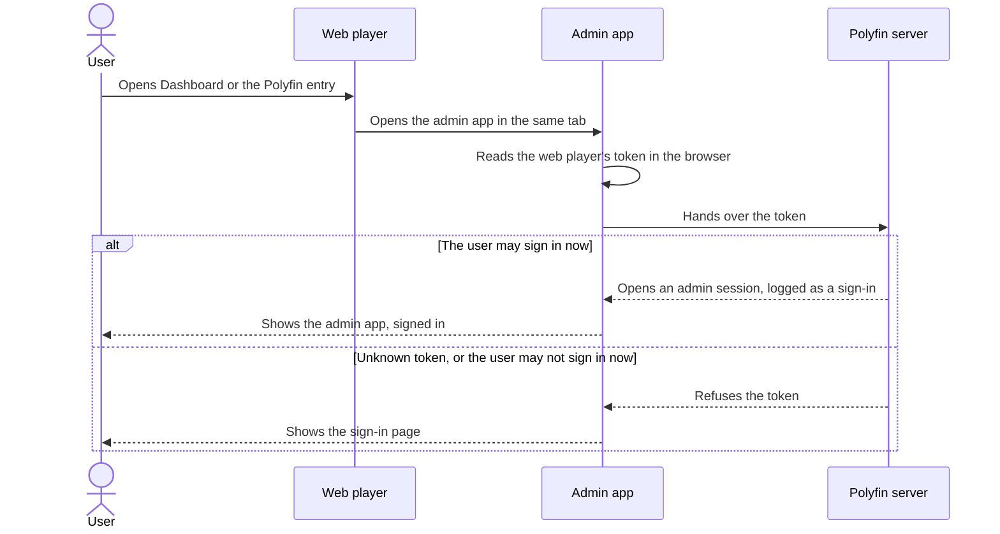

# Web player

Polyfin's Docker image includes the web player: jellyfin-web, Jellyfin's own web app. This page is for administrators. It covers how Polyfin serves the web player, what Polyfin adds to it, how it links to the admin app, and its license. Its look and its home page have their own pages: [Themes and custom code](themes-and-custom-code.md) and [Home rows](home-rows.md).

## The built-in web player

Once an administrator exists, `http://<server>:8096/` opens the web player. The Docker image includes jellyfin-web 12.4. Polyfin serves it at `/web/`, as Jellyfin does, and it connects to the server that served it.

- **Before an administrator exists:** `/` and `/web/` lead to the setup page in the admin app, since no account could sign in yet. See [getting started](getting-started.md).
- **Another copy:** `POLYFIN_WEB_DIR` can name another copy of jellyfin-web.
- **Outside the image:** without `POLYFIN_WEB_DIR`, there is no web player, and `/` leads to the admin app.
- **Compression:** the web player's scripts, styles and other text files go gzip-compressed to browsers that accept it. Each file is compressed once, on its first request, and kept in memory.

Polyfin adds these to the web player's pages:

- **Ratings:** on a title's page, the web player shows the IMDb rating, critics' score and audience score while the server has an **MDBList API key for ratings**. They replace the star and critic rating it shows otherwise. See [Ratings](collections-people-and-ratings.md#ratings).
- **Programme reminders:** on the page of a Live TV programme that has not started, **Remind me** follows the record buttons. See [Programme reminders](live-tv.md#programme-reminders).
  - Its menu offers **Remind me of every airing**.
  - A programme with a reminder shows **Reminder set**, which removes it.
  - When no target of the user receives reminders and their apps do not show them, a line under the button says so. It links to **My account › Notifications**.
- **Louder videos:** for a user with **Boost the volume in the web player**, videos play louder, and the player's settings menu offers **Boost the volume**. See [Louder videos in the web player](#louder-videos-in-the-web-player).
- **Recent searches:** on the search page, while the field is empty, the user's recent searches show above the Suggestions. See [Recent searches](#recent-searches).
- **Ratings on posters:** while **Show ratings on posters** is on, a movie's or a series' poster shows its ratings as the pointer or the focus comes to it. See [Ratings on posters](#ratings-on-posters).
- **Version badges:** while **Version badges** is on, a title's page shows badges for the version picked under its version menu, and a video shows those of the version it plays. See [Version badges](#version-badges).

**Compared with Jellyfin**

- Before an administrator exists, Jellyfin's web player opens its startup wizard instead.

### Recent searches

While the search field is empty, the search page lists your last searches under "Recent searches". They sit above the Suggestions, drawn as the Suggestions are.

- It keeps up to 10, newest first.
- Choosing one searches it again, in the library the search page was opened from, if any.
- The ✕ after a search removes it, and "Clear all" removes them all.

The [default theme](themes-and-custom-code.md#lumaaglaass) hides the Suggestions, so the searches show right under the field.

A search is kept when you leave its results:

- you open a result or another page;
- you clear the field or start another search;
- you close the tab.

Which searches are kept:

- Only a search that found something is kept.
- Typing on, as from "the" to "the matrix", keeps the longer search only.
- A search made again moves to the top. The same words in other capitals count as one.

The list works with the keyboard, as the rest of the page does. Tab, or the arrows in the TV layout, move to the searches and their buttons, and Enter chooses. After a search is chosen, the field has the focus. After one is removed, the next ✕ has it. The list's words follow the web player's language, as the script's other words do (see [Dashboard links and single sign-on](#dashboard-links-and-single-sign-on)).

Recent searches stay in the browser: nothing goes to the server.

- Each browser has its own, and other apps don't show them.
- They are kept for the server and the user signed in. Another user signing in on the same browser never sees them.
- **Sign out** keeps them for your next sign-in in that browser, as jellyfin-web keeps its other per-user settings in the browser.
- Clearing the site's data in the browser removes them.

**Compared with Jellyfin**

- jellyfin-web on a Jellyfin server keeps no recent searches.

### Ratings on posters

| Setting | Where | Default | What it does |
|---|---|---|---|
| **Show ratings on posters** | **Settings › Web player** | Off | Shows a movie's or a series' ratings over its poster in the web player as the pointer or the focus comes to it, for every user. |

The ratings show over a movie's or a series' poster as the pointer comes to its card, or the focus does, with the keyboard or a TV remote. They sit at the top, on the start side, under a count of versions when the card shows one. Each has an icon and no words:

- **A star:** the title's star rating, the one its page shows. It is the addon's, or the IMDb rating while the server has an **MDBList API key for ratings** (see [Ratings](collections-people-and-ratings.md#ratings)).
- **A review:** the critics' score, in percent.
- **A group of people:** the audience score, in percent.

The two scores show while the server has that key and MDBList gave them.

- A rating the title lacks is left out, and a title without any shows nothing.
- Other cards, such as episodes, collections and people, show nothing. So do the list layouts.
- The ratings follow the listings' rules: a title the user may not see answers nothing.
- They show with every theme, **LumaaGlaass**, **jellyfin-web's own look** or **Custom**, and in jellyfin-web's TV layout.
- The setting applies to every user. Users cannot change it.

While **Badges on posters**, under **Settings › Content › Posters**, is on, the posters themselves carry the ratings in every app (see [Badges on posters](artwork-and-editing.md#badges-on-posters)). The web player then shows none on hover, as when **Show ratings on posters** is off.

The ratings are asked for once per page:

- The first card the pointer or the focus comes to asks the server for the ratings of every movie and series card of the page. Those of the card's row come first, 100 at most.
- The cards answered then show theirs without asking again.
- The answers are kept for a minute, in the browser tab, for the user signed in.
- Polyfin reads them as a listing does. They cause no addon or MDBList request that the listing of those titles did not make.
- While the setting is off, the web player asks again a minute later at the earliest. Turning it on or off thus applies within a minute, without reloading the page.

**Compared with Jellyfin**

- jellyfin-web shows no ratings on posters, on Jellyfin either. A card has its played mark, its count of unplayed episodes and, on hover, its play, played, favorite and ⋮ buttons ([cardBuilder.js, lines 997 to 1029](https://github.com/jellyfin/jellyfin-web/blob/v12.4/src/components/cardbuilder/cardBuilder.js#L997-L1029)). Polyfin adds the ratings with its script, in the free corner.

API details: [Ratings on posters](jellyfin-api.md#ratings-on-posters-for-apps).

### Version badges

| Setting | Where | Default | What it does |
|---|---|---|---|
| **Version badges** | **Settings › Web player** | On | Shows a row of badges for the version picked on a title's page, and for the version a video plays, in the web player, for every user. |

Each badge is a short text in a thin border, in the page's font, such as "4K", "DV", "HEVC", "Atmos", "7.1", "IMAX" or "FR". They come in this order, those the version lacks left out:

1. resolution;
2. HDR;
3. video codec;
4. audio;
5. channels;
6. edition;
7. audio languages.

Polyfin writes them from the version's analysis once it has one, else from the addon's labels. A badge's tooltip, which screen readers read too, says it in full words, in the web player's language: "Dolby Vision", "7.1 surround", "Audio: French".

On a movie's or an episode's page:

- The row sits right under the "Version" menu, with **LumaaGlaass** as with jellyfin-web's own look. With one version, the menu is hidden, and the row joins the track menus instead: after them in jellyfin-web's own look, at the top of their panel with **LumaaGlaass**.
- It shows the badges of the version picked, and changes as you pick another.
- The "Version" menu's tooltip names the version picked in full, as its addon names it, which helps when the menu shows short names (see [Version names](versions.md#version-names)). The tooltip shows while the setting is off too.
- A version that joins the menu while the page is open gets its badges about a second later.
- Nothing changes while the menu has the focus, but for a pick: the rest waits for the focus to leave it.

During a video, the row sits in the player's controls at the bottom, above the progress bar, and shows and hides with them. Its badges have a dark ground, so they stay readable over a bright picture. The web player tells the server of a play a moment after the video starts, so the badges may take a few seconds to come. They go when the video ends.

The row wraps on a narrow screen and stays on one line where it fits. The TV layout shows larger badges. Nothing shows only on hover, since screen readers read each badge's full words, and there is no animation.

**Compared with Jellyfin**

- jellyfin-web shows no badges for a version. Its "Version" menu lists the versions' names only, and its player shows the title.

### Louder videos in the web player

**Boost the volume in the web player** makes videos louder in the web player for a user. The boost, how it is measured and where it applies are on [Loudness](loudness.md#loudness-in-the-web-player).

## Dashboard links and single sign-on

In the web player, these open Polyfin's [admin app](administration.md) at `/admin/` instead of jellyfin-web's dashboard:

- the **Dashboard**, from the menu or the user menu;
- every dashboard page, the metadata manager and plugin pages;
- the startup wizard.

Live TV's tuner pages open the admin app too:

- A tuner's page opens the tuner's source page.
- The page to add a tuner opens **Add a source** with **HDHomeRun tuner** chosen (see [HDHomeRun tuners](iptv.md#hdhomerun-tuners)).

### The Polyfin entry for members

Members, who don't have **Dashboard**, get a **Polyfin** entry in its place. It opens the admin app in the same tab, on their own pages: **Home**, **My sources**, **My account** and **Quick Connect**. It shows:

- in the user menu, above **Quick Connect** and **Sign out**;
- on the web player's **Settings** page, before the "User" section;
- with a legacy layout ("Desktop (Legacy)", "Mobile (Legacy)" or "TV"), in the side menu, at the top of the "User" section. Right after the libraries, without the "Administration" heading, it would read as one of them.

- The side menu of the default layout, in a narrow window, has no **Dashboard**, so no **Polyfin** entry either.
- The entry is named "Polyfin" in every language.
- Administrators never see it, and it goes when you sign out.
- After a member's first load in a browser, it shows as soon as jellyfin-web draws its menus.

### Polyfin's script in the web player

Polyfin adds one script of its own to jellyfin-web's page, `/web/polyfin.js`, which follows the web player's routes. It changes none of jellyfin-web's files.

Its words follow the web player's language: English, French, German, Spanish, Italian or Portuguese (in Brazilian Portuguese). Any other language gets English.

The script is made for every browser jellyfin-web 12.4 is built for, down to Chrome 27 and Safari on iOS 10. Older TVs' browsers are among them. It is written in ES5, and does without the features those browsers lack, such as `URL`, until jellyfin-web's own scripts make up for them.

#### On a title's page

On a movie's or an episode's page, the script:

- **Adds versions as they come:** the title's versions join the page's version menu as the addons answer, without reloading the page. The version selected, the first by default or the one the user picked, stays selected, even when a version that comes is listed before it.
- **Fills the track menus:** the Video, Audio and Subtitles menus fill once the selected version is analyzed, as a play analyzes it, or described by RemuxDB after the page opened. The browser tab is not reloaded. The version selected stays, and so do the audio and subtitle tracks you picked while the menus still list them. A version analyzed during a play shows its tracks once you are back on the page. See [Title pages](versions.md#title-pages).
- **Holds the play buttons:** Play, Resume and Play from the start stay disabled, with a spinner and the tooltip "Looking for sources…", until a version is known. Then they come back in place.
- **Says when nothing was found:** when every addon has answered without a version, "No source is available for this title." shows under the buttons. Its **Try again** button has Polyfin ask the addons again.
- **Shortens long names:** a long version, audio or subtitle name ends with "…" before its menu's arrow, so that it does not run under it. Stream addons' detailed version names are often that long. The open menu shows whole names.
- **Adds Share:** see [Share button](#share-button).
- **Shows version badges:** see [Version badges](#version-badges).

The script changes nothing during a video. It holds the buttons again when jellyfin-web redraws the page, and gives everything back when you leave it.

A Live TV recording's page has a single source under the recording's own identifier. Polyfin answers that it has no versions to wait for, so its buttons come back at once. See [Title pages](versions.md#title-pages).

While a torrent starts, after **Play**, the script writes how the start goes under jellyfin-web's spinner (see [Watching a torrent start](torrents.md#watching-a-torrent-start)). For example:

- "Finding peers: 12 found, 3 connected";
- then "Receiving the start: 2.4 MB from 3 peers".

When the server refuses to play a title, jellyfin-web 12.4 shows the reason, then "There was an error processing the request" over it. A reason is, for example, "This media cannot be played at this time due to rate limits." for a user playing on as many devices as allowed. The script closes the second, generic error as it opens, so only the reason shows. A real Jellyfin server gets the same two errors from jellyfin-web.

#### Libraries and home page

- **Collection libraries:** on the home page, the title of a collection library's "Recently Added in" row opens the library on its default screen, as its links in the header do. That screen is the one chosen in the web player's **Settings › Home**, rather than Suggestions (see [Collections from addons](collections-people-and-ratings.md#collections-from-addons)).
- **Hidden libraries:** once a user is signed in, the libraries hidden under **Content › Libraries** or **My sources** leave the top bar, its **More** menu and the side menu. They keep their row on the home page (see [Libraries hidden from the top bar](addons-and-libraries.md#libraries-hidden-from-the-top-bar)). After a user's first load in a browser, a reload doesn't show them even briefly: the script keeps the last answer in the browser's storage and applies it before jellyfin-web draws its menus.
- **Home rows:** the script adds the rows chosen under **Settings › Web player › Home rows**. See [Home rows](home-rows.md).
- **Place kept on Back:** in the modern and mobile layouts, Back to the home page or to search results returns to the same place, each row's sideways position included, once the rows are drawn; the logo and **Home** go to the top.

#### Card menus

The script adds Polyfin's entries to the ⋮ menus of cards and of a title's page. A right click on a card also opens its menu.

| Entry | Where | What it does |
|---|---|---|
| "Remove from Continue Watching" | A card of a Continue Watching row, the home page's or a library's | The title leaves the row, and keeps whether it is played. |
| "Remove from Next Up" | An episode's card in a Next Up list | The series leaves the user's Next Up until one of its episodes is played or a new one comes out. A message says so. |
| "Hide this title" | A movie, a home video or a series; a season or an episode, which hides its series; a video of a folder, which hides its folder | The title leaves the user's lists, its cards leave the page, and a message says so. |
| "Show this title again" | In its place, on a title the user hid | The title comes back. |
| "Add to Watchlist" | A movie or an episode the user's [Watchlist playlist](tracking-imports.md#the-watchlist-playlist) does not hold; a series or a season none of whose episodes it holds | A movie or an episode goes at the top of the playlist, a series or a season as its aired episodes, and a message says so. A user who deleted the playlist gets it again. |
| "Remove from Watchlist" | In its place, on a movie or an episode the playlist holds, or a series or a season it holds an episode of | A movie or an episode leaves the playlist, a series or a season all its entries. Its cards leave the playlist's page, and Now available and Still waiting, but no other row. A message says so. |
| "Watch together" | The ⋮ menu of a movie's or an episode's page, for a user who may create SyncPlay groups, in a web player that offers SyncPlay | The title opens paused at its start in a SyncPlay group, a new one unless the device is already in one, and a list of the people to invite opens. See [Watching together](playback.md#watching-together). |

- **Next Up lists:** the home page's Next Up, the Next Up page its title opens, the Next Up of a TV library's tab, and the Next Up of a series' page.
  - A removed card leaves the lists at once.
  - A series' page keeps showing its next episode, as Next Up asked for one series still answers it.
  - The home's Next Up in the TV layout, whose title opens no page, has no such entry.
- **Folders of videos:** see [Folders of videos](addons-and-libraries.md#folders-of-videos).
- **Words:** they follow the web player's language, as above.
- **Watch state:** see [Watch state](watch-state.md#watch-state) for what the entries change.
- **Watchlist rows:** for 2 minutes after either Watchlist entry, the Watchlist playlist's page and the Now available and Still waiting rows ask Polyfin again rather than drawing what jellyfin-web keeps. A title just added shows there when they are next drawn.

On a phone or a tablet, the home page's cards have no ⋮, and a long press on a card selects it. Select the card with a long press, then press the ⋮ at the top. With one card selected, that menu has the same entries, which leave the selection once pressed.

- The Next Up page, which the home's **Next Up** title opens, has a ⋮ on each card.
- This is jellyfin-web's own layout for touch screens. So it is in the Jellyfin apps for Android and iOS, which show the server's web player.

#### Rows that stay up to date

jellyfin-web keeps what its home rows list for up to a minute, also across a reload, and draws a row again from it without asking.

- **Cards taken off:** so that a card taken off does not come back meanwhile, the script remembers it for 2 minutes and leaves it out of the rows.
  - It keeps this in the browser tab's session storage, for that server and user only. Nothing is kept past that.
  - A series taken off Next Up is left out of the Next Up lists only, unless one of its episodes was played since.
- **Cards marked played:** that same minute made a card marked played with its ✓ look as if nothing happened (jellyfin/jellyfin-web#8543). The row stayed as it was until the home was drawn again, a minute later at least.

The script now has the home's Next Up, Continue Watching and Continue Listening rows ask Polyfin again at once when:

- an item of these rows is marked played or unplayed from the page;
- the server announces on the live connection that it was, from any of the user's apps;
- the server announces that its resume point moved.

The rows also ask again on each of their refreshes for a minute after.

- A card marked played makes way for the series' next episode within seconds, without a reload. So does a card whose episode another app marked played.
- A change heard both from the page and from the server refreshes the rows once.
- Only these rows ask more, and only after such a change.
- On a Jellyfin server, jellyfin-web keeps the row as it was.

#### Share button

On a movie's or an episode's page, a **Share** button comes before the ⋮ button. It shows for a user who may share titles while the server allows share links (see [Share links](invite-and-share-links.md#share-links)).

1. **Share** opens **My account › Shared links** in the admin app, in the same tab, with the title chosen.
2. The user picks when the link expires and how many may watch at once.
3. The user copies the link.

- A series, a season, a title the user may not see, or a user without the permission gets no button.
- Its word follows the web player's language, as above.
- It changes nothing during a video, comes back when jellyfin-web redraws the page, and goes when you leave the title.

API details: [Share button](jellyfin-api.md#share-button-for-apps).

#### Answers kept from the last user

jellyfin-web keeps its answers for up to a minute before asking again, and for a day in all, also across a reload. Some are not kept per user:

- the search page's suggestions and results;
- a library's Suggestions tab, with its Continue Watching, Latest and Next Up;
- a library's recommendations, filters and studios.

jellyfin-web's own **Sign out** forgets them all. A session that ends otherwise does not:

- a device signed out from the user's **Devices** section;
- a browser that lost its sign-in.

The next user to sign in in that browser would then see the last user's answers, titles their parental control forbids included. So when a different user signs in, the script has jellyfin-web forget everything it kept, as it does when the language changes. The same user signing in again keeps them.

**Compared with Jellyfin**

- jellyfin-web keeps these answers the same way on a Jellyfin server, which fills the search page's suggestions too. There, the next user to sign in after a session that ended otherwise sees the last user's.

### Signing in to the admin app

A user signed in to the web player, administrator or member, arrives in the admin app signed in. Without a session, the admin app hands over the access token the web player keeps in the browser for this server.

- **The session:** it is logged as a sign-in. A member's session opens their own pages only, as when they sign in with their password.
- **Who it works for:** only the signed-in device of a user who may sign in now.
- **Who it does not work for:**
  - an API key, which has no user;
  - a disabled or blocked account, or one outside its allowed hours;
  - a user outside the local network who may not connect from outside it;
  - an account with [two-step sign-in](sign-in-and-security.md#two-step-sign-in), or an administrator required to set it up. These sign in with their password and their code.
- **Identity provider:** a web player signed in through the identity provider still hands over its sign-in, with two-step sign-in or after a block for wrong passwords. The provider asked for its own steps.
- **Unknown tokens:** an unknown token counts as a wrong password toward the client's failed attempts.
- **No usable token:** the admin app shows its sign-in page.

The session lasts as long as the web player's sign-in it came from. It ends when:

- the web player signs out, with **Sign out**;
- its device is signed out, from **Devices** in **My account** or on the user's page, or for not being used (see [Signing out unused devices](sign-in-and-security.md#signing-out-unused-devices));
- someone signs in to the web player in that browser again, the same user or another.

An admin app left open then shows, at its next request, the user the web player is signed in as now. When the web player is signed out, it shows its sign-in page. The next person to use the browser never finds the admin app signed in as the one before.

Opened from the web player, the admin app shows the user signed in to the web player. A session of another user in the admin app, such as one opened with a password, is signed out first. This applies to every link from the web player:

- its **Dashboard** and dashboard pages;
- the **Polyfin** entry;
- **Share**;
- a reminder's link to **Notifications**.

A session opened in the admin app with a password, and the code of two-step sign-in, does not depend on the web player. It lasts until **Sign out** in the admin app, or 30 days without use.

**Sign out** in the admin app leaves the web player signed in. The admin app does not take the web player's sign-in again until the web player signs in anew, or the admin app is opened again.

**Compared with Jellyfin**

- Jellyfin's dashboard is part of jellyfin-web and uses its sign-in ([routes.tsx, lines 18 to 20](https://github.com/jellyfin/jellyfin-web/blob/v12.4/src/apps/dashboard/routes/routes.tsx#L18-L20)). Signing out of the web player signs out of the dashboard, and a user who is not an administrator is sent to the home page ([ConnectionRequired.tsx, lines 164 to 180](https://github.com/jellyfin/jellyfin-web/blob/v12.4/src/components/ConnectionRequired.tsx#L164-L180)). Polyfin's admin app has a session of its own, which follows the web player's in the same way when it came from it.
- Jellyfin ends a user's earlier sign-in on a device when that user signs in there again, but keeps another user's ([SessionManager.cs, lines 1784 to 1813](https://github.com/jellyfin/jellyfin/blob/v12.4/Emby.Server.Implementations/Session/SessionManager.cs#L1784-L1813)). Polyfin does the same for Jellyfin apps; only the admin session taken from the earlier sign-in ends.

API details: [Admin app sign-in from the web player](jellyfin-api.md#admin-app-sign-in-from-the-web-player-for-apps).

### Back to the web player

Opened from the web player, the admin app leads back to it in the same tab, as Jellyfin's dashboard shares jellyfin-web's tab.

- **Back to the web player** shows in the admin app's phone menu and its sign-in page, and the top bar's **Web player** has a back arrow. It opens the web player in that tab, also after the admin app is reloaded.
- In a tab opened otherwise, such as from a bookmark, the top bar's **Web player**, a screen icon below 1280 px, opens the web player in a new tab.
- A Ctrl-click or a middle click on either still opens a new tab.

The official Jellyfin apps for Android and iOS show the web player inside the app. There, **Dashboard** and the **Polyfin** entry open the admin app inside the app too, signed in (see [Signing in to the admin app](#signing-in-to-the-admin-app)).

- **Back to the web player** is on every page and stays in the app. It is a back arrow before the logo on a phone, the first entry of the menu, and a link under the sign-in form.
- **Open the web player**, under **Settings › Web player**, also stays in the app.
- **Android:** the **Back** button closes an open dialog or the menu first. Then it goes back through the admin app's pages, then returns to the web player's page the admin app was opened from. A settings page with unsaved changes asks first.
- **iOS:** pressing the **Home** tab again returns to the web player's home page. The iOS app has no Back button or swipe in its web view, on the web player's pages either.

**Compared with Jellyfin**

- Jellyfin's dashboard is a page of jellyfin-web, where the apps' Back and Home work as on its other pages. It shows a back arrow ([AppLayout.tsx, lines 73 to 88](https://github.com/jellyfin/jellyfin-web/blob/v12.4/src/apps/dashboard/AppLayout.tsx#L73-L88)), and its menu starts with the server's name, a link to the home page ([DrawerHeaderLink.tsx, line 16](https://github.com/jellyfin/jellyfin-web/blob/v12.4/src/apps/modern/components/drawers/DrawerHeaderLink.tsx#L16)). Polyfin's admin app is a page of its own: going back loads the web player again, which takes a moment.

API details: [Admin app inside the Jellyfin mobile apps](jellyfin-api.md#admin-app-inside-the-jellyfin-mobile-apps).

## Caching and security headers

| Files | Caching |
|---|---|
| The page itself | Never cached. |
| Files whose name or query carries a build hash | Cached for a year. |
| The other files | Revalidated. |
| The [default theme](themes-and-custom-code.md#lumaaglaass)'s files and loader | Cached for a year at the version of the bundled files. Any other version, such as `latest`, is redirected to the current one, and revalidated. |
| The Custom theme's texts, `/web/custom.css` and `/web/custom.js` | Cached for a year at the address with the hash of their content, which the page gives. Revalidated at any other address. |
| The files of a [copy of a theme](themes-and-custom-code.md#keeping-a-copy-of-a-theme), at `/web/polyfin/themes/saved/<id>/` | Cached for a year, as `<id>` changes with each copy. |

- **The default theme's files** are at `/web/polyfin/themes/lumaaglaass/<version>/assets/`, and the script that loads them at `/web/polyfin/themes/lumaaglaass/<version>/loader.js`. They are Polyfin's own, sent as `text/css` and `text/javascript`.
- **A copy's files** go with the type of their extension, and a `Content-Security-Policy` that keeps them from running anything when opened on their own.
- **The Custom texts:** see [Custom CSS](themes-and-custom-code.md#custom-css) and [Custom JavaScript](themes-and-custom-code.md#custom-javascript).
- **`/web/` gets no Content-Security-Policy,** as from Jellyfin: the admin app's would stop jellyfin-web from working. The other security headers stay.

**Compared with Jellyfin**

- Jellyfin sends no caching header and leaves browsers to guess.

## License and source code

jellyfin-web is free software by the Jellyfin contributors, and a separate program from Polyfin. Polyfin stays under the [MIT License](../LICENSE).

- The image contains jellyfin-web 12.4, unmodified, under the GNU General Public License, version 2.
- It is copied from the official `jellyfin/jellyfin:12.4` image into `/usr/share/polyfin/jellyfin-web`.
- Its license and a notice are in `/usr/share/doc/jellyfin-web` (from [`third_party/jellyfin-web`](../third_party/jellyfin-web)).
- Its complete source code is attached to every Polyfin release on GitHub as `jellyfin-web-12.4-source.tar.gz`. It is also at <https://github.com/jellyfin/jellyfin-web/tree/v12.4>.
- The Dockerfile pins both, side by side, to be changed together when jellyfin-web is updated.

The default theme, LumaaGlaass by Om Gupta and Dyhlio, is under the MIT License. Polyfin embeds its files, with five patches, and serves them to the web player (see [LumaaGlaass](themes-and-custom-code.md#lumaaglaass)).

- Its license and a notice naming the commit are in `/usr/share/doc/lumaaglaass` (from [`third_party/lumaaglaass`](../third_party/lumaaglaass)).
- With Polyfin Desktop, they are in `licenses/lumaaglaass`.

A copy of another theme's files, kept with **Keep a copy in Polyfin**, stays under that theme's own license. Polyfin saves it for your server only, and does not distribute it.

*Home rows* moved to [Home rows](home-rows.md#home-rows).

*Preview as a user* moved to [Home rows](home-rows.md#preview-as-a-user).

*Row schedules* moved to [Home rows](home-rows.md#row-schedules).

*Top picks for you* moved to [Home rows](home-rows.md#top-picks-for-you).

*Keeping a copy of a theme* moved to [Themes and custom code](themes-and-custom-code.md#keeping-a-copy-of-a-theme).

*Theme per user* moved to [Themes and custom code](themes-and-custom-code.md#lumaaglaass).

*Themes* moved to [Themes and custom code](themes-and-custom-code.md#themes).

*Use another theme* moved to [Themes and custom code](themes-and-custom-code.md#use-another-theme).

